# Veterinaria VetCare DOC Principal

### Main
Inicializacion
```py
    especie_service = EspecieService(EspecieDAO(conexion_db))
    EspecialidadDAO(conexion_db)
    propietario_service = PropietarioService(PropietarioDAO(conexion_db))
    mascota_service = MascotaService(MascotaDAO(conexion_db))
    veterinario_service = VeterinarioService(VeterinarioDAO(conexion_db))
    consulta_service = ConsultaService(ConsultaDAO(conexion_db))
    receta_medica_service = RecetaMedicaService(RecetaMedicaDAO(conexion_db))
    detalle_consulta_service = DetalleConsultaService(DetalleConsultaDAO(conexion_db))
    medicamento_service = MedicamentoService(MedicamentoDAO(conexion_db))
```
Inicializa los DAO entregándoles la conexión a la DB, además los DAO en su constructor construyen crear_tabla. Service se instancia con el DAO ya creado junto a su conexión respectiva a la DB. 

En conexión.py se crea la conexión, pero esto se llama desde Main.py


### Screens
Todo Screen contiene un método para poder crear el objeto con los datos del usuario
```py
    def _crear_veterinario(self) -> Veterinario:
        id_persona = int(input("ID de persona: "))
        nombre = input("Nombre del veterinario: ").strip()
        rut = input("RUT: ").strip()
        telefono = input("Teléfono (+569...): ").strip()
        id_veterinario = int(input("ID de veterinario: "))
        especialidades = list(Especialidad)
        print("Especialidades:")
        for indice, especialidad in enumerate(especialidades, start=1):
            print(f"{indice}. {especialidad.value}")
        indice_especialidad = int(input("Seleccione una especialidad: "))
        if indice_especialidad < 1 or indice_especialidad > len(especialidades):
            raise ValueError("La especialidad seleccionada no existe.")
        return Veterinario(
            id_persona,
            nombre,
            rut,
            telefono,
            id_veterinario,
            especialidades[indice_especialidad - 1],
        )
```

Con los datos que el usuario entrega, se usan los modelos, cada clase tiene sus setters, estos setters se inicializan junto al constructor init. Por lo tanto, apenas se crea el objeto se dispara el setter con las comprobaciones.

Models/Veterinario.py
```py
        self.id_persona = id_persona
        self.id_veterinario = id_veterinario
        self.especialidad = especialidad

    @property
    def id_persona(self) -> int:
        return self._id_persona

    @id_persona.setter
    def id_persona(self, nuevo_id: int):
        if not isinstance(nuevo_id, int) or isinstance(nuevo_id, bool):
            raise TypeError("El ID de la persona debe ser un número entero.")
        if nuevo_id <= 0:
            raise ValueError("El ID de la persona debe ser un número positivo.")
        self._id_persona = nuevo_id
```


Cabe resaltar que Screens solo captura datos del usuario y crea el objeto mediante el uso de los models. Por lo tanto, la inserción del objeto se delega a Service/DAO.
```py
    def _registrar_veterinario(self):
        try:
            veterinario = self._crear_veterinario()
            self._veterinario_service.registrar_veterinario(veterinario)
            print("[OK] Registro de veterinario exitoso.")
            input("Presione Enter para continuar...")
        except (ValueError, TypeError) as error:
            print(f"\n[Error de registro] {error}")
            input("Presione Enter para reintentar...")
```
Aqui se hace el try, veterinario se asigna como un método que estamos llamando “crear veterinario” y retorna un objeto ya creado tipo veterinario, así que la creación se delega a ese método llamado “crear_veterinario”. 
Luego de eso se hace un llamado a service, este se registra mediante su método registrar_veterinario de service y se le pasa como parámetro ese veterinario que anteriormente se creo con el método “crear_veterinario”, como dije antes, esto hace un return así que la asignación SI es un objeto tipo veterinario.

### Service
Los service son el orquestador principal entre el Screen y el DAO, service recibe el objeto creado en Screens, se lo pasa a DAO para que lo guarde en DB. 

Ejemplo en Screens:
```py
._mascota_service.registrar_mascota(mascota)
```
Eso esta en Screens, si se fijan, se crea el objeto mascota y posteriormente se registra mediante service. Service tiene la tarea de que ese registro llegue a DAO mediante:
```py
    def registrar_mascota(self, mascota: Mascota) -> Mascota:
        if not isinstance(mascota, Mascota):
            raise TypeError("Debe proporcionar una mascota válida.")
        try:
            self._mascota_dao.insertar(mascota)
            return mascota
        except sqlite3.IntegrityError as error:
            nombre_limpio = mascota.nombre.strip()
            raise ValueError(f"No se pudo registrar: la mascota '{nombre_limpio}' ya existe en el sistema.") from error
```
Hace un Try en donde usa el método insertar de mascota_dao para insertar a mascota, pero antes revisa si Mascota (es decir, el valor entregado) de verdad es una instancia de mascota (Doble check antes de try). El except espera un fallo tipo sqlite dado que los fallos de validación de datos ya fueron comprobados en el mismo modelos con los setters. 

Esto pasa directamente con TODO lo demás de service, desde registrar hasta borrar un dato, reciclando mismo flujo de control.

### DAO
Esta es la parte más compleja del programa, porque esta toda la lógica SQL. 
Cosas a tomar en cuenta:
-	Conn: es la conexión abierta en SQL lite que posteriormente se había abierto en conexión.py. Cabe resaltar que pase lo que pase un commit en la DB siempre acaba cerrando esa conexión por seguridad

-	Cursor: es un objeto que permite ejecutar instrucciones

-	Rowcount: es un entero, en un select devuelve -1 por lo que se usa fetchall y fetchone. El rowcount en un update dice cuantas filas se actualizaron, en insert cuantas fueron insertadas y en delete cuantas filas se borraron. 

-	sql: Es la instrucción misma en SQL, por ejemplo, crear_tabla: En crear tabla primero se usa cursor para ejecutar la instrucción que viene en sql.
Una vez que se entendieron estos temas pasos a explicarles que hace DAO:
DAO es el puente entre la base de datos y el sistema completo, ningún objeto pasa a la DB sin antes pasar DAO. DAO solo se llama desde service, no se debe llamar de ningún otro lado. DAO tiene la función de insertar,crear,actualizar,borrar mediante operaciones DDL/DML entre otras que sean parte de SQL. Esto quiere decir que DAO es en realidad un CRUD; create, replace, update, delete. No hay mucho que hablar luego de esto, los datos que inyecta DAO se pasan del mismo service, service toma el objeto creado desde screens, screens usa models, por lo cual activa setters.
```py
    def crear_tabla(self):
        ddl = """
            CREATE TABLE IF NOT EXISTS especies (
                id_especie INTEGER PRIMARY KEY,
                nombre TEXT NOT NULL UNIQUE,
                informacion TEXT NOT NULL
            )
        """
        with self._db.obtener_conexion() as conn:
            conn.execute(ddl)
```
Primero la instrucción DDL (DataModelLenguaje) que tiene una instrucción de crear una tabla. Posteriormente se ejecuta con conn.execute, por que no cursor si esto permite ejecutar instrucciones?
En sqlite3, conn.execute(sql) es una forma abreviada: ejecuta la instrucción y devuelve un Cursor. Así que no se está evitando el cursor, simplemente no se guarda en una variable porque aquí no hace falta usarlo después.

 
Para el CREATE TABLE, no hay filas que recuperar ni más operaciones sobre ese cursor, por eso basta con:
conn.execute(ddl)

Si luego de la ejecución de la instrucción se procede a realizar algo más, ahí se debe usar cursor. 
```py
    def listar_todos(self) -> list[Especie]:
        sql = "SELECT id_especie FROM especies ORDER BY nombre"
        especies = []
        with self._db.obtener_conexion() as conn:
            cursor = conn.cursor()
            cursor.execute(sql)
            filas = cursor.fetchall()

            for fila in filas:
                # Tupla: (id_especie,)
                especie = next(
                    especie
                    for especie in Especie
                    if especie.id_especie == fila[0]
                )
                especies.append(especie)
        return especies
```
Aquí es donde se recuperan filas
```py
cursor = conn.cursor()
cursor.execute(sql)
filas = cursor.fetchall()
```
Recupera el registro de todas las filas, hace fetchall. Luego, se reconstruye el objeto, es decir, el objeto del usuario que creo en screens no es el mismo con el que se consulta.


# models

Refactorización de consulta y detalle_consulta : 

Un setter monolitico que actualiza todos los valores de golpe es mala practica.
Se dividio en varios setters por cada atributo de clase 
Para automatizar este proceso se utilizo un agente IA.

El agente realizo: Analizo el codigo, separo el setter monolitico en varios setters para cada atributo.
Agente: Gemini 3.6 Flash

# Uso de IA para agilizar desarrollo

Código inicial, antes de integrar el borrado:
```py
class MenuBorrar():
    def __init__(self, menu_principal):
        self._menu_principal = menu_principal

    def ejecutar(self):
        print("=== Menú Borrar ===")
        print("1. Borrar consulta")
        print("2. Borrar propietario")
        print("3. Borrar mascota")
        print("4. Volver al menú principal")
        opcion = input("Seleccione una opción: ").strip()

        if opcion == "1":
            self.borrar_consulta()
        elif opcion == "2":
            self.borrar_propietario()
        elif opcion == "3":
            self.borrar_mascota()
        elif opcion == "4":
            return
        else:
            print("Opción inválida. Intente nuevamente.")

    def borrar_consulta(self):
        id = input("Ingrese el ID de la consulta a borrar: ").strip()

    def borrar_propietario(self):
        id = input("Ingrese el ID del propietario a borrar: ").strip()

    def borrar_mascota(self):
        id = input("Ingrese el ID de la mascota a borrar: ").strip()
```

En donde cada service no tiene un metodo para borrar el ID usando DAO que ya tiene el metodo listo para usarse.

Se agilizo el desarrollo usando este prompt:

en menu borrar integra todos los demas DAO que tengan la funcion de borrar por ID, sigue la misma logica de if elif elif elif luego una def de borrar que pida input con el id. luego de eso se comprueba el id si es negativo o no es entero da error con typevalue.  Para cada def se comprueba

Por ultimo en service crea una nueva funcion abajo de todas las demas que sea "borrar_x" donde x es el nombre del service ejemplo : "borrar_especie".

Esta luego usara el borrar del DAO con el ID entregado en screen para borrar ese registro.

CHATGPT-6 Luna | Copilot

Codigo Nuevo:

### `screens/menu_borrar.py`

El menú recibe los ocho servicios cuyo DAO ofrece `eliminar(id)`: consulta,
propietario, mascota, veterinario, detalle de consulta, medicamento, receta médica
y especie. `EspecialidadDAO.eliminar()` recibe un nombre, no un ID, así que no se
incluyó en este menú de borrado por ID.

```python
def ejecutar(self) -> None:
    while True:
        # Muestra opciones 1 a 8 para los registros y 9 para volver.
        opcion = input("Seleccione una opción: ").strip()
        if opcion == "1":
            self.borrar_consulta()
        elif opcion == "2":
            self.borrar_propietario()
        elif opcion == "3":
            self.borrar_mascota()
        elif opcion == "4":
            self.borrar_veterinario()
        elif opcion == "5":
            self.borrar_detalle_consulta()
        elif opcion == "6":
            self.borrar_medicamento()
        elif opcion == "7":
            self.borrar_receta_medica()
        elif opcion == "8":
            self.borrar_especie()
        elif opcion == "9":
            return
        else:
            print("Opción inválida. Intente nuevamente.")
```

Cada operación pide un ID y delega en el método del servicio correspondiente.
La comprobación compartida rechaza entradas que no sean enteros o IDs no
positivos y muestra errores de registro inexistente o de claves foráneas:

```python
def _borrar_por_id(self, entidad: str, accion: Callable[[int], bool]) -> None:
    try:
        entrada_id = input(f"Ingrese el ID de {entidad} a borrar: ").strip()
        try:
            id_registro = int(entrada_id)
        except ValueError as error:
            raise ValueError("El ID debe ser un número entero.") from error
        if id_registro <= 0:
            raise ValueError("El ID debe ser un número entero positivo.")
        accion(id_registro)
    except (TypeError, ValueError) as error:
        print(f"No se pudo borrar el registro de {entidad}: {error}")
    except sqlite3.IntegrityError:
        print(
            f"No se pudo borrar el registro de {entidad}: existen registros relacionados "
            "que impiden la eliminación."
        )
    else:
        print(f"El registro de {entidad} se eliminó correctamente.")
```

Las operaciones específicas conectan cada opción al servicio:

```python
def borrar_consulta(self) -> None:
    self._borrar_por_id("consulta", self._consulta_service.borrar_consulta)

def borrar_propietario(self) -> None:
    self._borrar_por_id("propietario", self._propietario_service.borrar_propietario)

def borrar_mascota(self) -> None:
    self._borrar_por_id("mascota", self._mascota_service.borrar_mascota)

def borrar_veterinario(self) -> None:
    self._borrar_por_id("veterinario", self._veterinario_service.borrar_veterinario)

def borrar_detalle_consulta(self) -> None:
    self._borrar_por_id(
        "detalle de consulta",
        self._detalle_consulta_service.borrar_detalle_consulta,
    )

def borrar_medicamento(self) -> None:
    self._borrar_por_id("medicamento", self._medicamento_service.borrar_medicamento)

def borrar_receta_medica(self) -> None:
    self._borrar_por_id("receta médica", self._receta_medica_service.borrar_receta_medica)

def borrar_especie(self) -> None:
    self._borrar_por_id("especie", self._especie_service.borrar_especie)
```

### Métodos nuevos de los servicios

Cada servicio delega el ID recibido al método `eliminar()` de su DAO:

```python
# consulta_service.py
def borrar_consulta(self, id_consulta: int) -> bool:
    return self._consulta_dao.eliminar(id_consulta)

# propietario_service.py
def borrar_propietario(self, id_propietario: int) -> bool:
    return self._propietario_dao.eliminar(id_propietario)

# mascota_service.py
def borrar_mascota(self, id_mascota: int) -> bool:
    return self._mascota_dao.eliminar(id_mascota)

# veterinario_service.py
def borrar_veterinario(self, id_veterinario: int) -> bool:
    return self._veterinario_dao.eliminar(id_veterinario)

# detalle_consulta_service.py
def borrar_detalle_consulta(self, id_detalle: int) -> bool:
    return self._detalle_consulta_dao.eliminar(id_detalle)

# medicamento_service.py
def borrar_medicamento(self, id_medicamento: int) -> bool:
    return self._medicamento_dao.eliminar(id_medicamento)

# receta_medica_service.py
def borrar_receta_medica(self, id_receta: int) -> bool:
    return self._receta_medica_dao.eliminar(id_receta)

# especie_service.py
def borrar_especie(self, id_especie: int) -> bool:
    return self._especie_dao.eliminar(id_especie)
```

## Evaluacion critica

Me di la tarea de validar el codigo generado por la IA 
Lo primero que me causo ruido fue sobre ingenieria en:
_borrar_por_id(self, entidad: str, accion: Callable[[int], bool]) -> None:

se cambio a:
    def _borrar_por_id(self, entidad, accion):

Muchas más legible, sacrificando TypeHints innecesarios que dificultaban la lectura del grupo.

Más haya de eso, los DAO ya tenian implementados el metodo borrar por ID, asi que la IA simplemente funciono de conector, agilizando trabajo repetitivo de tener que modificar cada .service con un metodo borrar y este llamar al DAO para borrar ese registro.

### Regla de Negocio

Las clases ENUMERATE no deberian ser borrables del sistema, por lo tanto no integre eso.

### Test de Validacion (Test/QA)

Luego de ese pequeño ajuste empece a verificar el codigo nuevo, verificando que no hubieran errores. Esto se encuentra en Image en /Pruebas.

# Reciclando logica para agregar una nueva funcion de actualizar

Prompt: 
actualizar_menu.py sigue la misma logica que los demas menu:

logica de if elif elif elif elif else
integrar un nuevo metodo en los service que sea actualizar_x donde "x" es el nombre del service
que ese service llame al DAO que tenga el metodo de actualizar
actualizar_menu.py pedira el ID y luego el relleno de los datos a actualizar.
los DAOs que no tengan un metodo de actualizacion no se meten en el menu, se da por hecho que fueron creados con la intencion de que no se actualicen. 

main_menu.py llama a la clase actualizar_menu con una nueva opcion

Evita type hints excesivos, mantenlo simple, deja typehints sin tanta complejidad o no los uses en partes que se vuelvan muy ilegibles.

reutiliza el actualizar DAO asi que intenta no tocar los DAOs.

Respuesta:

Se agregó un menú para actualizar las siete entidades cuyos DAO ya tenían ese método. La mayor parte fue reutilizar la lógica existente: el menú pide el ID y los nuevos datos, y cada servicio delega la actualización a su DAO. No fue necesario modificar los DAO.

El menú sigue el patrón de opciones `if/elif` y deriva cada caso a su formulario:

```python
if opcion == "1":
    self._ejecutar_actualizacion("consulta", self._actualizar_consulta)
elif opcion == "2":
    self._ejecutar_actualizacion(
        "detalle de consulta",
        self._actualizar_detalle_consulta,
    )
```

Los servicios repiten la misma delegación al método `actualizar` existente en su DAO:

```python
def actualizar_consulta(self, consulta):
    return self._consulta_dao.actualizar(consulta)
```

## Evaluacion Critica:

La mayor parte del trabajo ya estaba hecho, asi que la IA solo hizo la parte pesada de reutilizar codigo, igualmente, se hicieron sus debidas comprobaciones que estan en Pruebas/Image.


## Servicios

Cada entidad tiene su propio servicio (`*_service.py`). La interfaz recibe directamente
los servicios que necesita, y cada operación se delega al servicio de su entidad.

# Flujo de una ID
Para una consulta por ID de medicamento, el resultado pasa por estos pasos:

1. En `menu_consulta.py`, una opción asigna a `resultado` lo que devuelve el service:
   ```python
   resultado = self._medicamento_service.obtener_medicamento_por_id(id_entidad)
   ```
2. En `medicamento_service.py`, el método devuelve lo que obtuvo del DAO:
   ```python
   return self._medicamento_dao.obtener_por_id_estricto(id_medicamento)
   ```
3. En `medicamento_dao.py`, `obtener_por_id_estricto` devuelve el objeto creado desde la fila:
   ```python
   return self._crear_medicamento(fila)
   ```
   Y `_crear_medicamento` hace:
   ```python
   return Medicamento(...)
   ```
4. De vuelta en el menú, ese objeto queda en `resultado` y se pasa a:
   ```python
   self._imprimir_resultado(resultado)
   ```

Así que el `return` del DAO devuelve un objeto `Medicamento`; el menú lo recibe y `_imprimir_resultado` lo muestra.

## Quién usa el resultado de `obtener_por_id_estricto`

En la aplicación, `obtener_por_id_estricto` no imprime el resultado. Devuelve un
objeto al servicio que lo llamó; el servicio devuelve ese mismo objeto al menú,
y el menú decide qué hacer con él.

Para consultar un medicamento por ID, el recorrido completo es:

1. En `MenuConsulta._consultar_por_id`, la opción de medicamento llama al servicio:
   ```python
   resultado = self._medicamento_service.obtener_medicamento_por_id(id_entidad)
   ```
2. En `MedicamentoService.obtener_medicamento_por_id`, se delega la búsqueda al DAO:
   ```python
   return self._medicamento_dao.obtener_por_id_estricto(id_medicamento)
   ```
3. En `MedicamentoDAO.obtener_por_id_estricto`, se busca la fila en SQLite, se crea
   un objeto `Medicamento` y se devuelve al servicio:
   ```python
   return self._crear_medicamento(fila)
   ```
4. El servicio devuelve el objeto al menú. `_consultar_por_id` lo guarda en
   `resultado` y se lo pasa a `_imprimir_resultado(resultado)`, que lo muestra.

En cambio, el script `tests/test_sql_a_dominio_medicamento.py` llama directamente
al DAO. Allí el propio script recibe el objeto en la variable `medicamento` y lo
usa para mostrar sus datos y modificar su stock en memoria.

## Objetos creados al leer

Al leer, el DAO recibe una fila de SQLite y crea una instancia
Eso quiere decir que el objeto creado por el usuario no es el mismo que se usa para leerlo.

# fechas
 La base de datos guarda fecha_nacimiento como texto (TEXT), pero el modelo Mascota espera una fecha de Python (datetime.date).

Al guardar: mascota.fecha_nacimiento.isoformat() convierte la fecha en texto para SQLite.

Al leer: date.fromisoformat(fila[2]) convierte ese texto de vuelta en fecha.

## Búsqueda de objetos a partir de un ID

En algunos DAO, una fila de SQLite contiene el ID de una especie, pero el modelo
espera recibir el objeto `Especie`. Para convertir ese ID al valor correspondiente
de la enumeración se recorre `Especie` y se devuelve la primera coincidencia:

```python
especie = next(
    especie
    for especie in Especie
    if especie.id_especie == fila[3]
)
```

`next()` devuelve el elemento que cumple la condición; no devuelve el elemento
siguiente a la coincidencia. En este ejemplo, `fila[3]` es `id_especie` según
la tupla `(id_mascota, nombre, fecha_nacimiento, id_especie)`. El objeto encontrado
se pasa al constructor de `Mascota`, que requiere una instancia de `Especie`, no
solo su ID.

Esta búsqueda aparece en estos métodos:

- `EspecieDAO.obtener_por_id_estricto`: busca el valor de `Especie` cuyo ID coincide
  con la única columna consultada, `id_especie`.
- `EspecieDAO.listar_todos`: hace la misma conversión para cada fila de especies.
- `MascotaDAO._crear_mascota`: convierte el `id_especie` de la fila de mascota para
  poder construir el objeto `Mascota`.
- `MascotaDAO.listar_todos`: hace esa conversión para cada mascota listada.
- `PropietarioDAO._crear_propietario`: convierte el `id_especie` de la mascota
  asociada antes de construir la `Mascota` que contiene el propietario.

## Base de datos

Se realizo la conexion de la base de datos mediante main.py el cual incializa la conexion
conexion.py se encarga de repetir el codigo que estaba en los DAO asi no va creando
varias conexiones, crea solo una. Se uso "?" para tratar los datos del usuario
meramente como texto y asi evitar f-strings para evitar inyecciones SQL

¿Que hizo la IA?:

`main.py` crea una instancia compartida de `ConexionDB` y la inyecta en los DAO.
Cada operación usa `obtener_conexion()` para confirmar los cambios al terminar
o revertirlos si ocurre un error. La base nueva se guarda en
`database/clinica_vetcare.db`.

### Flujo de registro de un propietario

Al registrar un propietario, el menú recoge los datos y construye el objeto
`Propietario`. Después, la llamada sigue este recorrido:

1. `RegistrarMenu._registrar_propietario()` llama a
   `PropietarioService.registrar_propietario(propietario)`.
2. El servicio valida el objeto y delega la escritura en
   `PropietarioDAO.insertar(propietario)`.
3. El DAO abre una conexión con `ConexionDB.obtener_conexion()` y ejecuta las
   sentencias SQL con `conn.execute(...)`: primero guarda la especie, luego la
   mascota y finalmente el propietario.
4. Si todo termina correctamente, `obtener_conexion()` confirma la transacción
   con `commit`; si ocurre un error, la revierte con `rollback`.

Agente: GPT-6 Luna | Copilot


# Manejo de una mascota cuyo ID ya existe

Antes de insertar el propietario, `PropietarioDAO.insertar()` guarda la mascota
con un `INSERT ... ON CONFLICT(id_mascota) DO UPDATE`. Si no existe una mascota
con ese ID, la inserta; si ya existe, actualiza su nombre, fecha de nacimiento
y especie en lugar de intentar crear una segunda fila con la misma clave
primaria.

Como el DAO procesa primero la especie y la mascota, y luego inserta el
propietario con ese mismo `id_mascota`, la referencia del propietario apunta a
una fila de mascota existente y satisface la clave foránea. Esta lógica no solo
reutiliza la mascota sin cambios: cuando el ID ya existe, sobrescribe sus datos
con los del objeto recibido.

## Diagrama UML de clases

Uso de IA para generacion base del diagrama: Use IA para generar el diagrama BASE de clase UML
Luego de la entrega del primer diagrama lo fui perfeccionando y dividiendolo en pequeños diagramas
dado que era demasiado extenso. El prompt que utilice:

en el readme integra en mermaid.js un diagrama de clases UML que tenga clases, atributos, metodos, relaciones como herencia asociacion descomposicion etc.

Los atributos todos ponlos privados como debe ser "-" al tener "_" en python y los metodos dependeran del metodo. Recorda que el tipo de visibilidad viene primero luego el atributo y luego del atributo viene el tipo de dato. Los metodos pasa lo mismo con el tipo de dato, en este caso si no devuelve nada ponle void.

ej: 
```
atributo
- id_mascota : int
metodo
+ calcular_edad() : int 
```
Aparte de eso en los atributos el primero debe ser si o si el constructor el constructor debe ser el nombre de la clase junto a constructor ej:

clase mascota

el primer atributo seria su constructor llamado

ConstructorMascota() metele ahi todo lo que se debe inicializar en el init. 


La respuesta la enviare al final del documento dado que es demasiado extenso.
Agente: GPT-6 Luna | Copilot

## DOCUMENTACIÓN TÉCNICA • UML
### Diagramas UML · Guía de lectura

# GUÍA DE DIAGRAMAS UML
**Dominio · Servicios y DAO · Menús**

Lectura de relaciones, multiplicidades y responsabilidades

Esta guía resume las relaciones que **los diagramas principales de este documento dibujan** y distingue esa notación de los hechos concretos que muestra el código. No incluye el boceto inicial del diagrama.

### Resumen ejecutivo

| Área | Relaciones dibujadas | Lectura |
|---|---|---|
| Dominio | Herencia y asociaciones | Modela personas, mascotas, consultas, pagos y otras entidades relacionadas. |
| Servicios y DAO | Asociaciones | Cada servicio se conecta con su DAO y cada DAO con ConexionDB. |
| Menús de consulta | Asociaciones y composiciones | MenuPrincipal se asocia con MenuConsulta y se compone de MenuBorrar y ActualizarMenu. |
| Registro y borrado | Composiciones, asociaciones y dependencia | El diagrama marca tres menús como composiciones; los menús se asocian con servicios y RegistrarMenu depende de RecetaMedica en una operación. |

### Cómo leer las relaciones

La forma de la línea indica el tipo de relación; la etiqueta, como «usa», «abre» o «referencia», describe su significado en ese diagrama. La etiqueta no cambia el tipo de relación.

| Notación Mermaid | Tipo UML | Lectura |
|---|---|---|
| &lt;&#124;-- | Herencia | La clase hija hereda de la clase base. |
| --> | Asociación navegable | Existe un vínculo estructural entre los elementos. |
| *-- | Composición | El diagrama modela una relación parte–todo fuerte. |
| ..> | Dependencia | Un elemento usa o necesita otro para alguna operación. |
| o-- | Agregación | No se utiliza en los diagramas principales de este documento. |

Las multiplicidades junto a los extremos, como `1` y `0..*`, indican cuántas instancias de un extremo pueden relacionarse con una instancia del otro. Por ejemplo, `Consulta "0..*" --> "1" Veterinario` representa que cada consulta se relaciona con un veterinario y que un veterinario puede aparecer en cero o muchas consultas.

## 1. Diagrama de dominio

El [diagrama de dominio](#diagrama-mermaid-dominio) presenta entidades y sus relaciones.

| Elementos | Relación dibujada | Interpretación |
|---|---|---|
| Persona–Propietario | Herencia (&lt;&#124;--) | Propietario hereda de Persona. |
| Persona–Veterinario | Herencia (&lt;&#124;--) | Veterinario hereda de Persona. |
| Propietario–Mascota | Asociación, «tiene» | El propietario se relaciona con una mascota según las multiplicidades indicadas. |
| Mascota–Especie | Asociación, «pertenece a» | La mascota se relaciona con una especie. |
| Veterinario–Especialidad | Asociación, «tiene» | El veterinario se relaciona con una especialidad. |
| Consulta–Veterinario, Mascota y Propietario | Asociaciones etiquetadas con campos ID | La consulta se relaciona con esas entidades; en el modelo Python conserva sus identificadores. |
| DetalleConsulta–RecetaMedica | Asociación, «referencia» | El detalle mantiene una receta. |
| Pago–MetodosPago | Asociación, «metodo_pago» | El pago se relaciona con el método de pago. |

En este diagrama no se dibujan composiciones ni agregaciones. **«Referencia» es solo la etiqueta descriptiva** de la relación entre `DetalleConsulta` y `RecetaMedica`; en UML, esa relación también se considera una asociación, representada aquí con una flecha sólida (`-->`). «Referencia» no es un tipo adicional de relación UML.

## 2. Diagrama de servicios y DAO

El [diagrama de servicios](#diagrama-mermaid-servicios) muestra dos patrones de asociación:

| Patrón | Ejemplo | Significado |
|---|---|---|
| Servicio → DAO | MascotaService → MascotaDAO | El servicio utiliza y conserva su DAO. |
| DAO → conexión | MascotaDAO asociado con ConexionDB | El DAO utiliza y conserva la conexión a la base de datos. |

El mismo patrón servicio–DAO y DAO–`ConexionDB` se repite para Propietario, Veterinario, Consulta, DetalleConsulta, RecetaMedica, Medicamento, Especie y Especialidad. En este diagrama no se dibujan herencias, composiciones ni dependencias.

## 3. Diagrama de menús de consulta

El [diagrama de menús de consulta](#diagrama-mermaid-menus-consulta) muestra:

| Relación | Notación y etiqueta | Interpretación |
|---|---|---|
| MenuPrincipal–MenuConsulta | Asociación (-->), «abre» | El principal conserva y ejecuta el menú de consulta. |
| MenuPrincipal–MenuBorrar | Composición (*--), «crea» | El diagrama modela el menú de borrado como parte de MenuPrincipal. |
| MenuPrincipal–ActualizarMenu | Composición (*--), «crea» | El diagrama modela el menú de actualización como parte de MenuPrincipal. |
| MenuBorrar–sus siete servicios | Asociaciones (-->), «usa» | MenuBorrar utiliza los servicios indicados en el diagrama. |
| MenuConsulta–sus ocho servicios | Asociaciones (-->), «usa» | MenuConsulta utiliza los servicios indicados en el diagrama. |

### 3.1. Por qué `MenuConsulta` se dibuja distinto

El código confirma que los menús se obtienen de manera distinta. En [`main.py`](./main.py), se crea `MenuConsulta` y se pasa como argumento a `MenuPrincipal`. En [`screens/main_menu.py`](./screens/main_menu.py), `MenuPrincipal` guarda esa instancia en `_menu_consulta`, pero construye `MenuBorrar` y `ActualizarMenu` en su propio constructor.

| Evidencia | Qué demuestra |
|---|---|
| `menu_consulta = MenuConsulta(...)` en `main.py` | `MenuConsulta` se crea fuera de `MenuPrincipal`. |
| `self._menu_consulta = menu_consulta` | `MenuPrincipal` guarda la instancia recibida. |
| `self._menu_borrar = MenuBorrar(...)` | `MenuPrincipal` construye `MenuBorrar`. |
| `self._menu_actualizar = ActualizarMenu(...)` | `MenuPrincipal` construye `ActualizarMenu`. |
| `self._menu_consulta.ejecutar()` y llamadas equivalentes a los otros menús | Los tres menús se invocan desde `MenuPrincipal`. |

La diferencia de construcción explica la decisión representada en el diagrama

## 4. Diagrama de registro y borrado

El [diagrama de registro y borrado](#diagrama-mermaid-menus-registro-y-borrado) dibuja:

| Relación | Notación y etiqueta | Interpretación |
|---|---|---|
| MenuPrincipal–RegistrarMenu | Composición (*--), «crea temporalmente» | El diagrama lo representa como parte de MenuPrincipal. |
| MenuPrincipal–MenuBorrar y ActualizarMenu | Composición (*--) | El diagrama los representa como partes de MenuPrincipal. |
| MenuBorrar–sus siete servicios | Asociaciones (-->), «usa» | El menú utiliza los servicios indicados. |
| RegistrarMenu–sus seis servicios | Asociaciones (-->), «usa» | El menú de registro utiliza los servicios indicados. |
| ActualizarMenu–sus siete servicios | Asociaciones (-->), «usa» | El menú de actualización utiliza los servicios indicados. |
| RegistrarMenu–RecetaMedica | Dependencia (..>), «solicita receta para el detalle» | Al crear un detalle, el menú obtiene una receta y la entrega a DetalleConsulta. |

En el código, `RegistrarMenu` se instancia dentro de `MenuPrincipal.mostrar_menu()`, se ejecuta y no se guarda en un atributo. La notación `*--` es la relación que eligió el diagrama; que la creación sea temporal no prueba por sí sola la semántica de ciclo de vida propia de una composición.

La dependencia con `RecetaMedica` es de uso puntual: el menú solicita la receta mediante `RecetaMedicaService` para construir el detalle. Es distinta de la asociación persistente `DetalleConsulta`–`RecetaMedica` del diagrama de dominio.

## Conclusión

Los diagramas principales utilizan herencia en el dominio; asociaciones entre entidades, menús, servicios, DAO y conexión; composiciones entre `MenuPrincipal` y los menús que el diagrama marca con `*--`; y una dependencia de `RegistrarMenu` hacia `RecetaMedica`. No utilizan agregación (`o--`). Las relaciones expresan el modelo documentado; el código aporta evidencia de implementación, pero no sustituye la intención semántica que define una composición.

# Diagrama Mermaid: Dominio

```mermaid

classDiagram
    direction TB

    class Persona {
        + ConstructorPersona(nombre: str, rut: str, telefono: str) void
        - _nombre str
        - _rut str
        - _telefono str
        + nombre: str
        + rut: str
        + telefono: str
        + actualizar_telefono(nuevo_telefono: str) void
        + __str__() str
    }

    class Propietario {
        + ConstructorPropietario(nombre: str, rut: str, telefono: str, id_propietario: int, email: str, mascota: Mascota) void
        - _id_propietario int
        - _email str
        - _mascota Mascota
        + id_propietario: int
        + email: str
        + mascota: Mascota
        + asignar_mascota(nueva_mascota: Mascota) void
        + __str__() str
    }

    class Veterinario {
        + ConstructorVeterinario(id_persona: int, nombre: str, rut: str, telefono: str, id_veterinario: int, especialidad: Especialidad) void
        - _id_persona int
        - _id_veterinario int
        - _especialidad Especialidad
        + id_persona: int
        + id_veterinario: int
        + especialidad: Especialidad
        + realizar_consulta() void
        + __str__() str
    }

    class Mascota {
        + ConstructorMascota(id_mascota: int, nombre: str, fecha_nacimiento: date, especie: Especie) void
        - _id_mascota int
        - _nombre str
        - _fecha_nacimiento date
        - _especie Especie
        + id_mascota: int
        + nombre: str
        + fecha_nacimiento: date
        + especie: Especie
        + tipo_especie() str
        + calcular_edad() int
        + __str__() str
    }

    class Especie {
        <<enumeration>>
        CANINO
        FELINO
        - _id_especie int
        - _nombre_especie str
        - _informacion_especie str
        + id_especie: int
        + nombre_especie: str
        + informacion_especie: str
    }

    class Especialidad {
        <<enumeration>>
        MEDICINA_GENERAL
        CIRUGIA
        DERMATOLOGIA
        CARDIOLOGIA
        OFTALMOLOGIA
        ONCOLOGIA
        NEUROLOGIA
        ORTOPEDIA_Y_TRAUMATOLOGIA
        MEDICINA_EXOTICOS
        ETOLOGIA_CLINICA
        ODONTOLOGIA
        MEDICINA_FELINA
    }

    class Consulta {
        + ConstructorConsulta(id_consulta: int, motivo: str, fecha_consulta: date, veterinario_id: int, mascota_id: int, propietario_id: int) void
        - _id_consulta int
        - _motivo str
        - _fecha_consulta date
        - _veterinario_id int
        - _mascota_id int
        - _propietario_id int
        + id_consulta: int
        + motivo: str
        + fecha_consulta: date
        + veterinario_id: int
        + mascota_id: int
        + propietario_id: int
        + __repr__() str
    }

    class DetalleConsulta {
        + ConstructorDetalleConsulta(id_detalle: int, diagnostico: str, tratamiento: str, receta: RecetaMedica) void
        - _id_detalle int
        - _diagnostico str
        - _tratamiento str
        - _receta RecetaMedica
        + id_detalle: int
        + diagnostico: str
        + tratamiento: str
        + receta: RecetaMedica
        + __str__() str
        + __repr__() str
    }

    class RecetaMedica {
        + ConstructorRecetaMedica(id_receta: int, nombre_comercial: str, cantidad_mg: int, instrucciones: str) void
        - _id_receta int
        - _nombre_comercial str
        - _cantidad_mg int
        - _instrucciones str
        + id_receta: int
        + nombre_comercial: str
        + cantidad_mg: int
        + instrucciones: str
        + __str__() str
    }

    class Medicamento {
        + ConstructorMedicamento(id_medicamento: int, nombre_comercial: str, nombre_generico: str, tipo: str, precio: float, stock: int) void
        - _id_medicamento int
        - _nombre_comercial str
        - _nombre_generico str
        - _tipo str
        - _precio float
        - _stock int
        + id_medicamento: int
        + nombre_comercial: str
        + nombre_generico: str
        + tipo: str
        + precio: float
        + stock: int
        + __str__() str
    }

    class Pago {
        + ConstructorPago(id_pago: int, fecha_pago: datetime.datetime, monto: float, metodo_pago: MetodosPago) void
        - _id_pago int
        - _fecha_pago datetime.datetime
        - _monto float
        - _metodo_pago MetodosPago
        + id_pago: int
        + fecha_pago: datetime.datetime
        + monto: float
        + metodo_pago: MetodosPago
        + pagar(monto: float) void
        + __str__() str
    }

    class MetodosPago {
        <<enumeration>>
        EFECTIVO
        TARJETA_CREDITO
        TARJETA_DEBITO
        TRANSFERENCIA_BANCARIA
        PAYPAL
        CRIPTOMONEDA
    }

    %% Herencia
    Persona <|-- Propietario : herencia
    Persona <|-- Veterinario : herencia

    %% Asociaciones
    Propietario "0..*" --> "1" Mascota : tiene
    Mascota "0..*" --> "1" Especie : pertenece a
    Veterinario "0..*" --> "1" Especialidad : tiene

    %% Cada consulta referencia exactamente un veterinario, mascota y propietario.
    %% Cada uno de ellos puede estar asociado a cero o varias consultas.
    Consulta "0..*" --> "1" Veterinario : veterinario_id
    Consulta "0..*" --> "1" Mascota : mascota_id
    Consulta "0..*" --> "1" Propietario : propietario_id

    %% Detalle / receta
    DetalleConsulta "0..*" --> "1" RecetaMedica : referencia

    %% Pago
    Pago "0..*" --> "1" MetodosPago : metodo_pago
```


# Diagrama Mermaid: Servicios

```mermaid
classDiagram
    direction LR

    class MascotaService {
        + ConstructorMascotaService(mascota_dao: MascotaDAO) void
        - _mascota_dao MascotaDAO
        + obtener_mascota_por_id(id_mascota: int) Mascota
        + listar_mascotas() list~Mascota~
        + buscar_mascotas_por_nombre(termino: str) list~Mascota~
        + buscar_mascotas_por_especie(termino: str) list~Mascota~
        + buscar_mascotas_por_edad(edad: int) list~Mascota~
        + registrar_mascota(mascota: Mascota) Mascota
        + actualizar_mascota(mascota: Mascota) bool
        + borrar_mascota(id_mascota: int) bool
    }
    class PropietarioService {
        + ConstructorPropietarioService(propietario_dao: PropietarioDAO) void
        - _propietario_dao PropietarioDAO
        + obtener_propietario_por_id(id_propietario: int) Propietario
        + listar_propietarios() list~Propietario~
        + buscar_propietarios_por_nombre(termino: str) list~Propietario~
        + registrar_propietario(propietario: Propietario) Propietario
        + actualizar_propietario(propietario: Propietario) bool
        + borrar_propietario(id_propietario: int) bool
    }
    class VeterinarioService {
        + ConstructorVeterinarioService(veterinario_dao: VeterinarioDAO) void
        - _veterinario_dao VeterinarioDAO
        + obtener_veterinario_por_id(id_veterinario: int) Veterinario
        + listar_veterinarios() list~Veterinario~
        + registrar_veterinario(veterinario: Veterinario) Veterinario
        + actualizar_veterinario(veterinario: Veterinario) bool
        + borrar_veterinario(id_veterinario: int) bool
    }
    class ConsultaService {
        + ConstructorConsultaService(consulta_dao: ConsultaDAO) void
        - _consulta_dao ConsultaDAO
        + obtener_consulta_por_id(id_consulta: int) Consulta
        + listar_consultas() list~Consulta~
        + registrar_consulta(consulta: Consulta) Consulta
        + actualizar_consulta(consulta: Consulta) bool
        + borrar_consulta(id_consulta: int) bool
    }
    class DetalleConsultaService {
        + ConstructorDetalleConsultaService(detalle_consulta_dao: DetalleConsultaDAO) void
        - _detalle_consulta_dao DetalleConsultaDAO
        + obtener_detalle_consulta_por_id(id_detalle: int) DetalleConsulta
        + listar_detalles_consulta() list~DetalleConsulta~
        + registrar_detalle_consulta(detalle: DetalleConsulta) DetalleConsulta
        + actualizar_detalle_consulta(detalle: DetalleConsulta) bool
        + borrar_detalle_consulta(id_detalle: int) bool
    }
    class RecetaMedicaService {
        + ConstructorRecetaMedicaService(receta_medica_dao: RecetaMedicaDAO) void
        - _receta_medica_dao RecetaMedicaDAO
        + obtener_receta_medica_por_id(id_receta: int) RecetaMedica
        + listar_recetas_medicas() list~RecetaMedica~
        + registrar_receta_medica(receta: RecetaMedica) RecetaMedica
        + actualizar_receta_medica(receta: RecetaMedica) bool
        + borrar_receta_medica(id_receta: int) bool
    }
    class MedicamentoService {
        + ConstructorMedicamentoService(medicamento_dao: MedicamentoDAO) void
        - _medicamento_dao MedicamentoDAO
        + obtener_medicamento_por_id(id_medicamento: int) Medicamento
        + listar_medicamentos() list~Medicamento~
        + registrar_medicamento(medicamento: Medicamento) Medicamento
        + actualizar_medicamento(medicamento: Medicamento) bool
        + borrar_medicamento(id_medicamento: int) bool
    }
    class EspecieService {
        + ConstructorEspecieService(especie_dao: EspecieDAO) void
        - _especie_dao EspecieDAO
        + obtener_especie_por_id(id_especie: int) Especie
        + listar_especies() list~Especie~
        + registrar_especie(especie: Especie) Especie
    }
    class EspecialidadService {
        + ConstructorEspecialidadService(especialidad_dao: EspecialidadDAO) void
        - _especialidad_dao EspecialidadDAO
        + registrar_especialidad(especialidad: Especialidad) Especialidad
    }

    class ConexionDB {
        + ConstructorConexionDB(ruta_db: str = "database/clinica_vetcare.db") void
        - _ruta_db str
        + obtener_conexion() ContextManager~Connection~
    }

    class MascotaDAO {
        + ConstructorMascotaDAO(conexion_db: ConexionDB) void
        - _db ConexionDB
        + crear_tabla() void
        + insertar(mascota: Mascota) void
        - _crear_mascota(fila: tuple) Mascota
        + obtener_por_id_estricto(id_mascota: int) Mascota
        + listar_todos() list~Mascota~
        + actualizar(mascota: Mascota) bool
        + eliminar(id_mascota: int) bool
    }
    class PropietarioDAO {
        + ConstructorPropietarioDAO(conexion_db: ConexionDB) void
        - _db ConexionDB
        + crear_tabla() void
        + insertar(propietario: Propietario) void
        - _crear_propietario(fila_propietario: tuple, fila_mascota: tuple) Propietario
        + obtener_por_id_estricto(id_propietario: int) Propietario
        + listar_todos() list~Propietario~
        + actualizar(propietario: Propietario) bool
        + eliminar(id_propietario: int) bool
    }
    class VeterinarioDAO {
        + ConstructorVeterinarioDAO(conexion_db: ConexionDB) void
        - _db ConexionDB
        + crear_tabla() void
        + insertar(veterinario: Veterinario) void
        + obtener_por_id_estricto(id_veterinario: int) Veterinario
        + listar_todos() list~Veterinario~
        + actualizar(veterinario: Veterinario) bool
        + eliminar(id_veterinario: int) bool
    }
    class ConsultaDAO {
        + ConstructorConsultaDAO(conexion_db: ConexionDB) void
        - _db ConexionDB
        + crear_tabla() void
        + insertar(consulta: Consulta) void
        + obtener_por_id_estricto(id_consulta: int) Consulta
        + listar_todos() list~Consulta~
        + actualizar(consulta: Consulta) bool
        + eliminar(id_consulta: int) bool
    }
    class DetalleConsultaDAO {
        + ConstructorDetalleConsultaDAO(conexion_db: ConexionDB) void
        - _db ConexionDB
        + crear_tabla() void
        + insertar(detalle: DetalleConsulta) void
        - _crear_detalle(fila_detalle: tuple, fila_receta: tuple) DetalleConsulta
        + obtener_por_id_estricto(id_detalle: int) DetalleConsulta
        + listar_todos() list~DetalleConsulta~
        + actualizar(detalle: DetalleConsulta) bool
        + eliminar(id_detalle: int) bool
    }
    class RecetaMedicaDAO {
        + ConstructorRecetaMedicaDAO(conexion_db: ConexionDB) void
        - _db ConexionDB
        + crear_tabla() void
        + insertar(receta: RecetaMedica) void
        + obtener_por_id_estricto(id_receta: int) RecetaMedica
        + listar_todos() list~RecetaMedica~
        + actualizar(receta: RecetaMedica) bool
        + eliminar(id_receta: int) bool
    }
    class MedicamentoDAO {
        + ConstructorMedicamentoDAO(conexion_db: ConexionDB) void
        - _db ConexionDB
        - _crear_medicamento(fila: tuple) Medicamento
        + crear_tabla() void
        + insertar(medicamento: Medicamento) void
        + obtener_por_id_estricto(id_medicamento: int) Medicamento
        + listar_todos() list~Medicamento~
        + buscar_por_termino_seguro(termino: str) list~Medicamento~
        + actualizar(medicamento: Medicamento) bool
        + eliminar(id_medicamento: int) bool
        + actualizar_stock_seguro(id_medicamento: int, nuevo_stock: int) bool
    }
    class EspecieDAO {
        + ConstructorEspecieDAO(conexion_db: ConexionDB) void
        - _db ConexionDB
        + crear_tabla() void
        + insertar(especie: Especie) void
        + obtener_por_id_estricto(id_especie: int) Especie
        + listar_todos() list~Especie~
    }
    class EspecialidadDAO {
        + ConstructorEspecialidadDAO(conexion_db: ConexionDB) void
        - _db ConexionDB
        + crear_tabla() void
        + insertar(especialidad: Especialidad) void
        + obtener_por_nombre_estricto(nombre: str) Especialidad
        + listar_todos() list~Especialidad~
    }

    MascotaService --> MascotaDAO : DAO
    PropietarioService --> PropietarioDAO : DAO
    VeterinarioService --> VeterinarioDAO : DAO
    ConsultaService --> ConsultaDAO : DAO
    DetalleConsultaService --> DetalleConsultaDAO : DAO
    RecetaMedicaService --> RecetaMedicaDAO : DAO
    MedicamentoService --> MedicamentoDAO : DAO
    EspecieService --> EspecieDAO : DAO
    EspecialidadService --> EspecialidadDAO : DAO

    ConexionDB <-- MascotaDAO : conexion
    ConexionDB <-- PropietarioDAO : conexion
    ConexionDB <-- VeterinarioDAO : conexion
    ConexionDB <-- ConsultaDAO : conexion
    ConexionDB <-- DetalleConsultaDAO : conexion
    ConexionDB <-- RecetaMedicaDAO : conexion
    ConexionDB <-- MedicamentoDAO : conexion
    ConexionDB <-- EspecieDAO : conexion
    ConexionDB <-- EspecialidadDAO : conexion
```


# Diagrama Mermaid: Menus Consulta

```mermaid
classDiagram
    direction LR

    class MenuPrincipal {
        + ConstructorMenuPrincipal(propietario_service: PropietarioService, mascota_service: MascotaService, veterinario_service: VeterinarioService, menu_consulta: MenuConsulta, medicamento_service: MedicamentoService, receta_medica_service: RecetaMedicaService, detalle_consulta_service: DetalleConsultaService, consulta_service: ConsultaService) void
        - _propietario_service PropietarioService
        - _mascota_service MascotaService
        - _veterinario_service VeterinarioService
        - _menu_consulta MenuConsulta
        - _medicamento_service MedicamentoService
        - _receta_medica_service RecetaMedicaService
        - _detalle_consulta_service DetalleConsultaService
        - _menu_borrar MenuBorrar
        - _menu_actualizar ActualizarMenu
        + mostrar_menu() void
    }

    class MenuBorrar {
        + ConstructorMenuBorrar(consulta_service: ConsultaService, propietario_service: PropietarioService, mascota_service: MascotaService, veterinario_service: VeterinarioService, detalle_consulta_service: DetalleConsultaService, medicamento_service: MedicamentoService, receta_medica_service: RecetaMedicaService) void
        - _consulta_service ConsultaService
        - _propietario_service PropietarioService
        - _mascota_service MascotaService
        - _veterinario_service VeterinarioService
        - _detalle_consulta_service DetalleConsultaService
        - _medicamento_service MedicamentoService
        - _receta_medica_service RecetaMedicaService
        + ejecutar() void
        - _borrar_por_id(entidad: str, accion: Callable) void
        + borrar_consulta() void
        + borrar_propietario() void
        + borrar_mascota() void
        + borrar_veterinario() void
        + borrar_detalle_consulta() void
        + borrar_medicamento() void
        + borrar_receta_medica() void
    }

    class MenuConsulta {
        + ConstructorMenuConsulta(mascota_service: MascotaService, propietario_service: PropietarioService, veterinario_service: VeterinarioService, consulta_service: ConsultaService, especie_service: EspecieService, detalle_consulta_service: DetalleConsultaService, receta_medica_service: RecetaMedicaService, medicamento_service: MedicamentoService) void
        - _mascota_service MascotaService
        - _propietario_service PropietarioService
        - _veterinario_service VeterinarioService
        - _consulta_service ConsultaService
        - _especie_service EspecieService
        - _detalle_consulta_service DetalleConsultaService
        - _receta_medica_service RecetaMedicaService
        - _medicamento_service MedicamentoService
        + consultar_menu() str
        + ejecutar() void
        - _listar_registros() void
        - _consultar_por_id(entidad, obtener_por_id) void
        - _consultar_mascotas_por_nombre() void
        - _consultar_mascotas_por_especie() void
        - _consultar_mascotas_por_edad() void
        - _consultar_propietarios_por_nombre() void
        - _imprimir_resultados(resultados: Iterable) void
        - _imprimir_resultado(resultado: object) void
    }

    class MascotaService
    class PropietarioService
    class VeterinarioService
    class ConsultaService
    class EspecieService
    class DetalleConsultaService
    class RecetaMedicaService
    class MedicamentoService
    class ActualizarMenu

    MenuPrincipal --> MenuConsulta : abre
    MenuPrincipal *-- MenuBorrar : crea
    MenuPrincipal *-- ActualizarMenu : crea
    MenuBorrar --> ConsultaService : usa
    MenuBorrar --> PropietarioService : usa
    MenuBorrar --> MascotaService : usa
    MenuBorrar --> VeterinarioService : usa
    MenuBorrar --> DetalleConsultaService : usa
    MenuBorrar --> MedicamentoService : usa
    MenuBorrar --> RecetaMedicaService : usa

    MenuConsulta --> MascotaService : usa
    MenuConsulta --> PropietarioService : usa
    MenuConsulta --> VeterinarioService : usa
    MenuConsulta --> ConsultaService : usa
    MenuConsulta --> EspecieService : usa
    MenuConsulta --> DetalleConsultaService : usa
    MenuConsulta --> RecetaMedicaService : usa
    MenuConsulta --> MedicamentoService : usa
```



# Diagrama Mermaid: Menus Registro y Borrado

```mermaid
classDiagram
    direction LR

    class MenuPrincipal {
        + ConstructorMenuPrincipal(propietario_service: PropietarioService, mascota_service: MascotaService, veterinario_service: VeterinarioService, menu_consulta: MenuConsulta, medicamento_service: MedicamentoService, receta_medica_service: RecetaMedicaService, detalle_consulta_service: DetalleConsultaService, consulta_service: ConsultaService) void
        - _propietario_service PropietarioService
        - _mascota_service MascotaService
        - _veterinario_service VeterinarioService
        - _menu_consulta MenuConsulta
        - _medicamento_service MedicamentoService
        - _receta_medica_service RecetaMedicaService
        - _detalle_consulta_service DetalleConsultaService
        - _menu_borrar MenuBorrar
        - _menu_actualizar ActualizarMenu
        + mostrar_menu() void
    }

    class RegistrarMenu {
        + ConstructorRegistrarMenu(propietario_service: PropietarioService, mascota_service: MascotaService, veterinario_service: VeterinarioService, medicamento_service: MedicamentoService, receta_medica_service: RecetaMedicaService, detalle_consulta_service: DetalleConsultaService) void
        - _propietario_service PropietarioService
        - _mascota_service MascotaService
        - _veterinario_service VeterinarioService
        - _medicamento_service MedicamentoService
        - _receta_medica_service RecetaMedicaService
        - _detalle_consulta_service DetalleConsultaService
        + mostrar_menu() str
        + ejecutar() void
        - _registrar_propietario() void
        - _registrar_mascota() void
        - _registrar_veterinario() void
        - _registrar_medicamento() void
        - _registrar_receta_medica() void
        - _registrar_detalle_consulta() void
        - _crear_mascota() Mascota
        - _crear_propietario() Propietario
        - _crear_veterinario() Veterinario
        - _crear_medicamento() Medicamento
        - _crear_receta_medica() RecetaMedica
        - _crear_detalle_consulta() DetalleConsulta
    }

    class PropietarioService
    class MascotaService
    class VeterinarioService
    class MedicamentoService
    class RecetaMedicaService
    class DetalleConsultaService
    class RecetaMedica
    class ConsultaService
    class MenuConsulta

    class MenuBorrar {
        + ConstructorMenuBorrar(consulta_service: ConsultaService, propietario_service: PropietarioService, mascota_service: MascotaService, veterinario_service: VeterinarioService, detalle_consulta_service: DetalleConsultaService, medicamento_service: MedicamentoService, receta_medica_service: RecetaMedicaService) void
        - _consulta_service ConsultaService
        - _propietario_service PropietarioService
        - _mascota_service MascotaService
        - _veterinario_service VeterinarioService
        - _detalle_consulta_service DetalleConsultaService
        - _medicamento_service MedicamentoService
        - _receta_medica_service RecetaMedicaService
        + ejecutar() void
        - _borrar_por_id(entidad: str, accion: Callable) void
        + borrar_consulta() void
        + borrar_propietario() void
        + borrar_mascota() void
        + borrar_veterinario() void
        + borrar_detalle_consulta() void
        + borrar_medicamento() void
        + borrar_receta_medica() void
    }

    class ActualizarMenu {
        + ConstructorActualizarMenu(consulta_service: ConsultaService, detalle_consulta_service: DetalleConsultaService, mascota_service: MascotaService, medicamento_service: MedicamentoService, propietario_service: PropietarioService, receta_medica_service: RecetaMedicaService, veterinario_service: VeterinarioService) void
        - _consulta_service ConsultaService
        - _detalle_consulta_service DetalleConsultaService
        - _mascota_service MascotaService
        - _medicamento_service MedicamentoService
        - _propietario_service PropietarioService
        - _receta_medica_service RecetaMedicaService
        - _veterinario_service VeterinarioService
        + ejecutar() void
        - _ejecutar_actualizacion(entidad, actualizar) void
        - _actualizar_consulta() void
        - _actualizar_detalle_consulta() void
        - _actualizar_mascota() void
        - _actualizar_medicamento() void
        - _actualizar_propietario() void
        - _crear_mascota(id_mascota=None) Mascota
        - _actualizar_receta_medica() void
        - _actualizar_veterinario() void
    }

    MenuPrincipal *-- RegistrarMenu : crea temporalmente
    MenuPrincipal *-- MenuBorrar : crea en inicialización
    MenuPrincipal *-- ActualizarMenu : crea en inicialización
    MenuBorrar --> ConsultaService : usa
    MenuBorrar --> PropietarioService : usa
    MenuBorrar --> MascotaService : usa
    MenuBorrar --> VeterinarioService : usa
    MenuBorrar --> DetalleConsultaService : usa
    MenuBorrar --> MedicamentoService : usa
    MenuBorrar --> RecetaMedicaService : usa

    RegistrarMenu --> PropietarioService : usa
    RegistrarMenu --> MascotaService : usa
    RegistrarMenu --> VeterinarioService : usa
    RegistrarMenu --> MedicamentoService : usa
    RegistrarMenu --> RecetaMedicaService : usa
    RegistrarMenu --> DetalleConsultaService : usa
    RegistrarMenu ..> RecetaMedica : solicita receta para el detalle

    ActualizarMenu --> ConsultaService : usa
    ActualizarMenu --> DetalleConsultaService : usa
    ActualizarMenu --> MascotaService : usa
    ActualizarMenu --> MedicamentoService : usa
    ActualizarMenu --> PropietarioService : usa
    ActualizarMenu --> RecetaMedicaService : usa
    ActualizarMenu --> VeterinarioService : usa
```



# Diagrama UML de Clases : Boceto
La respuesta de la IA ante mi prompt fue un diagrama masivo que tuve que auditar y dividir en más diagramas
```mermaid
classDiagram
    class Persona {
        + ConstructorPersona(nombre: str, rut: str, telefono: str) : void
        - _nombre : str
        - _rut : str
        - _telefono : str
        + nombre() : str
        + rut() : str
        + telefono() : str
        + actualizar_telefono(nuevo_telefono: str) : void
        + __str__() : str
    }

    class Propietario {
        + ConstructorPropietario(nombre: str, rut: str, telefono: str, id_propietario: int, email: str, mascota: Mascota) : void
        - _id_propietario : int
        - _email : str
        - _mascota : Mascota
        + id_propietario() : int
        + email() : str
        + mascota() : Mascota
        + asignar_mascota(nueva_mascota: Mascota) : void
        + __str__() : str
    }

    class Veterinario {
        + ConstructorVeterinario(id_persona: int, nombre: str, rut: str, telefono: str, id_veterinario: int, especialidad: Especialidad) : void
        - _id_persona : int
        - _id_veterinario : int
        - _especialidad : Especialidad
        + id_persona() : int
        + id_veterinario() : int
        + especialidad() : Especialidad
        + realizar_consulta() : void
        + __str__() : str
    }

    class Mascota {
        + ConstructorMascota(id_mascota: int, nombre: str, fecha_nacimiento: date, especie: Especie) : void
        - _id_mascota : int
        - _nombre : str
        - _fecha_nacimiento : date
        - _especie : Especie
        + id_mascota() : int
        + nombre() : str
        + fecha_nacimiento() : date
        + especie() : Especie
        + tipo_especie() : str
        + calcular_edad() : int
        + __str__() : str
    }

    class Especie {
        + ConstructorEspecie(id_especie: int, nombre_especie: str, informacion_especie: str) : void
        - _id_especie : int
        - _nombre_especie : str
        - _informacion_especie : str
        + id_especie() : int
        + nombre_especie() : str
        + informacion_especie() : str
    }

    class Consulta {
        + ConstructorConsulta(id_consulta: int, motivo: str, fecha_consulta: date, veterinario_id: int, mascota_id: int, propietario_id: int) : void
        - _id_consulta : int
        - _motivo : str
        - _fecha_consulta : date
        - _veterinario_id : int
        - _mascota_id : int
        - _propietario_id : int
        + id_consulta() : int
        + motivo() : str
        + fecha_consulta() : date
        + veterinario_id() : int
        + mascota_id() : int
        + propietario_id() : int
        + __repr__() : str
    }

    class DetalleConsulta {
        + ConstructorDetalleConsulta(id_detalle: int, diagnostico: str, tratamiento: str, receta: RecetaMedica) : void
        - _id_detalle : int
        - _diagnostico : str
        - _tratamiento : str
        - _receta : RecetaMedica
        + id_detalle() : int
        + diagnostico() : str
        + tratamiento() : str
        + receta() : RecetaMedica
        + __str__() : str
        + __repr__() : str
    }

    class RecetaMedica {
        + ConstructorRecetaMedica(id_receta: int, nombre_comercial: str, cantidad_mg: int, instrucciones: str) : void
        - _id_receta : int
        - _nombre_comercial : str
        - _cantidad_mg : int
        - _instrucciones : str
        + id_receta() : int
        + nombre_comercial() : str
        + cantidad_mg() : int
        + instrucciones() : str
        + __str__() : str
    }

    class Medicamento {
        + ConstructorMedicamento(id_medicamento: int, nombre_comercial: str, nombre_generico: str, tipo: str, precio: float, stock: int) : void
        - _id_medicamento : int
        - _nombre_comercial : str
        - _nombre_generico : str
        - _tipo : str
        - _precio : float
        - _stock : int
        + id_medicamento() : int
        + nombre_comercial() : str
        + nombre_generico() : str
        + tipo() : str
        + precio() : float
        + stock() : int
        + __str__() : str
    }

    class Pago {
        + ConstructorPago(id_pago: int, fecha_pago: datetime.datetime, monto: float, metodo_pago: MetodosPago) : void
        - _id_pago : int
        - _fecha_pago : datetime.datetime
        - _monto : float
        - _metodo_pago : MetodosPago
        + id_pago() : int
        + fecha_pago() : datetime.datetime
        + monto() : float
        + metodo_pago() : MetodosPago
        + pagar(monto: float) : void
        + __str__() : str
    }

    class Especialidad {
        <<enumeration>>
        MEDICINA_GENERAL
        CIRUGIA
        DERMATOLOGIA
        CARDIOLOGIA
        OFTALMOLOGIA
        ONCOLOGIA
        NEUROLOGIA
        ORTOPEDIA_Y_TRAUMATOLOGIA
        MEDICINA_EXOTICOS
        ETOLOGIA_CLINICA
        ODONTOLOGIA
        MEDICINA_FELINA
    }

    class MetodosPago {
        <<enumeration>>
        EFECTIVO
        TARJETA_CREDITO
        TARJETA_DEBITO
        TRANSFERENCIA_BANCARIA
        PAYPAL
        CRIPTOMONEDA
    }

    class ConexionDB {
        + ConstructorConexionDB(ruta_db: str) : void
        - _ruta_db : str
        + obtener_conexion() : ContextManager~Connection~
    }

    class MascotaDAO {
        + ConstructorMascotaDAO(conexion_db: ConexionDB) : void
        - _db : ConexionDB
        + crear_tabla() : void
        + insertar(mascota: Mascota) : void
        - _crear_mascota(fila: tuple) : Mascota
        + obtener_por_id_estricto(id_mascota: int) : Mascota
        + listar_todos() : list~Mascota~
        + actualizar(mascota: Mascota) : bool
        + eliminar(id_mascota: int) : bool
    }

    class PropietarioDAO {
        + ConstructorPropietarioDAO(conexion_db: ConexionDB) : void
        - _db : ConexionDB
        + crear_tabla() : void
        + insertar(propietario: Propietario) : void
        - _crear_propietario(fila_propietario: tuple, fila_mascota: tuple) : Propietario
        + obtener_por_id_estricto(id_propietario: int) : Propietario
        + listar_todos() : list~Propietario~
        + actualizar(propietario: Propietario) : bool
        + eliminar(id_propietario: int) : bool
    }

    class VeterinarioDAO {
        + ConstructorVeterinarioDAO(conexion_db: ConexionDB) : void
        - _db : ConexionDB
        + crear_tabla() : void
        + insertar(veterinario: Veterinario) : void
        + obtener_por_id_estricto(id_veterinario: int) : Veterinario
        + listar_todos() : list~Veterinario~
        + actualizar(veterinario: Veterinario) : bool
        + eliminar(id_veterinario: int) : bool
    }

    class ConsultaDAO {
        + ConstructorConsultaDAO(conexion_db: ConexionDB) : void
        - _db : ConexionDB
        + crear_tabla() : void
        + insertar(consulta: Consulta) : void
        + obtener_por_id_estricto(id_consulta: int) : Consulta
        + listar_todos() : list~Consulta~
        + actualizar(consulta: Consulta) : bool
        + eliminar(id_consulta: int) : bool
    }

    class DetalleConsultaDAO {
        + ConstructorDetalleConsultaDAO(conexion_db: ConexionDB) : void
        - _db : ConexionDB
        + crear_tabla() : void
        + insertar(detalle: DetalleConsulta) : void
        - _crear_detalle(fila_detalle: tuple, fila_receta: tuple) : DetalleConsulta
        + obtener_por_id_estricto(id_detalle: int) : DetalleConsulta
        + listar_todos() : list~DetalleConsulta~
        + actualizar(detalle: DetalleConsulta) : bool
        + eliminar(id_detalle: int) : bool
    }

    class RecetaMedicaDAO {
        + ConstructorRecetaMedicaDAO(conexion_db: ConexionDB) : void
        - _db : ConexionDB
        + crear_tabla() : void
        + insertar(receta: RecetaMedica) : void
        + obtener_por_id_estricto(id_receta: int) : RecetaMedica
        + listar_todos() : list~RecetaMedica~
        + actualizar(receta: RecetaMedica) : bool
        + eliminar(id_receta: int) : bool
    }

    class MedicamentoDAO {
        + ConstructorMedicamentoDAO(conexion_db: ConexionDB) : void
        - _db : ConexionDB
        - _crear_medicamento(fila: tuple) : Medicamento
        + crear_tabla() : void
        + insertar(medicamento: Medicamento) : void
        + obtener_por_id_estricto(id_medicamento: int) : Medicamento
        + listar_todos() : list~Medicamento~
        + buscar_por_termino_seguro(termino: str) : list~Medicamento~
        + actualizar(medicamento: Medicamento) : bool
        + eliminar(id_medicamento: int) : bool
        + actualizar_stock_seguro(id_medicamento: int, nuevo_stock: int) : bool
    }

    class EspecieDAO {
        + ConstructorEspecieDAO(conexion_db: ConexionDB) : void
        - _db : ConexionDB
        + crear_tabla() : void
        + insertar(especie: Especie) : void
        + obtener_por_id_estricto(id_especie: int) : Especie
        + listar_todos() : list~Especie~
        + actualizar(especie: Especie) : bool
        + eliminar(id_especie: int) : bool
    }

    class EspecialidadDAO {
        + ConstructorEspecialidadDAO(conexion_db: ConexionDB) : void
        - _db : ConexionDB
        + crear_tabla() : void
        + insertar(especialidad: Especialidad) : void
        + obtener_por_nombre_estricto(nombre: str) : Especialidad
        + listar_todos() : list~Especialidad~
        + actualizar(especialidad: Especialidad, nombre_anterior: str) : bool
        + eliminar(nombre: str) : bool
    }

    class MascotaService {
        + ConstructorMascotaService(mascota_dao: MascotaDAO) : void
        - _mascota_dao : MascotaDAO
        + obtener_mascota_por_id(id_mascota: int) : Mascota
        + listar_mascotas() : list~Mascota~
        + buscar_mascotas_por_nombre(termino: str) : list~Mascota~
        + buscar_mascotas_por_especie(termino: str) : list~Mascota~
        + buscar_mascotas_por_edad(edad: int) : list~Mascota~
        + registrar_mascota(mascota: Mascota) : Mascota
    }

    class PropietarioService {
        + ConstructorPropietarioService(propietario_dao: PropietarioDAO) : void
        - _propietario_dao : PropietarioDAO
        + obtener_propietario_por_id(id_propietario: int) : Propietario
        + listar_propietarios() : list~Propietario~
        + buscar_propietarios_por_nombre(termino: str) : list~Propietario~
        + registrar_propietario(propietario: Propietario) : Propietario
    }

    class VeterinarioService {
        + ConstructorVeterinarioService(veterinario_dao: VeterinarioDAO) : void
        - _veterinario_dao : VeterinarioDAO
        + obtener_veterinario_por_id(id_veterinario: int) : Veterinario
        + listar_veterinarios() : list~Veterinario~
        + registrar_veterinario(veterinario: Veterinario) : Veterinario
    }

    class ConsultaService {
        + ConstructorConsultaService(consulta_dao: ConsultaDAO) : void
        - _consulta_dao : ConsultaDAO
        + obtener_consulta_por_id(id_consulta: int) : Consulta
        + listar_consultas() : list~Consulta~
        + registrar_consulta(consulta: Consulta) : Consulta
    }

    class DetalleConsultaService {
        + ConstructorDetalleConsultaService(detalle_consulta_dao: DetalleConsultaDAO) : void
        - _detalle_consulta_dao : DetalleConsultaDAO
        + obtener_detalle_consulta_por_id(id_detalle: int) : DetalleConsulta
        + listar_detalles_consulta() : list~DetalleConsulta~
        + registrar_detalle_consulta(detalle: DetalleConsulta) : DetalleConsulta
    }

    class RecetaMedicaService {
        + ConstructorRecetaMedicaService(receta_medica_dao: RecetaMedicaDAO) : void
        - _receta_medica_dao : RecetaMedicaDAO
        + obtener_receta_medica_por_id(id_receta: int) : RecetaMedica
        + listar_recetas_medicas() : list~RecetaMedica~
        + registrar_receta_medica(receta: RecetaMedica) : RecetaMedica
    }

    class MedicamentoService {
        + ConstructorMedicamentoService(medicamento_dao: MedicamentoDAO) : void
        - _medicamento_dao : MedicamentoDAO
        + obtener_medicamento_por_id(id_medicamento: int) : Medicamento
        + listar_medicamentos() : list~Medicamento~
        + registrar_medicamento(medicamento: Medicamento) : Medicamento
    }

    class EspecieService {
        + ConstructorEspecieService(especie_dao: EspecieDAO) : void
        - _especie_dao : EspecieDAO
        + obtener_especie_por_id(id_especie: int) : Especie
        + listar_especies() : list~Especie~
        + registrar_especie(especie: Especie) : Especie
    }

    class EspecialidadService {
        + ConstructorEspecialidadService(especialidad_dao: EspecialidadDAO) : void
        - _especialidad_dao : EspecialidadDAO
        + registrar_especialidad(especialidad: Especialidad) : Especialidad
    }

    class MenuPrincipal {
        + ConstructorMenuPrincipal(propietario_service: PropietarioService, mascota_service: MascotaService, veterinario_service: VeterinarioService, menu_consulta: MenuConsulta, medicamento_service: MedicamentoService, receta_medica_service: RecetaMedicaService, detalle_consulta_service: DetalleConsultaService) : void
        - _propietario_service : PropietarioService
        - _mascota_service : MascotaService
        - _veterinario_service : VeterinarioService
        - _menu_consulta : MenuConsulta
        - _medicamento_service : MedicamentoService
        - _receta_medica_service : RecetaMedicaService
        - _detalle_consulta_service : DetalleConsultaService
        + mostrar_menu() : void
    }

    class MenuConsulta {
        + ConstructorMenuConsulta(mascota_service: MascotaService, propietario_service: PropietarioService, veterinario_service: VeterinarioService, consulta_service: ConsultaService, especie_service: EspecieService, detalle_consulta_service: DetalleConsultaService, receta_medica_service: RecetaMedicaService, medicamento_service: MedicamentoService) : void
        - _mascota_service : MascotaService
        - _propietario_service : PropietarioService
        - _veterinario_service : VeterinarioService
        - _consulta_service : ConsultaService
        - _especie_service : EspecieService
        - _detalle_consulta_service : DetalleConsultaService
        - _receta_medica_service : RecetaMedicaService
        - _medicamento_service : MedicamentoService
        + consultar_menu() : str
        + ejecutar() : void
        - _listar_registros() : void
        - _consultar_por_id() : void
        - _consultar_mascotas_por_nombre() : void
        - _consultar_mascotas_por_especie() : void
        - _consultar_mascotas_por_edad() : void
        - _consultar_propietarios_por_nombre() : void
        - _imprimir_resultados(resultados: Iterable) : void
        - _imprimir_resultado(resultado: object) : void
    }

    class RegistrarMenu {
        + ConstructorRegistrarMenu(propietario_service: PropietarioService, mascota_service: MascotaService, veterinario_service: VeterinarioService, medicamento_service: MedicamentoService, receta_medica_service: RecetaMedicaService, detalle_consulta_service: DetalleConsultaService) : void
        - _propietario_service : PropietarioService
        - _mascota_service : MascotaService
        - _veterinario_service : VeterinarioService
        - _medicamento_service : MedicamentoService
        - _receta_medica_service : RecetaMedicaService
        - _detalle_consulta_service : DetalleConsultaService
        + mostrar_menu() : str
        + ejecutar() : void
        - _registrar_propietario() : void
        - _registrar_mascota() : void
        - _registrar_veterinario() : void
        - _registrar_medicamento() : void
        - _registrar_receta_medica() : void
        - _registrar_detalle_consulta() : void
        - _crear_mascota() : Mascota
        - _crear_propietario() : Propietario
        - _crear_veterinario() : Veterinario
        - _crear_medicamento() : Medicamento
        - _crear_receta_medica() : RecetaMedica
        - _crear_detalle_consulta() : DetalleConsulta
    }

    Persona <|-- Propietario : herencia
    Persona <|-- Veterinario : herencia
    Propietario "0..*" --> "1" Mascota : tiene
    Mascota "*" --> "1" Especie : pertenece a
    Veterinario "*" --> "1" Especialidad : tiene
    DetalleConsulta "*" --> "1" RecetaMedica : referencia
    Consulta ..> Mascota : id_mascota
    Consulta ..> Propietario : propietario_id
    Consulta ..> Veterinario : veterinario_id
    Pago ..> MetodosPago : metodo_pago

    ConexionDB <-- MascotaDAO : conexion
    ConexionDB <-- PropietarioDAO : conexion
    ConexionDB <-- VeterinarioDAO : conexion
    ConexionDB <-- ConsultaDAO : conexion
    ConexionDB <-- DetalleConsultaDAO : conexion
    ConexionDB <-- RecetaMedicaDAO : conexion
    ConexionDB <-- MedicamentoDAO : conexion
    ConexionDB <-- EspecieDAO : conexion
    ConexionDB <-- EspecialidadDAO : conexion

    MascotaDAO <-- MascotaService : DAO
    PropietarioDAO <-- PropietarioService : DAO
    VeterinarioDAO <-- VeterinarioService : DAO
    ConsultaDAO <-- ConsultaService : DAO
    DetalleConsultaDAO <-- DetalleConsultaService : DAO
    RecetaMedicaDAO <-- RecetaMedicaService : DAO
    MedicamentoDAO <-- MedicamentoService : DAO
    EspecieDAO <-- EspecieService : DAO
    EspecialidadDAO <-- EspecialidadService : DAO

    MenuConsulta --> MascotaService : usa
    MenuConsulta --> PropietarioService : usa
    MenuConsulta --> VeterinarioService : usa
    MenuConsulta --> ConsultaService : usa
    MenuConsulta --> EspecieService : usa
    MenuConsulta --> DetalleConsultaService : usa
    MenuConsulta --> RecetaMedicaService : usa
    MenuConsulta --> MedicamentoService : usa
    MenuPrincipal --> MenuConsulta : abre
    RegistrarMenu --> PropietarioService : usa
    RegistrarMenu --> MascotaService : usa
    RegistrarMenu --> VeterinarioService : usa
    RegistrarMenu --> MedicamentoService : usa
    RegistrarMenu --> RecetaMedicaService : usa
    RegistrarMenu --> DetalleConsultaService : usa
    RegistrarMenu ..> RecetaMedica : solicita receta para el detalle
    MenuPrincipal *-- RegistrarMenu : crea temporalmente
```
