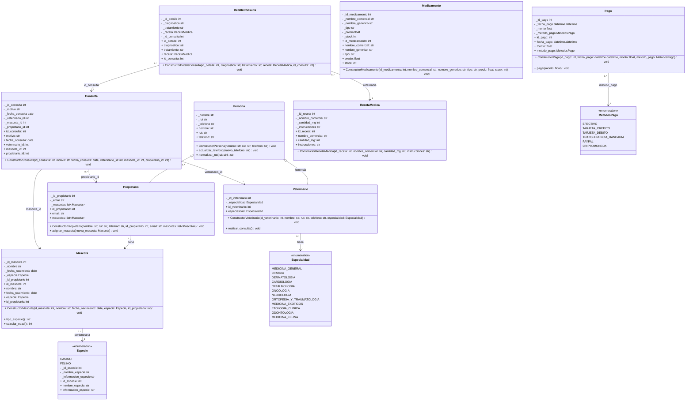

# Veterinaria VetCare DOC Principal

Sistema de consola para gestionar una clínica veterinaria (propietarios, mascotas, veterinarios, consultas, detalles de consulta, recetas médicas y medicamentos) hecho en Python con SQLite.

# Resumen de Cambios - VetCare (Versión v5 / Rama `brayan`)

Este apartado detalla todas las modificaciones, correcciones e implementaciones técnicas realizadas en el proyecto **VetCare** que se hicieron en la rama brayan y luego se trayeron a main con un merge/fusion.

---

## 1. Visión General del Trabajo Realizado

Los cambios se estructuraron respetando la arquitectura por capas del proyecto (`models`, `dao`, `services`, `screens`):

* **Archivo nuevo creado:** `screens/utilidades.py`.


* **Archivos modificados:** Todos los modelos con ID, 8 de los 9 DAO (salvo `especialidad_dao.py`), 7 servicios, los 5 menús de la capa `screens`, `main.py` y el `README.md`.


---

## 2. Detalle de los 10 Cambios Clave

### 1. Búsquedas por RUT y por Nombre


* Se reemplazó la búsqueda generalizada por ID en el menú de consultas.


* **RUT:** Comparación mediante normalización (método `Persona.normalizar_rut()`), permitiendo escribir RUTs con o sin puntos y guion (ej. `11.111.111-1` o `111111111`).


* **Nombres:** Búsqueda parcial de texto (ej. "amoxi" encuentra "Amoxicilina 250mg").


### 2. Consultas y Recetas Unificadas por RUT


* Muestra las consultas y recetas de un propietario ordenadas cronológicamente de la más antigua a la más nueva.


* Se incluyó la información del detalle de consulta (diagnóstico, tratamiento y receta) directamente debajo de cada consulta.


### 3. Asignación Automática de IDs (`AUTOINCREMENT`)


* Las claves primarias se configuraron como `INTEGER PRIMARY KEY AUTOINCREMENT` en SQLite.


* Los modelos ahora aceptan `None` en el ID antes de ser guardados.


* El ID se obtiene mediante `cursor.lastrowid` al insertar y se le informa al usuario sin que este tenga que ingresarlo manualmente.


### 4. Listados Legibles y Ordenados por ID


* Se restauraron los métodos `__str__` en los modelos usados en los listados y `__repr__` en `Consulta` y `DetalleConsulta` para evitar la salida genérica de memoria tipo `<object at 0x...>`.


* Los métodos `listar_todos()` de entidades con ID ordenan por ID (`ORDER BY id...`); los catálogos sin ID usan orden alfabético.


### 5. Nueva Opción "Registrar Consulta" y Detalle Asociado


* Se agregó la opción 7 *"Registrar Consulta"* en el menú de registro.


* La tabla `detalle_consulta` incorpora la columna `id_consulta` para asociar cada detalle con su consulta correspondiente.


### 6. Relación 1 a N: Un Dueño con Varias Mascotas


* Se invirtió la relación previa (1:1): la columna `id_propietario` ahora vive en la tabla `mascotas`.


* En `models/propietario.py`, la propiedad `mascota` pasó a ser la lista `mascotas` con el método `asignar_mascota()`.


* Al registrar un dueño se permite ingresar múltiples mascotas consecutivas.


### 7. Integridad de Mascotas (Obligatoriedad de Dueño)


* Ninguna mascota puede registrarse o existir en el sistema sin un `id_propietario`.


* Al registrar una mascota en `screens/registrar_menu.py`, se solicita asociarla a un dueño existente (buscado por RUT) o registrar un dueño nuevo en el momento.


### 8. Limpieza de Pantalla y Navegación Fluidizada


* Implementación de `limpiar_pantalla()` (`cls` en Windows / `clear` en Linux/Mac) al cambiar de menú.


* Se agregó la función `pausar()` ("Presione Enter para continuar...") para evitar que la información se borre inmediatamente.


### 9. Captura de Datos con Reintentos (`utilidades.py`)


* **`pedir_dato()`:** Vuelve a solicitar únicamente el dato erróneo (máximo 3 intentos por campo) sin perder la información ya ingresada en el formulario.


* **`validar()`:** Ejecuta los setters de los modelos sobre una instancia borrador (`_Borrador()`) para validar reglas de negocio en tiempo real.


* **Excepción `DemasiadosIntentos`:** Si el usuario falla 3 veces en el mismo campo, se cancela el formulario de forma segura y se vuelve al menú principal.


### 10. Robustez y Manejo de Errores


* **OverflowError:** Rechazo de enteros demasiado grandes para SQLite (ej. números gigantes en ID o stock).


* **Validación de flotantes:** Rechazo de valores `nan` e `inf` en precios.


* **Cierre abrupto:** Manejo limpio de `KeyboardInterrupt` (Ctrl+C) y `EOFError` en `main.py`.


* **Base bloqueada:** Captura de `sqlite3.OperationalError` (`database is locked`) mostrando una advertencia en lugar de cerrar la aplicación.


* **Consistencia de datos:** Verificación de pertenencia entre mascota y propietario antes de actualizar una consulta.


---

## 3. Resumen de Archivos Modificados por Capa


```
| Capa | Archivos | Cambios Principales |
| --- | --- | --- |
| **`models/`** | `mascota.py`, `propietario.py`, `persona.py`, `detalle_consulta.py`, `consulta.py`, `veterinario.py`, `medicamento.py`, `receta_medica.py`, `pago.py`<br> | ID opcional (`None`), lista de mascotas en propietario, `id_consulta` en detalle, `normalizar_rut()` en persona y restauración de `__str__`.

 |
| **`dao/`** | `propietario_dao.py`, `mascota_dao.py`, `detalle_consulta_dao.py`, `consulta_dao.py`, `veterinario_dao.py`, `medicamento_dao.py`, `receta_medica_dao.py`, `especie_dao.py`<br> | Uso de `AUTOINCREMENT`, asignación mediante `cursor.lastrowid` y ordenamiento por ID.

 |
| **`services/`** | `propietario_service.py`, `veterinario_service.py`, `consulta_service.py`, `detalle_consulta_service.py`, `medicamento_service.py`, `especie_service.py`, `mascota_service.py`<br> | Búsquedas por RUT/nombre, ordenamiento de consultas por fecha y rechazo de mascotas sin dueño.

 |
| **`screens/`** | `utilidades.py` *(NUEVO)*, `registrar_menu.py`, `menu_consulta.py`, `actualizar_menu.py`, `menu_borrar.py`, `main_menu.py`<br> | Reintentos por campo con `pedir_dato()`, menú de consultas renovado, opción de registrar consulta y limpieza de terminal.

 |
| **Raíz** | `main.py`, `README.md`<br> | Manejo de interrupciones globales, errores de base de datos y documentación UML actualizada.

 |
```
### Cómo ejecutar
La base de datos se resuelve desde la carpeta del proyecto (`database/clinica_vetcare.db`), así que el programa puede iniciarse desde cualquier directorio:
```
python C:\ruta\al\proyecto\main.py
```
Al iniciar, se muestra la ruta exacta del archivo de base de datos que se está usando. Si no se puede abrir:
```
[Error de base de datos] unable to open database file
Revise la ruta de la base de datos, los permisos de escritura y que el archivo no esté bloqueado por otro programa.
```

### Estructura
```
veterinaria/
├── main.py              -> inicializa la conexión, los DAO, los service y los menús
├── database/            -> conexion.py y el archivo clinica_vetcare.db
├── models/              -> clases del dominio (con sus setters de validación)
├── dao/                 -> toda la lógica SQL (CRUD)
├── services/            -> orquestador entre screens y DAO
├── screens/             -> menús de consola y captura de datos
│   └── utilidades.py    -> limpiar pantalla, pausar y pedir datos con reintentos
└── pruebas/             -> pruebas del DAO de medicamento e imágenes de QA
```

### Main
Inicializacion
```py
    especie_service = EspecieService(EspecieDAO(conexion_db))
    EspecialidadDAO(conexion_db)
    propietario_service = PropietarioService(PropietarioDAO(conexion_db))
    mascota_service = MascotaService(MascotaDAO(conexion_db))
    veterinario_service = VeterinarioService(VeterinarioDAO(conexion_db))
    consulta_service = ConsultaService(ConsultaDAO(conexion_db))
    receta_medica_service = RecetaMedicaService(RecetaMedicaDAO(conexion_db))
    detalle_consulta_service = DetalleConsultaService(DetalleConsultaDAO(conexion_db))
    medicamento_service = MedicamentoService(MedicamentoDAO(conexion_db))
```
Inicializa los DAO entregándoles la conexión a la DB, además los DAO en su constructor construyen crear_tabla. Service se instancia con el DAO ya creado junto a su conexión respectiva a la DB.

En conexión.py se crea la conexión, pero esto se llama desde Main.py

Al final de `main.py` la llamada a `main()` está protegida, así el programa nunca termina mostrando un error de Python:
```py
if __name__ == "__main__":
    try:
        main()
    except (KeyboardInterrupt, EOFError):
        # Ctrl+C o cierre de la entrada: se sale sin mostrar el error de Python
        print("\nSaliendo del sistema...")
    except sqlite3.Error as error:
        print(f"\n[Error de base de datos] {error}")
        print(
            "Revise la ruta de la base de datos, los permisos de escritura "
            "y que el archivo no esté bloqueado por otro programa."
        )
```
- `KeyboardInterrupt`: el usuario presionó Ctrl+C.
- `EOFError`: se cerró la entrada (Ctrl+Z en Windows o Ctrl+D en Linux).
- `sqlite3.Error`: no se pudo abrir la base de datos al iniciar.

### Menús
El menú principal abre cuatro submenús. Cada vez que se cambia de menú se limpia la terminal y luego se muestra el menú.

| Menú principal | Qué hace |
|---|---|
| 1. Registrar consulta | Abre el menú de registro: propietario, mascota, veterinario, medicamento, receta médica, detalle de consulta y consulta |
| 2. Consultar | Búsquedas por RUT o por nombre y listado de registros |
| 3. Borrar | Borra un registro por su ID |
| 4. Actualizar | Actualiza un registro por su ID |
| 5. Salir | Termina el programa |

Menú de Registro:

| Opción | Qué pide |
|---|---|
| 1. Asignar Propietario | Datos del propietario y de su primera mascota. Luego pregunta "¿Desea agregar otra mascota? (S/N)" |
| 2. Asignar Mascota | Pregunta a quién pertenece: a un dueño ya registrado (se busca por RUT) o a un dueño nuevo (se registra en ese momento) |
| 3. Asignar Veterinario | Nombre, RUT, teléfono y especialidad |
| 4. Registrar Medicamento | Nombre comercial, nombre genérico, tipo, precio y stock |
| 5. Registrar Receta Médica | Nombre comercial, cantidad en mg e instrucciones |
| 6. Registrar Detalle de Consulta | ID de la receta, ID de la consulta a la que pertenece, diagnóstico y tratamiento |
| 7. Registrar Consulta | RUT del propietario, mascota (si tiene varias se elige de una lista), RUT del veterinario, motivo y fecha |
| 8. Salir | Vuelve al menú principal |

El ID nunca se pide al registrar: lo asigna la base de datos y se muestra al terminar, por ejemplo `[OK] Registro de mascota exitoso. ID asignado: 13`.

Menú de Consulta:

| Opción | Cómo busca |
|---|---|
| 1. Consultar consultas por RUT del propietario | Muestra todas sus consultas de la más antigua a la más nueva, cada una con su detalle debajo |
| 2. Consultar recetas médicas por RUT del propietario | Igual que la anterior, mostrando las recetas de cada consulta |
| 3. Consultar medicamento por nombre comercial | Acepta parte del nombre (por ejemplo "amoxi") |
| 4. Consultar mascotas por RUT del propietario | Muestra todas las mascotas del dueño |
| 5. Buscar mascotas por nombre | Muestra todas las mascotas cuyo nombre contenga el texto |
| 6. Consultar propietario por RUT | |
| 7. Consultar veterinario por RUT | |
| 8. Consultar especie por nombre | |
| 9. Consultar mascota por especie | |
| 10. Consultar mascota por edad | |
| 11. Consultar por dueño | Por nombre del propietario |
| 12. Listar registros | Lista todos los registros de una entidad ordenados por su ID |
| 13. Volver al Menú Principal | |

El RUT se puede escribir con o sin puntos y guion (`11.111.111-1` y `111111111` se consideran iguales). El detalle de consulta no tiene opción de búsqueda propia: se muestra junto con su consulta.

Los menús de Borrar y Actualizar trabajan por ID. Los IDs se pueden ver en "Listar registros" o en los resultados de las búsquedas.

### Screens
Todo Screen contiene un método para poder crear el objeto con los datos del usuario
```py
    def _crear_veterinario(self) -> Veterinario:
        nombre = pedir_dato(
            "Nombre del veterinario: ",
            lambda texto: validar(Veterinario, "nombre", texto.strip()),
        )
        rut = pedir_dato("RUT: ", self._rut_veterinario_disponible)
        telefono = pedir_dato(
            "Teléfono (+569...): ",
            lambda texto: validar(Veterinario, "telefono", texto.strip()),
        )
        especialidades = list(Especialidad)
        print("Especialidades:")
        for indice, especialidad in enumerate(especialidades, start=1):
            print(f"{indice}. {especialidad.value}")
        especialidad = elegir_de_lista(
            "Seleccione una especialidad: ", especialidades, "especialidad"
        )
        return Veterinario(
            None,  # el ID lo asigna la base de datos
            nombre,
            rut,
            telefono,
            especialidad,
        )
```

Con los datos que el usuario entrega, se usan los modelos, cada clase tiene sus setters, estos setters se inicializan junto al constructor init. Por lo tanto, apenas se crea el objeto se dispara el setter con las comprobaciones.

Models/Veterinario.py
```py
        self.id_veterinario = id_veterinario
        self.especialidad = especialidad
```

Además, cada dato se valida **apenas el usuario lo escribe** con `pedir_dato` y `validar` (ver [Utilidades de pantalla](#utilidades-de-pantalla)). Así, si el usuario escribe mal el RUT, solo se le vuelve a pedir el RUT y no todo el formulario.

Veterinario usa únicamente `id_veterinario`; Propietario se identifica únicamente con `id_propietario`. Al iniciar con una base existente, `VeterinarioDAO` elimina la columna heredada `id_persona` y conserva los demás datos del veterinario.

El ID se entrega como `None` porque todavía no existe: lo asigna la base de datos al guardar el objeto (ver [IDs automáticos](#ids-automáticos)).

Cabe resaltar que Screens solo captura datos del usuario y crea el objeto mediante el uso de los models. Por lo tanto, la inserción del objeto se delega a Service/DAO.
```py
    def _registrar_veterinario(self):
        try:
            veterinario = self._crear_veterinario()
            self._veterinario_service.registrar_veterinario(veterinario)
            print(f"[OK] Registro de veterinario exitoso. ID asignado: {veterinario.id_veterinario}")
        except (ValueError, TypeError) as error:
            print(f"\n[Error de registro] {error}")
        pausar()
```
Aqui se hace el try, veterinario se asigna como un método que estamos llamando “crear veterinario” y retorna un objeto ya creado tipo veterinario, así que la creación se delega a ese método llamado “crear_veterinario”.
Luego de eso se hace un llamado a service, este se registra mediante su método registrar_veterinario de service y se le pasa como parámetro ese veterinario que anteriormente se creo con el método “crear_veterinario”, como dije antes, esto hace un return así que la asignación SI es un objeto tipo veterinario.

Después de guardar, el objeto ya tiene el ID que le asignó la base de datos, por eso se puede mostrar en el mensaje. `pausar()` muestra "Presione Enter para continuar..." para que el mensaje alcance a leerse antes de que se limpie la pantalla.

### Utilidades de pantalla
`screens/utilidades.py` reúne las funciones que usan todos los menús:

| Función | Qué hace |
|---|---|
| `limpiar_pantalla()` | Limpia la terminal (`cls` en Windows, `clear` en Linux/Mac). Se llama al inicio de cada menú |
| `pausar()` | Muestra "Presione Enter para continuar..." |
| `pedir_dato(mensaje, convertir)` | Pide un dato y, si es inválido, repite **solo ese dato**. Al tercer error lanza `DemasiadosIntentos` y se vuelve al menú |
| `validar(clase, atributo, valor)` | Valida un dato con el setter del modelo, sin crear el objeto completo |
| `convertir_entero`, `convertir_decimal`, `convertir_fecha`, `convertir_si_no` | Convierten el texto escrito al tipo correcto con mensajes en español |
| `elegir_de_lista(mensaje, opciones, nombre)` | Pide el número de una opción de una lista (especie, especialidad, mascota) |

```py
def pedir_dato(mensaje: str, convertir=lambda texto: texto.strip()):
    for intento in range(1, MAXIMO_INTENTOS + 1):
        texto = input(mensaje)
        try:
            return convertir(texto)
        except (ValueError, TypeError) as error:
            restantes = MAXIMO_INTENTOS - intento
            if restantes > 0:
                print(f"  [Dato inválido] {error} (le quedan {restantes} intento(s))")
            else:
                print(f"  [Dato inválido] {error}")
    raise DemasiadosIntentos(
        f"Se equivocó {MAXIMO_INTENTOS} veces en el mismo dato. Volviendo al menú."
    )
```
`convertir` es una función que recibe el texto y devuelve el valor listo, o lanza `ValueError`/`TypeError` con el motivo. Por ejemplo, para el precio:
```py
pedir_dato(
    "Precio: ",
    lambda texto: validar(Medicamento, "precio", convertir_decimal(texto)),
)
```
Ejemplo en consola:
```
RUT: 123
  [Dato inválido] Cantidad de caracteres imposible, verifique bien el rut. (le quedan 2 intento(s))
RUT: 11.111.111-2
  [Dato inválido] Rut inválido, verifique bien el rut. (le quedan 1 intento(s))
RUT: 11.111.111-1
Teléfono (+569...):
```
`DemasiadosIntentos` hereda de `ValueError`, por lo tanto los `except (ValueError, TypeError)` que ya tenían los menús la capturan sin cambios y el programa vuelve al menú. Así se evita quedar atrapado en un bucle si el usuario quiere salir.

`validar` reutiliza el setter del modelo, así las reglas de validación están en un solo lugar (el modelo) y no se repiten en los menús:
```py
def validar(clase, atributo: str, valor):
    getattr(clase, atributo).fset(_Borrador(), valor)
    return valor
```
`getattr(Medicamento, "precio")` devuelve la property y `.fset` es su setter. Se ejecuta sobre `_Borrador`, un objeto vacío, solo para comprobar el dato.

Algunos datos además revisan la base de datos mientras se escriben:
- El RUT de un propietario o veterinario nuevo no puede estar registrado ("Ya existe un propietario con ese RUT.").
- Los IDs y RUTs que se ingresan para buscar deben existir ("No existe un propietario con RUT ...").
- Los números no pueden ser más grandes de lo que SQLite puede guardar, y el precio no acepta `nan` ni `inf`.

### Service
Los service son el orquestador principal entre el Screen y el DAO, service recibe el objeto creado en Screens, se lo pasa a DAO para que lo guarde en DB.

Ejemplo en Screens:
```py
._mascota_service.registrar_mascota(mascota)
```
Eso esta en Screens, si se fijan, se crea el objeto mascota y posteriormente se registra mediante service. Service tiene la tarea de que ese registro llegue a DAO mediante:
```py
    def registrar_mascota(self, mascota: Mascota) -> Mascota:
        if not isinstance(mascota, Mascota):
            raise TypeError("Debe proporcionar una mascota válida.")
        if mascota.id_propietario is None:
            raise ValueError("No se puede registrar una mascota sin dueño.")
        try:
            self._mascota_dao.insertar(mascota)
            return mascota
        except sqlite3.IntegrityError as error:
            nombre_limpio = mascota.nombre.strip()
            raise ValueError(f"No se pudo registrar: la mascota '{nombre_limpio}' ya existe en el sistema.") from error
```
Hace un Try en donde usa el método insertar de mascota_dao para insertar a mascota, pero antes revisa si Mascota (es decir, el valor entregado) de verdad es una instancia de mascota (Doble check antes de try) y que tenga dueño, porque no pueden existir mascotas sin dueño. El except espera un fallo tipo sqlite dado que los fallos de validación de datos ya fueron comprobados en el mismo modelos con los setters.

Esto pasa directamente con TODO lo demás de service, desde registrar hasta borrar un dato, reciclando mismo flujo de control.

#### Búsquedas en los service
Las búsquedas siguen el mismo estilo que `buscar_mascotas_por_nombre`: piden la lista al DAO y filtran en Python.

| Service | Método | Qué devuelve |
|---|---|---|
| PropietarioService | `obtener_propietario_por_rut(rut)` | El propietario con ese RUT (con o sin puntos y guion) |
| PropietarioService | `buscar_mascotas_por_rut(rut)` | Todas las mascotas del propietario |
| VeterinarioService | `obtener_veterinario_por_rut(rut)` | El veterinario con ese RUT |
| ConsultaService | `buscar_consultas_por_propietario(id_propietario)` | Sus consultas, de la más antigua a la más nueva |
| DetalleConsultaService | `buscar_detalles_por_consulta(id_consulta)` | Los detalles de esa consulta |
| MedicamentoService | `buscar_medicamentos_por_nombre(termino)` | Usa `buscar_por_termino_seguro` del DAO (`LIKE`) |
| EspecieService | `buscar_especies_por_nombre(termino)` | Especies cuyo nombre contenga el texto |

Para comparar RUTs se usa `Persona.normalizar_rut`, que quita puntos y guion:
```py
    @staticmethod
    def normalizar_rut(rut: str) -> str:
        return rut.replace(".", "").replace("-", "").strip().upper()
```

### DAO
Esta es la parte más compleja del programa, porque esta toda la lógica SQL.
Cosas a tomar en cuenta:
-	Conn: es la conexión abierta en SQL lite que posteriormente se había abierto en conexión.py. Cabe resaltar que pase lo que pase un commit en la DB siempre acaba cerrando esa conexión por seguridad

-	Cursor: es un objeto que permite ejecutar instrucciones

-	Rowcount: es un entero, en un select devuelve -1 por lo que se usa fetchall y fetchone. El rowcount en un update dice cuantas filas se actualizaron, en insert cuantas fueron insertadas y en delete cuantas filas se borraron.

-	Lastrowid: después de un INSERT, `cursor.lastrowid` entrega el ID que la base de datos le asignó a la fila nueva.

-	sql: Es la instrucción misma en SQL, por ejemplo, crear_tabla: En crear tabla primero se usa cursor para ejecutar la instrucción que viene en sql.
Una vez que se entendieron estos temas pasos a explicarles que hace DAO:
DAO es el puente entre la base de datos y el sistema completo, ningún objeto pasa a la DB sin antes pasar DAO. DAO solo se llama desde service, no se debe llamar de ningún otro lado. DAO tiene la función de insertar,crear,actualizar,borrar mediante operaciones DDL/DML entre otras que sean parte de SQL. Esto quiere decir que DAO es en realidad un CRUD; create, read, update, delete. No hay mucho que hablar luego de esto, los datos que inyecta DAO se pasan del mismo service, service toma el objeto creado desde screens, screens usa models, por lo cual activa setters.
```py
    def crear_tabla(self):
        ddl = """
            CREATE TABLE IF NOT EXISTS mascotas (
                id_mascota INTEGER PRIMARY KEY AUTOINCREMENT,
                nombre TEXT NOT NULL,
                fecha_nacimiento TEXT NOT NULL,
                id_especie INTEGER NOT NULL,
                id_propietario INTEGER NOT NULL,
                FOREIGN KEY (id_especie) REFERENCES especies(id_especie),
                FOREIGN KEY (id_propietario) REFERENCES propietarios(id_propietario)
            )
        """
        with self._db.obtener_conexion() as conn:
            conn.execute(ddl)
```
Primero la instrucción DDL (Data Definition Language) que tiene una instrucción de crear una tabla. Posteriormente se ejecuta con conn.execute, por que no cursor si esto permite ejecutar instrucciones?
En sqlite3, conn.execute(sql) es una forma abreviada: ejecuta la instrucción y devuelve un Cursor. Así que no se está evitando el cursor, simplemente no se guarda en una variable porque aquí no hace falta usarlo después.

Para el CREATE TABLE, no hay filas que recuperar ni más operaciones sobre ese cursor, por eso basta con:
conn.execute(ddl)

Si luego de la ejecución de la instrucción se procede a realizar algo más, ahí se debe usar cursor.
```py
    def listar_todos(self) -> list[Especie]:
        sql = "SELECT id_especie FROM especies ORDER BY id_especie"
        especies = []
        with self._db.obtener_conexion() as conn:
            cursor = conn.cursor()
            cursor.execute(sql)
            filas = cursor.fetchall()

            for fila in filas:
                # Tupla: (id_especie,)
                especie = next(
                    especie
                    for especie in Especie
                    if especie.id_especie == fila[0]
                )
                especies.append(especie)
        return especies
```
Aquí es donde se recuperan filas
```py
cursor = conn.cursor()
cursor.execute(sql)
filas = cursor.fetchall()
```
Recupera el registro de todas las filas, hace fetchall. Luego, se reconstruye el objeto, es decir, el objeto del usuario que creo en screens no es el mismo con el que se consulta.

Los `listar_todos` de las entidades con ID ordenan por ID (`ORDER BY id_...`); los catálogos sin ID, como especialidades, se ordenan por nombre.

#### IDs automáticos
Las tablas con IDs generados usan `INTEGER PRIMARY KEY AUTOINCREMENT`. SQLite asigna un ID cuando se inserta `NULL`, y el DAO lo copia al objeto con `lastrowid`. En una base nueva, el primer ID es 1. `AUTOINCREMENT` conserva el contador: no reutiliza IDs borrados, y una base existente con un contador avanzado seguirá asignando números desde ese contador.

Al insertar, el objeto llega con ID `None`. SQLite recibe `NULL` en la clave primaria y asigna el siguiente número; luego el DAO lo copia al objeto con `lastrowid`:
```py
        with self._db.obtener_conexion() as conn:
            conn.execute(
                "INSERT OR IGNORE INTO especies (id_especie, nombre, informacion) VALUES (?, ?, ?)",
                parametros_especie,
            )
            cursor = conn.execute(sql, parametros_mascota)
            # La base de datos asigna el ID automáticamente
            mascota.id_mascota = cursor.lastrowid
```
Para que el objeto pueda existir antes de tener ID, los setters de ID de los modelos aceptan `None`:
```py
    @id_mascota.setter
    def id_mascota(self, nuevo_id: int | None):
        if nuevo_id is None:
            # Aún no se guarda: el ID lo asigna la base de datos
            self._id_mascota = None
            return
        if not isinstance(nuevo_id, int) or isinstance(nuevo_id, bool):
            raise TypeError("El ID de la mascota debe ser un número entero.")
        ...
```
Si se entrega un ID a mano (como hacen los scripts de `pruebas/`), SQLite usa ese ID.

# models

Refactorización de consulta y detalle_consulta : 

Un setter monolitico que actualiza todos los valores de golpe es mala practica.
Se dividio en varios setters por cada atributo de clase 
Para automatizar este proceso se utilizo un agente IA.

El agente realizo: Analizo el codigo, separo el setter monolitico en varios setters para cada atributo.
Agente: Gemini 3.6 Flash


### Cambios en models

| Clase | Cambio |
|---|---|
| Todas las que tienen ID | El setter del ID acepta `None` mientras el objeto no se guarda (el ID lo asigna la base de datos) |
| Mascota | Nuevo atributo `id_propietario`: cada mascota sabe quién es su dueño |
| Propietario | `mascota` pasó a ser `mascotas` (una lista). `asignar_mascota()` agrega una mascota más a la lista |
| DetalleConsulta | Nuevo atributo `id_consulta`: une el detalle con la consulta a la que pertenece |
| Persona | Nuevo método estático `normalizar_rut()` para comparar RUTs escritos con o sin puntos y guion |
| Todas | Se restauraron los métodos `__str__` (y `__repr__` en Consulta y DetalleConsulta) |

Sobre el último punto: en un commit anterior se borraron los `__str__` por considerarlos innecesarios, pero el menú imprime los objetos con `print(resultado)`, y sin `__str__` Python muestra algo como `<models.mascota.Mascota object at 0x0000022D948E0050>`. Se restauraron tal como estaban. Ejemplo:
```py
    def __str__(self) -> str:
        return (
            f"ID Mascota: {self.id_mascota}\n"
            f"Nombre: {self.nombre}\n"
            f"Fecha de Nacimiento: {self.fecha_nacimiento.strftime('%d/%m/%Y')}\n"
            f"Especie: {self.tipo_especie}\n"
            f"Edad: {self.calcular_edad()} años"
        )
```
Propietario ahora muestra todas sus mascotas:
```py
            f"Mascotas: {', '.join(mascota.nombre for mascota in self.mascotas) or 'Sin mascotas'}"
```

# Uso de IA para agilizar desarrollo

Código inicial, antes de integrar el borrado:
```py
class MenuBorrar():
    def __init__(self, menu_principal):
        self._menu_principal = menu_principal

    def ejecutar(self):
        print("=== Menú Borrar ===")
        print("1. Borrar consulta")
        print("2. Borrar propietario")
        print("3. Borrar mascota")
        print("4. Volver al menú principal")
        opcion = input("Seleccione una opción: ").strip()

        if opcion == "1":
            self.borrar_consulta()
        elif opcion == "2":
            self.borrar_propietario()
        elif opcion == "3":
            self.borrar_mascota()
        elif opcion == "4":
            return
        else:
            print("Opción inválida. Intente nuevamente.")

    def borrar_consulta(self):
        id = input("Ingrese el ID de la consulta a borrar: ").strip()

    def borrar_propietario(self):
        id = input("Ingrese el ID del propietario a borrar: ").strip()

    def borrar_mascota(self):
        id = input("Ingrese el ID de la mascota a borrar: ").strip()
```

En donde cada service no tiene un metodo para borrar el ID usando DAO que ya tiene el metodo listo para usarse.

Se agilizo el desarrollo usando este prompt:

en menu borrar integra todos los demas DAO que tengan la funcion de borrar por ID, sigue la misma logica de if elif elif elif luego una def de borrar que pida input con el id. luego de eso se comprueba el id si es negativo o no es entero da error con typevalue.  Para cada def se comprueba

Por ultimo en service crea una nueva funcion abajo de todas las demas que sea "borrar_x" donde x es el nombre del service ejemplo : "borrar_especie".

Esta luego usara el borrar del DAO con el ID entregado en screen para borrar ese registro.

CHATGPT-6 Luna | Copilot

Codigo Nuevo:

### `screens/menu_borrar.py`

El menú recibe los ocho servicios cuyo DAO ofrece `eliminar(id)`: consulta,
propietario, mascota, veterinario, detalle de consulta, medicamento, receta médica
y especie. `EspecialidadDAO.eliminar()` recibe un nombre, no un ID, así que no se
incluyó en este menú de borrado por ID.

```python
def ejecutar(self) -> None:
    while True:
        # Muestra opciones 1 a 8 para los registros y 9 para volver.
        opcion = input("Seleccione una opción: ").strip()
        if opcion == "1":
            self.borrar_consulta()
        elif opcion == "2":
            self.borrar_propietario()
        elif opcion == "3":
            self.borrar_mascota()
        elif opcion == "4":
            self.borrar_veterinario()
        elif opcion == "5":
            self.borrar_detalle_consulta()
        elif opcion == "6":
            self.borrar_medicamento()
        elif opcion == "7":
            self.borrar_receta_medica()
        elif opcion == "8":
            self.borrar_especie()
        elif opcion == "9":
            return
        else:
            print("Opción inválida. Intente nuevamente.")
```

Cada operación pide un ID y delega en el método del servicio correspondiente.
La comprobación compartida rechaza entradas que no sean enteros o IDs no
positivos y muestra errores de registro inexistente o de claves foráneas:

```python
def _borrar_por_id(self, entidad: str, accion: Callable[[int], bool]) -> None:
    try:
        entrada_id = input(f"Ingrese el ID de {entidad} a borrar: ").strip()
        try:
            id_registro = int(entrada_id)
        except ValueError as error:
            raise ValueError("El ID debe ser un número entero.") from error
        if id_registro <= 0:
            raise ValueError("El ID debe ser un número entero positivo.")
        accion(id_registro)
    except (TypeError, ValueError) as error:
        print(f"No se pudo borrar el registro de {entidad}: {error}")
    except sqlite3.IntegrityError:
        print(
            f"No se pudo borrar el registro de {entidad}: existen registros relacionados "
            "que impiden la eliminación."
        )
    else:
        print(f"El registro de {entidad} se eliminó correctamente.")
```

Las operaciones específicas conectan cada opción al servicio:

```python
def borrar_consulta(self) -> None:
    self._borrar_por_id("consulta", self._consulta_service.borrar_consulta)

def borrar_propietario(self) -> None:
    self._borrar_por_id("propietario", self._propietario_service.borrar_propietario)

def borrar_mascota(self) -> None:
    self._borrar_por_id("mascota", self._mascota_service.borrar_mascota)

def borrar_veterinario(self) -> None:
    self._borrar_por_id("veterinario", self._veterinario_service.borrar_veterinario)

def borrar_detalle_consulta(self) -> None:
    self._borrar_por_id(
        "detalle de consulta",
        self._detalle_consulta_service.borrar_detalle_consulta,
    )

def borrar_medicamento(self) -> None:
    self._borrar_por_id("medicamento", self._medicamento_service.borrar_medicamento)

def borrar_receta_medica(self) -> None:
    self._borrar_por_id("receta médica", self._receta_medica_service.borrar_receta_medica)

def borrar_especie(self) -> None:
    self._borrar_por_id("especie", self._especie_service.borrar_especie)
```

### Métodos nuevos de los servicios

Cada servicio delega el ID recibido al método `eliminar()` de su DAO:

```python
# consulta_service.py
def borrar_consulta(self, id_consulta: int) -> bool:
    return self._consulta_dao.eliminar(id_consulta)

# propietario_service.py
def borrar_propietario(self, id_propietario: int) -> bool:
    return self._propietario_dao.eliminar(id_propietario)

# mascota_service.py
def borrar_mascota(self, id_mascota: int) -> bool:
    return self._mascota_dao.eliminar(id_mascota)

# veterinario_service.py
def borrar_veterinario(self, id_veterinario: int) -> bool:
    return self._veterinario_dao.eliminar(id_veterinario)

# detalle_consulta_service.py
def borrar_detalle_consulta(self, id_detalle: int) -> bool:
    return self._detalle_consulta_dao.eliminar(id_detalle)

# medicamento_service.py
def borrar_medicamento(self, id_medicamento: int) -> bool:
    return self._medicamento_dao.eliminar(id_medicamento)

# receta_medica_service.py
def borrar_receta_medica(self, id_receta: int) -> bool:
    return self._receta_medica_dao.eliminar(id_receta)

# especie_service.py
def borrar_especie(self, id_especie: int) -> bool:
    return self._especie_dao.eliminar(id_especie)
```

## Evaluacion critica

Me di la tarea de validar el codigo generado por la IA 
Lo primero que me causo ruido fue sobre ingenieria en:
_borrar_por_id(self, entidad: str, accion: Callable[[int], bool]) -> None:

se cambio a:
    def _borrar_por_id(self, entidad, accion):

Muchas más legible, sacrificando TypeHints innecesarios que dificultaban la lectura del grupo.

Más haya de eso, los DAO ya tenian implementados el metodo borrar por ID, asi que la IA simplemente funciono de conector, agilizando trabajo repetitivo de tener que modificar cada .service con un metodo borrar y este llamar al DAO para borrar ese registro.

### Regla de Negocio

Las clases ENUMERATE no deberian ser borrables del sistema, por lo tanto no integre eso.

### Test de Validacion (Test/QA)

Luego de ese pequeño ajuste empece a verificar el codigo nuevo, verificando que no hubieran errores. Esto se encuentra en Image en /Pruebas.

# Reciclando logica para agregar una nueva funcion de actualizar

Prompt: 
actualizar_menu.py sigue la misma logica que los demas menu:

logica de if elif elif elif elif else
integrar un nuevo metodo en los service que sea actualizar_x donde "x" es el nombre del service
que ese service llame al DAO que tenga el metodo de actualizar
actualizar_menu.py pedira el ID y luego el relleno de los datos a actualizar.
los DAOs que no tengan un metodo de actualizacion no se meten en el menu, se da por hecho que fueron creados con la intencion de que no se actualicen. 

main_menu.py llama a la clase actualizar_menu con una nueva opcion

Evita type hints excesivos, mantenlo simple, deja typehints sin tanta complejidad o no los uses en partes que se vuelvan muy ilegibles.

reutiliza el actualizar DAO asi que intenta no tocar los DAOs.

Respuesta:

Se agregó un menú para actualizar las siete entidades cuyos DAO ya tenían ese método. La mayor parte fue reutilizar la lógica existente: el menú pide el ID y los nuevos datos, y cada servicio delega la actualización a su DAO. No fue necesario modificar los DAO.

El menú sigue el patrón de opciones `if/elif` y deriva cada caso a su formulario:

```python
if opcion == "1":
    self._ejecutar_actualizacion("consulta", self._actualizar_consulta)
elif opcion == "2":
    self._ejecutar_actualizacion(
        "detalle de consulta",
        self._actualizar_detalle_consulta,
    )
```

Los servicios repiten la misma delegación al método `actualizar` existente en su DAO:

```python
def actualizar_consulta(self, consulta):
    return self._consulta_dao.actualizar(consulta)
```

## Evaluacion Critica:

La mayor parte del trabajo ya estaba hecho, asi que la IA solo hizo la parte pesada de reutilizar codigo, igualmente, se hicieron sus debidas comprobaciones que estan en Pruebas/Image.


## Servicios

Cada entidad tiene su propio servicio (`*_service.py`). La interfaz recibe directamente
los servicios que necesita, y cada operación se delega al servicio de su entidad.

# Flujo de una búsqueda por RUT
Para consultar las mascotas de un dueño por su RUT (opción 4 del menú de consulta), el resultado pasa por estos pasos:

1. En `menu_consulta.py`, la opción pide el RUT con `pedir_dato` y le entrega el método del service que hace la búsqueda:
   ```python
   resultados = pedir_dato(
       "Ingrese el RUT del dueño: ",
       self._propietario_service.buscar_mascotas_por_rut,
   )
   ```
   Si el RUT no existe, el service lanza `ValueError` y `pedir_dato` vuelve a pedir el RUT (máximo 3 veces).
2. En `propietario_service.py`, se busca al propietario y se devuelven sus mascotas:
   ```python
   propietario = self.obtener_propietario_por_rut(rut)
   return propietario.mascotas
   ```
   `obtener_propietario_por_rut` recorre `listar_todos()` del DAO y compara los RUT normalizados.
3. En `propietario_dao.py`, `listar_todos` lee cada propietario y sus mascotas (`WHERE id_propietario = ?`) y crea los objetos:
   ```python
   propietarios.append(self._crear_propietario(fila_propietario, filas_mascotas))
   ```
4. De vuelta en el menú, la lista queda en `resultados` y se pasa a:
   ```python
   self._imprimir_resultados(resultados)
   ```
   que imprime cada mascota usando su `__str__`.

La búsqueda de consultas por RUT (opción 1) sigue el mismo camino y además, por cada consulta, pide sus detalles a `DetalleConsultaService.buscar_detalles_por_consulta` para mostrarlos debajo:
```
=== Consultas de Ana Perez (de la más antigua a la más nueva) ===
----------------------------------------
Consulta #2 | Fecha: 15/01/2025
Motivo: Control general
ID Mascota: 13 | ID Veterinario: 1
--- Detalle de la consulta ---
ID Detalle: 1
Diagnóstico: Otitis leve
...
----------------------------------------
Consulta #1 | Fecha: 01/03/2026
Motivo: Vacuna anual
ID Mascota: 13 | ID Veterinario: 1
Detalle: (sin detalle registrado)
```

## Quién usa el resultado de `obtener_por_id_estricto`

`obtener_por_id_estricto` no imprime el resultado. Devuelve un objeto al servicio que lo llamó; el servicio devuelve ese mismo objeto al menú, y el menú decide qué hacer con él.

Ya no se usa para las búsquedas del menú de consulta (ahora son por RUT o nombre), pero sí en:
- `ActualizarMenu`: para comprobar que el ID a actualizar existe y obtener los datos actuales (por ejemplo, las mascotas de un propietario o el dueño de una mascota).
- `RegistrarMenu._crear_detalle_consulta`: para obtener la receta y la consulta a las que se une el detalle.

En cambio, el script `pruebas/test_sql_a_dominio_medicamento.py` llama directamente
al DAO. Allí el propio script recibe el objeto en la variable `medicamento` y lo
usa para mostrar sus datos y modificar su stock en memoria.

## Objetos creados al leer

Al leer, el DAO recibe una fila de SQLite y crea una instancia
Eso quiere decir que el objeto creado por el usuario no es el mismo que se usa para leerlo.

# fechas
 La base de datos guarda fecha_nacimiento como texto (TEXT), pero el modelo Mascota espera una fecha de Python (datetime.date).

Al guardar: mascota.fecha_nacimiento.isoformat() convierte la fecha en texto para SQLite.

Al leer: date.fromisoformat(fila[2]) convierte ese texto de vuelta en fecha.

Al escribir: `convertir_fecha` de `utilidades.py` convierte lo que escribe el usuario (`AAAA-MM-DD`) y, si el formato está mal, muestra "La fecha debe tener el formato AAAA-MM-DD." y vuelve a pedir solo la fecha.

## Búsqueda de objetos a partir de un ID

En algunos DAO, una fila de SQLite contiene el ID de una especie, pero el modelo
espera recibir el objeto `Especie`. Para convertir ese ID al valor correspondiente
de la enumeración se recorre `Especie` y se devuelve la primera coincidencia:

```python
especie = next(
    especie
    for especie in Especie
    if especie.id_especie == fila[3]
)
```

`next()` devuelve el elemento que cumple la condición; no devuelve el elemento
siguiente a la coincidencia. En este ejemplo, `fila[3]` es `id_especie` según
la tupla `(id_mascota, nombre, fecha_nacimiento, id_especie, id_propietario)`. El objeto encontrado
se pasa al constructor de `Mascota`, que requiere una instancia de `Especie`, no
solo su ID.

Esta búsqueda aparece en estos métodos:

- `EspecieDAO.obtener_por_id_estricto`: busca el valor de `Especie` cuyo ID coincide
  con la única columna consultada, `id_especie`.
- `EspecieDAO.listar_todos`: hace la misma conversión para cada fila de especies.
- `MascotaDAO._crear_mascota`: convierte el `id_especie` de la fila de mascota para
  poder construir el objeto `Mascota`.
- `MascotaDAO.listar_todos`: hace esa conversión para cada mascota listada.
- `PropietarioDAO._crear_propietario`: convierte el `id_especie` de cada mascota
  del propietario antes de construir sus objetos `Mascota`.

## Base de datos

Se realizo la conexion de la base de datos mediante main.py el cual incializa la conexion
conexion.py se encarga de repetir el codigo que estaba en los DAO asi no va creando
varias conexiones, crea solo una. Se uso "?" para tratar los datos del usuario
meramente como texto y asi evitar f-strings para evitar inyecciones SQL

¿Que hizo la IA?:

`main.py` crea una instancia compartida de `ConexionDB` y la inyecta en los DAO.
Cada operación usa `obtener_conexion()` para confirmar los cambios al terminar
o revertirlos si ocurre un error. La base nueva se guarda en
`database/clinica_vetcare.db`.

### Tablas

| Tabla | Clave primaria | Relaciones |
|---|---|---|
| especies | `id_especie` | — |
| especialidades | `nombre` | — |
| propietarios | `id_propietario` (`INTEGER PRIMARY KEY AUTOINCREMENT`) | — |
| mascotas | `id_mascota` (`INTEGER PRIMARY KEY AUTOINCREMENT`) | `id_especie` → especies, `id_propietario` → propietarios |
| veterinarios | `id_veterinario` (`INTEGER PRIMARY KEY AUTOINCREMENT`) | `especialidad` → especialidades |
| consulta | `id_consulta` (`INTEGER PRIMARY KEY AUTOINCREMENT`) | `id_mascota` → mascotas, `veterinario_id` → veterinarios, `propietario_id` → propietarios |
| detalle_consulta | `id_detalle` (`INTEGER PRIMARY KEY AUTOINCREMENT`) | `id_receta` → receta_medica, `id_consulta` → consulta |
| receta_medica | `id_receta` (`INTEGER PRIMARY KEY AUTOINCREMENT`) | — |
| medicamentos | `id_medicamento` (`INTEGER PRIMARY KEY AUTOINCREMENT`) | — |

Como las claves foráneas están activas (`PRAGMA foreign_keys = ON` en `conexion.py`), no se puede borrar un registro que otro usa. Por ejemplo, no se puede borrar un propietario que todavía tiene mascotas, ni una consulta que tiene detalles. En esos casos el menú de borrar muestra "existen registros relacionados que impiden la eliminación".

### Errores de base de datos
Si la base de datos está bloqueada (por ejemplo, abierta en DB Browser for SQLite con cambios sin guardar, o mientras OneDrive la sincroniza), el menú principal muestra el error y vuelve al menú en vez de cerrar el programa:
```
[Error de base de datos] database is locked
Cierre otros programas que estén usando la base de datos e intente nuevamente.
```

### Flujo de registro de un propietario

Al registrar un propietario, el menú recoge los datos y construye el objeto
`Propietario` con la lista de sus mascotas. Después, la llamada sigue este recorrido:

1. `RegistrarMenu._registrar_propietario()` llama a
   `PropietarioService.registrar_propietario(propietario)`.
2. El servicio valida el objeto y delega la escritura en
   `PropietarioDAO.insertar(propietario)`.
3. El DAO abre una conexión con `ConexionDB.obtener_conexion()` y ejecuta las
   sentencias SQL con `conn.execute(...)`: primero guarda el propietario y obtiene su ID
   con `lastrowid`; luego, por cada mascota, le asigna ese `id_propietario`, guarda su especie
   y guarda la mascota.
4. Si todo termina correctamente, `obtener_conexion()` confirma la transacción
   con `commit`; si ocurre un error, la revierte con `rollback` (no queda un propietario sin sus mascotas).

Agente: GPT-6 Luna | Copilot


# Relación propietario–mascotas

Antes, cada propietario guardaba una sola mascota (`propietarios.id_mascota`), por lo que un dueño no podía tener más de una mascota y podían existir mascotas sin dueño.

Ahora la relación se invirtió: **cada mascota guarda a su dueño** (`mascotas.id_propietario`, obligatorio). Un propietario puede tener varias mascotas y no pueden existir mascotas sin dueño.

| Acción | Cómo funciona |
|---|---|
| Registrar propietario | Se ingresan sus datos y su primera mascota; luego se pueden agregar más ("¿Desea agregar otra mascota? (S/N)") |
| Registrar mascota | Se elige un dueño ya registrado (por RUT) o se registra un dueño nuevo en ese momento |
| Registrar consulta | Si el dueño tiene varias mascotas se elige cuál de una lista |
| Actualizar propietario | Se puede actualizar también una de sus mascotas, elegida de una lista |
| Actualizar consulta | La mascota debe pertenecer al propietario indicado |
| Actualizar mascota | Se mantiene su dueño |
| Borrar propietario | Solo si ya no tiene mascotas |

`PropietarioDAO.actualizar` ahora solo actualiza los datos del propietario; sus mascotas se actualizan con `MascotaDAO.actualizar`.


# Ajustes con IA: búsquedas, IDs automáticos, mascotas y validaciones

Los últimos cambios se hicieron por etapas, pidiendo cada ajuste por separado y revisando el resultado antes de pasar al siguiente. Se pidió mantener la estructura y la lógica del código, cambiando solo lo necesario.

Agente: Claude | Anthropic

### Etapa 1: búsquedas e IDs

Prompt (resumen de lo pedido):

quiero que las cosas se dejen de buscar por el id. consulta: que se busque a través del rut del propietario y muestre todas las consultas que ha hecho ordenadas de la más antigua a la más nueva. detalle consulta: que no se muestre como opción de búsqueda sino junto con la consulta. receta médica: que se busque igual que consulta. medicamento: por nombre comercial. mascota: por rut de su dueño y además una opción aparte para buscarla por nombre. propietario y veterinario: por su rut. especie: por su nombre. también quiero que el id se asigne automáticamente, con un sequence si es posible. y revisar la opción 13 de listar registros, que solo muestra `<models.mascota.Mascota object at 0x...>`.

Respuesta:
- Se agregaron los métodos de búsqueda en los service (ver [Búsquedas en los service](#búsquedas-en-los-service)) y se cambió el menú de consulta.
- Como el detalle de consulta no estaba unido a ninguna consulta, se agregó la columna `id_consulta` en `detalle_consulta`.
- No existía una opción para registrar consultas, así que se agregó "7. Registrar Consulta" en el menú de registro.
- Los IDs se asignan con `INTEGER PRIMARY KEY AUTOINCREMENT` y `lastrowid` (ver [IDs automáticos](#ids-automáticos)).
- La opción de listar mostraba `<... object at 0x...>` porque se habían borrado los `__str__` de los modelos; se restauraron. Además los listados se ordenan por ID.

### Etapa 2: mascotas, pantalla y reintentos

Prompt (resumen de lo pedido):

los dueños deben poder tener más de 1 mascota. no se pueden crear mascotas sin dueño: al crear una mascota se le debe asignar un dueño existente o dar la opción de crear un nuevo dueño. al cambiar de menú, que limpie la terminal y después muestre el menú. y cuando me equivoque al ingresar un dato (por ejemplo el rut), que no vuelva desde el inicio, que solo repita el dato equivocado, pero si me equivoco 3 veces que vuelva al menú para evitar un bucle.

Respuesta:
- Se invirtió la relación propietario–mascota (ver [Relación propietario–mascotas](#relación-propietariomascotas)).
- Se creó `screens/utilidades.py` con `limpiar_pantalla`, `pausar` y `pedir_dato` (ver [Utilidades de pantalla](#utilidades-de-pantalla)).
- Todos los formularios de registro, actualización, borrado y búsqueda piden cada dato con `pedir_dato`, validándolo con los setters del modelo.

### Etapa 3: revisión de errores

Se pidió revisar todo el código en busca de errores que hicieran fallar el programa. Se encontraron y corrigieron:

| Error | Qué pasaba | Corrección |
|---|---|---|
| Números gigantes | Un ID, stock o cantidad en mg muy grande (por ejemplo `99999999999999999999`) cerraba el programa con `OverflowError`, porque SQLite no puede guardar enteros de más de 64 bits | `convertir_entero` rechaza esos números con "El número es demasiado grande." |
| Precio `nan` o `inf` | `float()` acepta esos textos: con `nan` aparecía un mensaje falso ("ya existe en el sistema") y con `inf` se guardaba un precio infinito | `convertir_decimal` solo acepta números finitos |
| Ctrl+C o cerrar la entrada | El programa terminaba mostrando `KeyboardInterrupt` o `EOFError` | `main.py` los captura y sale con "Saliendo del sistema..." |
| Base de datos bloqueada | Si otro programa tenía la base abierta, el programa se cerraba con `database is locked` | El menú principal muestra el error y vuelve al menú |
| Ruta de la base de datos | Al ejecutar desde otra carpeta, SQLite podía usar otra ruta relativa | La ruta predeterminada ahora se resuelve desde el proyecto y se muestra al iniciar (ver [Cómo ejecutar](#cómo-ejecutar)) |
| Actualizar consulta | Se podía guardar una consulta con la mascota de otro propietario; esa consulta aparecía luego en el RUT equivocado | Se comprueba que la mascota pertenezca al propietario |
| Actualizar propietario | Se guardaban los datos del propietario antes de preguntar por su mascota; si el usuario se equivocaba 3 veces en la mascota, el propietario quedaba cambiado pero el mensaje decía "No se pudo actualizar" | Primero se piden todos los datos y al final se guarda |
| Listar → Volver | Elegir "9. Volver" pedía "Presione Enter" antes de volver | Ahora vuelve directo |

## Pruebas de validación

Para validar el código se armó un probador que ejecuta `main.py`, le entrega las respuestas como si fuera el usuario y revisa los mensajes de salida y que no aparezca ningún `Traceback`:

| Prueba | Qué cubre |
|---|---|
| Base vacía | Las 13 opciones de consulta, el submenú de listar, las 7 de borrar, las 7 de actualizar y las de registrar, con opciones inválidas y 3 errores seguidos |
| Registrar todo | 2 propietarios (uno con 3 mascotas), mascota con dueño existente y con dueño nuevo, 2 veterinarios, medicamento, 2 recetas, 3 consultas y 2 detalles, ingresando datos erróneos a propósito |
| Consultar con datos | Todas las búsquedas y los 8 listados, incluido el orden de las consultas |
| Actualizar todo | Las 7 entidades, RUT repetido y actualización de una mascota desde el propietario |
| Borrar todo | Primero los casos bloqueados por registros relacionados y luego los 16 registros |
| Casos extremos | Números gigantes, `nan`/`inf`, Ctrl+C, cierre de la entrada y base de datos bloqueada |
| Base antigua | Un `.db` de la versión original se actualiza solo y conserva sus datos |
| `pruebas/` | Los tres scripts de prueba del DAO de medicamento siguen funcionando |

### Observaciones (no se cambiaron)
Estas validaciones vienen del código original. No hacen fallar el programa, pero permiten guardar datos poco realistas:
- `Persona.nombre` acepta un nombre vacío (solo revisa que no tenga números).
- `Persona.telefono` revisa que empiece con `+569` y tenga 12 caracteres, pero no que el resto sean números.
- `Propietario.email` solo revisa que tenga `@` (acepta por ejemplo `@brayanisl`).
- `Mascota.fecha_nacimiento` acepta fechas muy antiguas (por ejemplo `1234-12-12`).
- La tabla `especies` solo guarda una especie cuando se registra la primera mascota de esa especie, por eso "Consultar especie por nombre" y "Listar especies" solo muestran especies ya usadas.

## Diagrama UML de clases

Uso de IA para generacion base del diagrama: Use IA para generar el diagrama BASE de clase UML
Luego de la entrega del primer diagrama lo fui perfeccionando y dividiendolo en pequeños diagramas
dado que era demasiado extenso. El prompt que utilice:

en el readme integra en mermaid.js un diagrama de clases UML que tenga clases, atributos, metodos, relaciones como herencia asociacion descomposicion etc.

Los atributos todos ponlos privados como debe ser "-" al tener "_" en python y los metodos dependeran del metodo. Recorda que el tipo de visibilidad viene primero luego el atributo y luego del atributo viene el tipo de dato. Los metodos pasa lo mismo con el tipo de dato, en este caso si no devuelve nada ponle void.

ej: 
```
atributo
- id_mascota : int
metodo
+ calcular_edad() : int 
```
Aparte de eso en los atributos el primero debe ser si o si el constructor el constructor debe ser el nombre de la clase junto a constructor ej:

clase mascota

el primer atributo seria su constructor llamado

ConstructorMascota() metele ahi todo lo que se debe inicializar en el init. 


La respuesta la enviare al final del documento dado que es demasiado extenso.
Agente: GPT-6 Luna | Copilot


## DOCUMENTACIÓN TÉCNICA • UML
### Diagramas UML · Guía de lectura

# GUÍA DE DIAGRAMAS UML
**Dominio · Servicios y DAO · Menús**

Lectura de relaciones, multiplicidades y responsabilidades

Esta guía resume las relaciones que **los diagramas principales de este documento dibujan** y distingue esa notación de los hechos concretos que muestra el código. No incluye el boceto inicial del diagrama.

### Resumen ejecutivo

| Área | Relaciones dibujadas | Lectura |
|---|---|---|
| Dominio | Herencia y asociaciones | Modela personas, mascotas, consultas, pagos y otras entidades relacionadas. |
| Servicios y DAO | Asociaciones | Cada servicio se conecta con su DAO y cada DAO con ConexionDB. |
| Menús de consulta | Asociaciones y composiciones | MenuPrincipal se asocia con MenuConsulta y se compone de MenuBorrar y ActualizarMenu. |
| Registro y borrado | Composiciones, asociaciones y dependencias | El diagrama marca tres menús como composiciones; los menús se asocian con servicios, RegistrarMenu depende de RecetaMedica en una operación y los menús dependen del módulo `utilidades`. |

### Cómo leer las relaciones

La forma de la línea indica el tipo de relación; la etiqueta, como «usa», «abre» o «referencia», describe su significado en ese diagrama. La etiqueta no cambia el tipo de relación.

| Notación Mermaid | Tipo UML | Lectura |
|---|---|---|
| &lt;&#124;-- | Herencia | La clase hija hereda de la clase base. |
| --> | Asociación navegable | Existe un vínculo estructural entre los elementos. |
| *-- | Composición | El diagrama modela una relación parte–todo fuerte. |
| ..> | Dependencia | Un elemento usa o necesita otro para alguna operación. |
| o-- | Agregación | No se utiliza en los diagramas principales de este documento. |

Las multiplicidades junto a los extremos, como `1` y `0..*`, indican cuántas instancias de un extremo pueden relacionarse con una instancia del otro. Por ejemplo, `Consulta "0..*" --> "1" Veterinario` representa que cada consulta se relaciona con un veterinario y que un veterinario puede aparecer en cero o muchas consultas.

## 1. Diagrama de dominio

El [diagrama de dominio](#diagrama-mermaid-dominio) presenta entidades y sus relaciones.

| Elementos | Relación dibujada | Interpretación |
|---|---|---|
| Persona–Propietario | Herencia (&lt;&#124;--) | Propietario hereda de Persona. |
| Persona–Veterinario | Herencia (&lt;&#124;--) | Veterinario hereda de Persona. |
| Propietario–Mascota | Asociación, «tiene» | Un propietario tiene una o varias mascotas y cada mascota tiene exactamente un dueño (`Mascota.id_propietario`). |
| Mascota–Especie | Asociación, «pertenece a» | La mascota se relaciona con una especie. |
| Veterinario–Especialidad | Asociación, «tiene» | El veterinario se relaciona con una especialidad. |
| Consulta–Veterinario, Mascota y Propietario | Asociaciones etiquetadas con campos ID | La consulta se relaciona con esas entidades; en el modelo Python conserva sus identificadores. |
| DetalleConsulta–Consulta | Asociación, «id_consulta» | Cada detalle pertenece a una consulta; una consulta puede tener cero o varios detalles. |
| DetalleConsulta–RecetaMedica | Asociación, «referencia» | El detalle mantiene una receta. |
| Pago–MetodosPago | Asociación, «metodo_pago» | El pago se relaciona con el método de pago. |

En este diagrama no se dibujan composiciones ni agregaciones. **«Referencia» es solo la etiqueta descriptiva** de la relación entre `DetalleConsulta` y `RecetaMedica`; en UML, esa relación también se considera una asociación, representada aquí con una flecha sólida (`-->`). «Referencia» no es un tipo adicional de relación UML.

## 2. Diagrama de servicios y DAO

El [diagrama de servicios](#diagrama-mermaid-servicios) muestra dos patrones de asociación:

| Patrón | Ejemplo | Significado |
|---|---|---|
| Servicio → DAO | MascotaService → MascotaDAO | El servicio utiliza y conserva su DAO. |
| DAO → conexión | MascotaDAO asociado con ConexionDB | El DAO utiliza y conserva la conexión a la base de datos. |

El mismo patrón servicio–DAO y DAO–`ConexionDB` se repite para Propietario, Veterinario, Consulta, DetalleConsulta, RecetaMedica, Medicamento, Especie y Especialidad. En este diagrama no se dibujan herencias, composiciones ni dependencias.

## 3. Diagrama de menús de consulta

El [diagrama de menús de consulta](#diagrama-mermaid-menus-consulta) muestra:

| Relación | Notación y etiqueta | Interpretación |
|---|---|---|
| MenuPrincipal–MenuConsulta | Asociación (-->), «abre» | El principal conserva y ejecuta el menú de consulta. |
| MenuPrincipal–MenuBorrar | Composición (*--), «crea» | El diagrama modela el menú de borrado como parte de MenuPrincipal. |
| MenuPrincipal–ActualizarMenu | Composición (*--), «crea» | El diagrama modela el menú de actualización como parte de MenuPrincipal. |
| MenuBorrar–sus siete servicios | Asociaciones (-->), «usa» | MenuBorrar utiliza los servicios indicados en el diagrama. |
| MenuConsulta–sus ocho servicios | Asociaciones (-->), «usa» | MenuConsulta utiliza los servicios indicados en el diagrama. |
| MenuConsulta y MenuBorrar–utilidades | Dependencia (..>), «pide datos» | Usan `pedir_dato`, `limpiar_pantalla` y `pausar`. |

### 3.1. Por qué `MenuConsulta` se dibuja distinto

El código confirma que los menús se obtienen de manera distinta. En [`main.py`](./main.py), se crea `MenuConsulta` y se pasa como argumento a `MenuPrincipal`. En [`screens/main_menu.py`](./screens/main_menu.py), `MenuPrincipal` guarda esa instancia en `_menu_consulta`, pero construye `MenuBorrar` y `ActualizarMenu` en su propio constructor.

| Evidencia | Qué demuestra |
|---|---|
| `menu_consulta = MenuConsulta(...)` en `main.py` | `MenuConsulta` se crea fuera de `MenuPrincipal`. |
| `self._menu_consulta = menu_consulta` | `MenuPrincipal` guarda la instancia recibida. |
| `self._menu_borrar = MenuBorrar(...)` | `MenuPrincipal` construye `MenuBorrar`. |
| `self._menu_actualizar = ActualizarMenu(...)` | `MenuPrincipal` construye `ActualizarMenu`. |
| `self._menu_consulta.ejecutar()` y llamadas equivalentes a los otros menús | Los tres menús se invocan desde `MenuPrincipal`. |

La diferencia de construcción explica la decisión representada en el diagrama

## 4. Diagrama de registro y borrado

El [diagrama de registro y borrado](#diagrama-mermaid-menus-registro-y-borrado) dibuja:

| Relación | Notación y etiqueta | Interpretación |
|---|---|---|
| MenuPrincipal–RegistrarMenu | Composición (*--), «crea temporalmente» | El diagrama lo representa como parte de MenuPrincipal. |
| MenuPrincipal–MenuBorrar y ActualizarMenu | Composición (*--) | El diagrama los representa como partes de MenuPrincipal. |
| MenuBorrar–sus siete servicios | Asociaciones (-->), «usa» | El menú utiliza los servicios indicados. |
| RegistrarMenu–sus siete servicios | Asociaciones (-->), «usa» | El menú de registro utiliza los servicios indicados (ahora incluye ConsultaService). |
| ActualizarMenu–sus siete servicios | Asociaciones (-->), «usa» | El menú de actualización utiliza los servicios indicados. |
| RegistrarMenu–RecetaMedica | Dependencia (..>), «solicita receta para el detalle» | Al crear un detalle, el menú obtiene una receta y la entrega a DetalleConsulta. |
| RegistrarMenu, ActualizarMenu y MenuBorrar–utilidades | Dependencia (..>), «pide datos» | Los formularios piden cada dato con `pedir_dato`. |
| DemasiadosIntentos–ValueError | Herencia (&lt;&#124;--) | Por eso los `except ValueError` de los menús la capturan. |

En el código, `RegistrarMenu` se instancia dentro de `MenuPrincipal.mostrar_menu()`, se ejecuta y no se guarda en un atributo. La notación `*--` es la relación que se selecciono para esto al ser un todo.

La dependencia con `RecetaMedica` es de uso puntual, el menú solicita la receta mediante `RecetaMedicaService` para construir el detalle. Es distinta de la asociación persistente `DetalleConsulta`–`RecetaMedica` del diagrama de dominio.

## Conclusión

Los diagramas principales utilizan herencia en el dominio, asociaciones entre entidades, menús, servicios, DAO y conexión, composiciones entre `MenuPrincipal` y los menús que el diagrama marca con `*--` y dependencias de los menús hacia `RecetaMedica` y el módulo `utilidades`. No utilizan agregación (`o--`). Las relaciones expresan el modelo documentado, el código aporta evidencia de implementación

# Diagrama Mermaid: Dominio


# Diagrama Mermaid: Servicios

```mermaid
classDiagram
    direction LR

    class MascotaService {
        + ConstructorMascotaService(mascota_dao: MascotaDAO) void
        - _mascota_dao MascotaDAO
        + obtener_mascota_por_id(id_mascota: int) Mascota
        + listar_mascotas() list~Mascota~
        + buscar_mascotas_por_nombre(termino: str) list~Mascota~
        + buscar_mascotas_por_especie(termino: str) list~Mascota~
        + buscar_mascotas_por_edad(edad: int) list~Mascota~
        + registrar_mascota(mascota: Mascota) Mascota
        + actualizar_mascota(mascota: Mascota) bool
        + borrar_mascota(id_mascota: int) bool
    }
    class PropietarioService {
        + ConstructorPropietarioService(propietario_dao: PropietarioDAO) void
        - _propietario_dao PropietarioDAO
        + obtener_propietario_por_id(id_propietario: int) Propietario
        + listar_propietarios() list~Propietario~
        + buscar_propietarios_por_nombre(termino: str) list~Propietario~
        + obtener_propietario_por_rut(rut: str) Propietario
        + buscar_mascotas_por_rut(rut: str) list~Mascota~
        + registrar_propietario(propietario: Propietario) Propietario
        + actualizar_propietario(propietario: Propietario) bool
        + borrar_propietario(id_propietario: int) bool
    }
    class VeterinarioService {
        + ConstructorVeterinarioService(veterinario_dao: VeterinarioDAO) void
        - _veterinario_dao VeterinarioDAO
        + obtener_veterinario_por_id(id_veterinario: int) Veterinario
        + listar_veterinarios() list~Veterinario~
        + obtener_veterinario_por_rut(rut: str) Veterinario
        + registrar_veterinario(veterinario: Veterinario) Veterinario
        + actualizar_veterinario(veterinario: Veterinario) bool
        + borrar_veterinario(id_veterinario: int) bool
    }
    class ConsultaService {
        + ConstructorConsultaService(consulta_dao: ConsultaDAO) void
        - _consulta_dao ConsultaDAO
        + obtener_consulta_por_id(id_consulta: int) Consulta
        + listar_consultas() list~Consulta~
        + buscar_consultas_por_propietario(id_propietario: int) list~Consulta~
        + registrar_consulta(consulta: Consulta) Consulta
        + actualizar_consulta(consulta: Consulta) bool
        + borrar_consulta(id_consulta: int) bool
    }
    class DetalleConsultaService {
        + ConstructorDetalleConsultaService(detalle_consulta_dao: DetalleConsultaDAO) void
        - _detalle_consulta_dao DetalleConsultaDAO
        + obtener_detalle_consulta_por_id(id_detalle: int) DetalleConsulta
        + listar_detalles_consulta() list~DetalleConsulta~
        + buscar_detalles_por_consulta(id_consulta: int) list~DetalleConsulta~
        + registrar_detalle_consulta(detalle: DetalleConsulta) DetalleConsulta
        + actualizar_detalle_consulta(detalle: DetalleConsulta) bool
        + borrar_detalle_consulta(id_detalle: int) bool
    }
    class RecetaMedicaService {
        + ConstructorRecetaMedicaService(receta_medica_dao: RecetaMedicaDAO) void
        - _receta_medica_dao RecetaMedicaDAO
        + obtener_receta_medica_por_id(id_receta: int) RecetaMedica
        + listar_recetas_medicas() list~RecetaMedica~
        + registrar_receta_medica(receta: RecetaMedica) RecetaMedica
        + actualizar_receta_medica(receta: RecetaMedica) bool
        + borrar_receta_medica(id_receta: int) bool
    }
    class MedicamentoService {
        + ConstructorMedicamentoService(medicamento_dao: MedicamentoDAO) void
        - _medicamento_dao MedicamentoDAO
        + obtener_medicamento_por_id(id_medicamento: int) Medicamento
        + listar_medicamentos() list~Medicamento~
        + buscar_medicamentos_por_nombre(termino: str) list~Medicamento~
        + registrar_medicamento(medicamento: Medicamento) Medicamento
        + actualizar_medicamento(medicamento: Medicamento) bool
        + borrar_medicamento(id_medicamento: int) bool
    }
    class EspecieService {
        + ConstructorEspecieService(especie_dao: EspecieDAO) void
        - _especie_dao EspecieDAO
        + obtener_especie_por_id(id_especie: int) Especie
        + listar_especies() list~Especie~
        + buscar_especies_por_nombre(termino: str) list~Especie~
        + registrar_especie(especie: Especie) Especie
    }
    class EspecialidadService {
        + ConstructorEspecialidadService(especialidad_dao: EspecialidadDAO) void
        - _especialidad_dao EspecialidadDAO
        + registrar_especialidad(especialidad: Especialidad) Especialidad
    }

    class ConexionDB {
        + ConstructorConexionDB(ruta_db: str | None = None) void
        - _ruta_db str
        + obtener_conexion() ContextManager~Connection~
    }

    class MascotaDAO {
        + ConstructorMascotaDAO(conexion_db: ConexionDB) void
        - _db ConexionDB
        + crear_tabla() void
        + insertar(mascota: Mascota) void
        - _crear_mascota(fila: tuple) Mascota
        + obtener_por_id_estricto(id_mascota: int) Mascota
        + listar_todos() list~Mascota~
        + actualizar(mascota: Mascota) bool
        + eliminar(id_mascota: int) bool
    }
    class PropietarioDAO {
        + ConstructorPropietarioDAO(conexion_db: ConexionDB) void
        - _db ConexionDB
        + crear_tabla() void
        + insertar(propietario: Propietario) void
        - _crear_propietario(fila_propietario: tuple, filas_mascotas: list) Propietario
        + obtener_por_id_estricto(id_propietario: int) Propietario
        + listar_todos() list~Propietario~
        + actualizar(propietario: Propietario) bool
        + eliminar(id_propietario: int) bool
    }
    class VeterinarioDAO {
        + ConstructorVeterinarioDAO(conexion_db: ConexionDB) void
        - _db ConexionDB
        + crear_tabla() void
        + insertar(veterinario: Veterinario) void
        + obtener_por_id_estricto(id_veterinario: int) Veterinario
        + listar_todos() list~Veterinario~
        + actualizar(veterinario: Veterinario) bool
        + eliminar(id_veterinario: int) bool
    }
    class ConsultaDAO {
        + ConstructorConsultaDAO(conexion_db: ConexionDB) void
        - _db ConexionDB
        + crear_tabla() void
        + insertar(consulta: Consulta) void
        + obtener_por_id_estricto(id_consulta: int) Consulta
        + listar_todos() list~Consulta~
        + actualizar(consulta: Consulta) bool
        + eliminar(id_consulta: int) bool
    }
    class DetalleConsultaDAO {
        + ConstructorDetalleConsultaDAO(conexion_db: ConexionDB) void
        - _db ConexionDB
        + crear_tabla() void
        + insertar(detalle: DetalleConsulta) void
        - _crear_detalle(fila_detalle: tuple, fila_receta: tuple) DetalleConsulta
        + obtener_por_id_estricto(id_detalle: int) DetalleConsulta
        + listar_todos() list~DetalleConsulta~
        + actualizar(detalle: DetalleConsulta) bool
        + eliminar(id_detalle: int) bool
    }
    class RecetaMedicaDAO {
        + ConstructorRecetaMedicaDAO(conexion_db: ConexionDB) void
        - _db ConexionDB
        + crear_tabla() void
        + insertar(receta: RecetaMedica) void
        + obtener_por_id_estricto(id_receta: int) RecetaMedica
        + listar_todos() list~RecetaMedica~
        + actualizar(receta: RecetaMedica) bool
        + eliminar(id_receta: int) bool
    }
    class MedicamentoDAO {
        + ConstructorMedicamentoDAO(conexion_db: ConexionDB) void
        - _db ConexionDB
        - _crear_medicamento(fila: tuple) Medicamento
        + crear_tabla() void
        + insertar(medicamento: Medicamento) void
        + obtener_por_id_estricto(id_medicamento: int) Medicamento
        + listar_todos() list~Medicamento~
        + buscar_por_termino_seguro(termino: str) list~Medicamento~
        + actualizar(medicamento: Medicamento) bool
        + eliminar(id_medicamento: int) bool
        + actualizar_stock_seguro(id_medicamento: int, nuevo_stock: int) bool
    }
    class EspecieDAO {
        + ConstructorEspecieDAO(conexion_db: ConexionDB) void
        - _db ConexionDB
        + crear_tabla() void
        + insertar(especie: Especie) void
        + obtener_por_id_estricto(id_especie: int) Especie
        + listar_todos() list~Especie~
    }
    class EspecialidadDAO {
        + ConstructorEspecialidadDAO(conexion_db: ConexionDB) void
        - _db ConexionDB
        + crear_tabla() void
        + insertar(especialidad: Especialidad) void
        + obtener_por_nombre_estricto(nombre: str) Especialidad
        + listar_todos() list~Especialidad~
    }

    MascotaService --> MascotaDAO : DAO
    PropietarioService --> PropietarioDAO : DAO
    VeterinarioService --> VeterinarioDAO : DAO
    ConsultaService --> ConsultaDAO : DAO
    DetalleConsultaService --> DetalleConsultaDAO : DAO
    RecetaMedicaService --> RecetaMedicaDAO : DAO
    MedicamentoService --> MedicamentoDAO : DAO
    EspecieService --> EspecieDAO : DAO
    EspecialidadService --> EspecialidadDAO : DAO

    ConexionDB <-- MascotaDAO : conexion
    ConexionDB <-- PropietarioDAO : conexion
    ConexionDB <-- VeterinarioDAO : conexion
    ConexionDB <-- ConsultaDAO : conexion
    ConexionDB <-- DetalleConsultaDAO : conexion
    ConexionDB <-- RecetaMedicaDAO : conexion
    ConexionDB <-- MedicamentoDAO : conexion
    ConexionDB <-- EspecieDAO : conexion
    ConexionDB <-- EspecialidadDAO : conexion
```


# Diagrama Mermaid: Menus Consulta

```mermaid
classDiagram
    direction LR

    class MenuPrincipal {
        + ConstructorMenuPrincipal(propietario_service: PropietarioService, mascota_service: MascotaService, veterinario_service: VeterinarioService, menu_consulta: MenuConsulta, medicamento_service: MedicamentoService, receta_medica_service: RecetaMedicaService, detalle_consulta_service: DetalleConsultaService, consulta_service: ConsultaService) void
        - _propietario_service PropietarioService
        - _mascota_service MascotaService
        - _veterinario_service VeterinarioService
        - _menu_consulta MenuConsulta
        - _medicamento_service MedicamentoService
        - _receta_medica_service RecetaMedicaService
        - _detalle_consulta_service DetalleConsultaService
        - _consulta_service ConsultaService
        - _menu_borrar MenuBorrar
        - _menu_actualizar ActualizarMenu
        + mostrar_menu() void
    }

    class MenuBorrar {
        + ConstructorMenuBorrar(consulta_service: ConsultaService, propietario_service: PropietarioService, mascota_service: MascotaService, veterinario_service: VeterinarioService, detalle_consulta_service: DetalleConsultaService, medicamento_service: MedicamentoService, receta_medica_service: RecetaMedicaService) void
        - _consulta_service ConsultaService
        - _propietario_service PropietarioService
        - _mascota_service MascotaService
        - _veterinario_service VeterinarioService
        - _detalle_consulta_service DetalleConsultaService
        - _medicamento_service MedicamentoService
        - _receta_medica_service RecetaMedicaService
        + ejecutar() void
        - _borrar_por_id(entidad: str, accion: Callable) void
        - _convertir_id(texto: str) int$
        + borrar_consulta() void
        + borrar_propietario() void
        + borrar_mascota() void
        + borrar_veterinario() void
        + borrar_detalle_consulta() void
        + borrar_medicamento() void
        + borrar_receta_medica() void
    }

    class MenuConsulta {
        + ConstructorMenuConsulta(mascota_service: MascotaService, propietario_service: PropietarioService, veterinario_service: VeterinarioService, consulta_service: ConsultaService, especie_service: EspecieService, detalle_consulta_service: DetalleConsultaService, receta_medica_service: RecetaMedicaService, medicamento_service: MedicamentoService) void
        - _mascota_service MascotaService
        - _propietario_service PropietarioService
        - _veterinario_service VeterinarioService
        - _consulta_service ConsultaService
        - _especie_service EspecieService
        - _detalle_consulta_service DetalleConsultaService
        - _receta_medica_service RecetaMedicaService
        - _medicamento_service MedicamentoService
        + consultar_menu() str
        + ejecutar() void
        - _listar_registros() bool
        - _consultar_por_rut(entidad, obtener_por_rut) void
        - _consultar_consultas_por_rut() void
        - _consultar_recetas_por_rut() void
        - _consultar_medicamentos_por_nombre() void
        - _consultar_mascotas_por_rut() void
        - _consultar_especies_por_nombre() void
        - _consultar_mascotas_por_nombre() void
        - _consultar_mascotas_por_especie() void
        - _consultar_mascotas_por_edad() void
        - _consultar_propietarios_por_nombre() void
        - _imprimir_resultados(resultados: Iterable) void
        - _imprimir_resultado(resultado: object) void
    }

    class MascotaService
    class PropietarioService
    class VeterinarioService
    class ConsultaService
    class EspecieService
    class DetalleConsultaService
    class RecetaMedicaService
    class MedicamentoService
    class ActualizarMenu
    class utilidades {
        <<module>>
        + limpiar_pantalla() void
        + pausar() void
        + pedir_dato(mensaje: str, convertir: Callable) object
    }

    MenuPrincipal --> MenuConsulta : abre
    MenuPrincipal *-- MenuBorrar : crea
    MenuPrincipal *-- ActualizarMenu : crea
    MenuBorrar --> ConsultaService : usa
    MenuBorrar --> PropietarioService : usa
    MenuBorrar --> MascotaService : usa
    MenuBorrar --> VeterinarioService : usa
    MenuBorrar --> DetalleConsultaService : usa
    MenuBorrar --> MedicamentoService : usa
    MenuBorrar --> RecetaMedicaService : usa

    MenuConsulta --> MascotaService : usa
    MenuConsulta --> PropietarioService : usa
    MenuConsulta --> VeterinarioService : usa
    MenuConsulta --> ConsultaService : usa
    MenuConsulta --> EspecieService : usa
    MenuConsulta --> DetalleConsultaService : usa
    MenuConsulta --> RecetaMedicaService : usa
    MenuConsulta --> MedicamentoService : usa
    MenuConsulta ..> utilidades : pide datos
    MenuBorrar ..> utilidades : pide datos
```



# Diagrama Mermaid: Menus Registro y Borrado

```mermaid
classDiagram
    direction LR

    class MenuPrincipal {
        + ConstructorMenuPrincipal(propietario_service: PropietarioService, mascota_service: MascotaService, veterinario_service: VeterinarioService, menu_consulta: MenuConsulta, medicamento_service: MedicamentoService, receta_medica_service: RecetaMedicaService, detalle_consulta_service: DetalleConsultaService, consulta_service: ConsultaService) void
        - _propietario_service PropietarioService
        - _mascota_service MascotaService
        - _veterinario_service VeterinarioService
        - _menu_consulta MenuConsulta
        - _medicamento_service MedicamentoService
        - _receta_medica_service RecetaMedicaService
        - _detalle_consulta_service DetalleConsultaService
        - _consulta_service ConsultaService
        - _menu_borrar MenuBorrar
        - _menu_actualizar ActualizarMenu
        + mostrar_menu() void
    }

    class RegistrarMenu {
        + ConstructorRegistrarMenu(propietario_service: PropietarioService, mascota_service: MascotaService, veterinario_service: VeterinarioService, medicamento_service: MedicamentoService, receta_medica_service: RecetaMedicaService, detalle_consulta_service: DetalleConsultaService, consulta_service: ConsultaService) void
        - _propietario_service PropietarioService
        - _mascota_service MascotaService
        - _veterinario_service VeterinarioService
        - _medicamento_service MedicamentoService
        - _receta_medica_service RecetaMedicaService
        - _detalle_consulta_service DetalleConsultaService
        - _consulta_service ConsultaService
        + mostrar_menu() str
        + ejecutar() void
        - _registrar_propietario() void
        - _registrar_mascota() void
        - _registrar_veterinario() void
        - _registrar_medicamento() void
        - _registrar_receta_medica() void
        - _registrar_detalle_consulta() void
        - _registrar_consulta() void
        - _crear_mascota(id_propietario=None) Mascota
        - _rut_propietario_disponible(texto: str) str
        - _crear_propietario() Propietario
        - _rut_veterinario_disponible(texto: str) str
        - _crear_veterinario() Veterinario
        - _crear_medicamento() Medicamento
        - _crear_receta_medica() RecetaMedica
        - _crear_detalle_consulta() DetalleConsulta
        - _crear_consulta() Consulta
    }

    class PropietarioService
    class MascotaService
    class VeterinarioService
    class MedicamentoService
    class RecetaMedicaService
    class DetalleConsultaService
    class RecetaMedica
    class ConsultaService
    class MenuConsulta

    class MenuBorrar {
        + ConstructorMenuBorrar(consulta_service: ConsultaService, propietario_service: PropietarioService, mascota_service: MascotaService, veterinario_service: VeterinarioService, detalle_consulta_service: DetalleConsultaService, medicamento_service: MedicamentoService, receta_medica_service: RecetaMedicaService) void
        - _consulta_service ConsultaService
        - _propietario_service PropietarioService
        - _mascota_service MascotaService
        - _veterinario_service VeterinarioService
        - _detalle_consulta_service DetalleConsultaService
        - _medicamento_service MedicamentoService
        - _receta_medica_service RecetaMedicaService
        + ejecutar() void
        - _borrar_por_id(entidad: str, accion: Callable) void
        - _convertir_id(texto: str) int$
        + borrar_consulta() void
        + borrar_propietario() void
        + borrar_mascota() void
        + borrar_veterinario() void
        + borrar_detalle_consulta() void
        + borrar_medicamento() void
        + borrar_receta_medica() void
    }

    class ActualizarMenu {
        + ConstructorActualizarMenu(consulta_service: ConsultaService, detalle_consulta_service: DetalleConsultaService, mascota_service: MascotaService, medicamento_service: MedicamentoService, propietario_service: PropietarioService, receta_medica_service: RecetaMedicaService, veterinario_service: VeterinarioService) void
        - _consulta_service ConsultaService
        - _detalle_consulta_service DetalleConsultaService
        - _mascota_service MascotaService
        - _medicamento_service MedicamentoService
        - _propietario_service PropietarioService
        - _receta_medica_service RecetaMedicaService
        - _veterinario_service VeterinarioService
        + ejecutar() void
        - _ejecutar_actualizacion(entidad, actualizar) void
        - _actualizar_consulta() void
        - _propietario_de_mascota(id_propietario, mascota) int
        - _actualizar_detalle_consulta() void
        - _actualizar_mascota() void
        - _actualizar_medicamento() void
        - _actualizar_propietario() void
        - _rut_disponible(texto, clase, obtener_por_rut, es_el_mismo, entidad) str$
        - _crear_mascota(id_mascota, id_propietario=None) Mascota
        - _actualizar_receta_medica() void
        - _actualizar_veterinario() void
    }

    class utilidades {
        <<module>>
        + MAXIMO_INTENTOS int
        + limpiar_pantalla() void
        + pausar() void
        + pedir_dato(mensaje: str, convertir: Callable) object
        + validar(clase, atributo: str, valor) object
        + convertir_entero(texto: str) int
        + convertir_decimal(texto: str) float
        + convertir_fecha(texto: str) date
        + convertir_si_no(texto: str) bool
        + elegir_de_lista(mensaje: str, opciones: list, nombre: str) object
    }

    class DemasiadosIntentos
    class ValueError

    MenuPrincipal *-- RegistrarMenu : crea temporalmente
    MenuPrincipal *-- MenuBorrar : crea en inicialización
    MenuPrincipal *-- ActualizarMenu : crea en inicialización
    MenuBorrar --> ConsultaService : usa
    MenuBorrar --> PropietarioService : usa
    MenuBorrar --> MascotaService : usa
    MenuBorrar --> VeterinarioService : usa
    MenuBorrar --> DetalleConsultaService : usa
    MenuBorrar --> MedicamentoService : usa
    MenuBorrar --> RecetaMedicaService : usa

    RegistrarMenu --> PropietarioService : usa
    RegistrarMenu --> MascotaService : usa
    RegistrarMenu --> VeterinarioService : usa
    RegistrarMenu --> MedicamentoService : usa
    RegistrarMenu --> RecetaMedicaService : usa
    RegistrarMenu --> DetalleConsultaService : usa
    RegistrarMenu --> ConsultaService : usa
    RegistrarMenu ..> RecetaMedica : solicita receta para el detalle

    ActualizarMenu --> ConsultaService : usa
    ActualizarMenu --> DetalleConsultaService : usa
    ActualizarMenu --> MascotaService : usa
    ActualizarMenu --> MedicamentoService : usa
    ActualizarMenu --> PropietarioService : usa
    ActualizarMenu --> RecetaMedicaService : usa
    ActualizarMenu --> VeterinarioService : usa

    RegistrarMenu ..> utilidades : pide datos
    ActualizarMenu ..> utilidades : pide datos
    MenuBorrar ..> utilidades : pide datos
    utilidades ..> DemasiadosIntentos : lanza
    ValueError <|-- DemasiadosIntentos : herencia
```


# Diagrama UML de Clases : Boceto
La respuesta de la IA ante mi prompt fue un diagrama masivo que tuve que auditar y dividir en más diagramas
```mermaid
classDiagram
    class Persona {
        + ConstructorPersona(nombre: str, rut: str, telefono: str) : void
        - _nombre : str
        - _rut : str
        - _telefono : str
        + nombre() : str
        + rut() : str
        + telefono() : str
        + actualizar_telefono(nuevo_telefono: str) : void
    }

    class Propietario {
        + ConstructorPropietario(nombre: str, rut: str, telefono: str, id_propietario: int, email: str, mascota: Mascota) : void
        - _id_propietario : int
        - _email : str
        - _mascota : Mascota
        + id_propietario() : int
        + email() : str
        + mascota() : Mascota
        + asignar_mascota(nueva_mascota: Mascota) : void
    }

    class Veterinario {
        + ConstructorVeterinario(id_veterinario: int, nombre: str, rut: str, telefono: str, especialidad: Especialidad) : void
        - _id_veterinario : int
        - _especialidad : Especialidad
        + id_veterinario() : int
        + especialidad() : Especialidad
        + realizar_consulta() : void
    }

    class Mascota {
        + ConstructorMascota(id_mascota: int, nombre: str, fecha_nacimiento: date, especie: Especie) : void
        - _id_mascota : int
        - _nombre : str
        - _fecha_nacimiento : date
        - _especie : Especie
        + id_mascota() : int
        + nombre() : str
        + fecha_nacimiento() : date
        + especie() : Especie
        + tipo_especie() : str
        + calcular_edad() : int
    }

    class Especie {
        + ConstructorEspecie(id_especie: int, nombre_especie: str, informacion_especie: str) : void
        - _id_especie : int
        - _nombre_especie : str
        - _informacion_especie : str
        + id_especie() : int
        + nombre_especie() : str
        + informacion_especie() : str
    }

    class Consulta {
        + ConstructorConsulta(id_consulta: int, motivo: str, fecha_consulta: date, veterinario_id: int, mascota_id: int, propietario_id: int) : void
        - _id_consulta : int
        - _motivo : str
        - _fecha_consulta : date
        - _veterinario_id : int
        - _mascota_id : int
        - _propietario_id : int
        + id_consulta() : int
        + motivo() : str
        + fecha_consulta() : date
        + veterinario_id() : int
        + mascota_id() : int
        + propietario_id() : int
    }

    class DetalleConsulta {
        + ConstructorDetalleConsulta(id_detalle: int, diagnostico: str, tratamiento: str, receta: RecetaMedica) : void
        - _id_detalle : int
        - _diagnostico : str
        - _tratamiento : str
        - _receta : RecetaMedica
        + id_detalle() : int
        + diagnostico() : str
        + tratamiento() : str
        + receta() : RecetaMedica
    }

    class RecetaMedica {
        + ConstructorRecetaMedica(id_receta: int, nombre_comercial: str, cantidad_mg: int, instrucciones: str) : void
        - _id_receta : int
        - _nombre_comercial : str
        - _cantidad_mg : int
        - _instrucciones : str
        + id_receta() : int
        + nombre_comercial() : str
        + cantidad_mg() : int
        + instrucciones() : str
    }

    class Medicamento {
        + ConstructorMedicamento(id_medicamento: int, nombre_comercial: str, nombre_generico: str, tipo: str, precio: float, stock: int) : void
        - _id_medicamento : int
        - _nombre_comercial : str
        - _nombre_generico : str
        - _tipo : str
        - _precio : float
        - _stock : int
        + id_medicamento() : int
        + nombre_comercial() : str
        + nombre_generico() : str
        + tipo() : str
        + precio() : float
        + stock() : int
    }

    class Pago {
        + ConstructorPago(id_pago: int, fecha_pago: datetime.datetime, monto: float, metodo_pago: MetodosPago) : void
        - _id_pago : int
        - _fecha_pago : datetime.datetime
        - _monto : float
        - _metodo_pago : MetodosPago
        + id_pago() : int
        + fecha_pago() : datetime.datetime
        + monto() : float
        + metodo_pago() : MetodosPago
        + pagar(monto: float) : void
    }

    class Especialidad {
        <<enumeration>>
        MEDICINA_GENERAL
        CIRUGIA
        DERMATOLOGIA
        CARDIOLOGIA
        OFTALMOLOGIA
        ONCOLOGIA
        NEUROLOGIA
        ORTOPEDIA_Y_TRAUMATOLOGIA
        MEDICINA_EXOTICOS
        ETOLOGIA_CLINICA
        ODONTOLOGIA
        MEDICINA_FELINA
    }

    class MetodosPago {
        <<enumeration>>
        EFECTIVO
        TARJETA_CREDITO
        TARJETA_DEBITO
        TRANSFERENCIA_BANCARIA
        PAYPAL
        CRIPTOMONEDA
    }

    class ConexionDB {
        + ConstructorConexionDB(ruta_db: str) : void
        - _ruta_db : str
        + obtener_conexion() : ContextManager~Connection~
    }

    class MascotaDAO {
        + ConstructorMascotaDAO(conexion_db: ConexionDB) : void
        - _db : ConexionDB
        + crear_tabla() : void
        + insertar(mascota: Mascota) : void
        - _crear_mascota(fila: tuple) : Mascota
        + obtener_por_id_estricto(id_mascota: int) : Mascota
        + listar_todos() : list~Mascota~
        + actualizar(mascota: Mascota) : bool
        + eliminar(id_mascota: int) : bool
    }

    class PropietarioDAO {
        + ConstructorPropietarioDAO(conexion_db: ConexionDB) : void
        - _db : ConexionDB
        + crear_tabla() : void
        + insertar(propietario: Propietario) : void
        - _crear_propietario(fila_propietario: tuple, fila_mascota: tuple) : Propietario
        + obtener_por_id_estricto(id_propietario: int) : Propietario
        + listar_todos() : list~Propietario~
        + actualizar(propietario: Propietario) : bool
        + eliminar(id_propietario: int) : bool
    }

    class VeterinarioDAO {
        + ConstructorVeterinarioDAO(conexion_db: ConexionDB) : void
        - _db : ConexionDB
        + crear_tabla() : void
        + insertar(veterinario: Veterinario) : void
        + obtener_por_id_estricto(id_veterinario: int) : Veterinario
        + listar_todos() : list~Veterinario~
        + actualizar(veterinario: Veterinario) : bool
        + eliminar(id_veterinario: int) : bool
    }

    class ConsultaDAO {
        + ConstructorConsultaDAO(conexion_db: ConexionDB) : void
        - _db : ConexionDB
        + crear_tabla() : void
        + insertar(consulta: Consulta) : void
        + obtener_por_id_estricto(id_consulta: int) : Consulta
        + listar_todos() : list~Consulta~
        + actualizar(consulta: Consulta) : bool
        + eliminar(id_consulta: int) : bool
    }

    class DetalleConsultaDAO {
        + ConstructorDetalleConsultaDAO(conexion_db: ConexionDB) : void
        - _db : ConexionDB
        + crear_tabla() : void
        + insertar(detalle: DetalleConsulta) : void
        - _crear_detalle(fila_detalle: tuple, fila_receta: tuple) : DetalleConsulta
        + obtener_por_id_estricto(id_detalle: int) : DetalleConsulta
        + listar_todos() : list~DetalleConsulta~
        + actualizar(detalle: DetalleConsulta) : bool
        + eliminar(id_detalle: int) : bool
    }

    class RecetaMedicaDAO {
        + ConstructorRecetaMedicaDAO(conexion_db: ConexionDB) : void
        - _db : ConexionDB
        + crear_tabla() : void
        + insertar(receta: RecetaMedica) : void
        + obtener_por_id_estricto(id_receta: int) : RecetaMedica
        + listar_todos() : list~RecetaMedica~
        + actualizar(receta: RecetaMedica) : bool
        + eliminar(id_receta: int) : bool
    }

    class MedicamentoDAO {
        + ConstructorMedicamentoDAO(conexion_db: ConexionDB) : void
        - _db : ConexionDB
        - _crear_medicamento(fila: tuple) : Medicamento
        + crear_tabla() : void
        + insertar(medicamento: Medicamento) : void
        + obtener_por_id_estricto(id_medicamento: int) : Medicamento
        + listar_todos() : list~Medicamento~
        + buscar_por_termino_seguro(termino: str) : list~Medicamento~
        + actualizar(medicamento: Medicamento) : bool
        + eliminar(id_medicamento: int) : bool
        + actualizar_stock_seguro(id_medicamento: int, nuevo_stock: int) : bool
    }

    class EspecieDAO {
        + ConstructorEspecieDAO(conexion_db: ConexionDB) : void
        - _db : ConexionDB
        + crear_tabla() : void
        + insertar(especie: Especie) : void
        + obtener_por_id_estricto(id_especie: int) : Especie
        + listar_todos() : list~Especie~
        + actualizar(especie: Especie) : bool
        + eliminar(id_especie: int) : bool
    }

    class EspecialidadDAO {
        + ConstructorEspecialidadDAO(conexion_db: ConexionDB) : void
        - _db : ConexionDB
        + crear_tabla() : void
        + insertar(especialidad: Especialidad) : void
        + obtener_por_nombre_estricto(nombre: str) : Especialidad
        + listar_todos() : list~Especialidad~
        + actualizar(especialidad: Especialidad, nombre_anterior: str) : bool
        + eliminar(nombre: str) : bool
    }

    class MascotaService {
        + ConstructorMascotaService(mascota_dao: MascotaDAO) : void
        - _mascota_dao : MascotaDAO
        + obtener_mascota_por_id(id_mascota: int) : Mascota
        + listar_mascotas() : list~Mascota~
        + buscar_mascotas_por_nombre(termino: str) : list~Mascota~
        + buscar_mascotas_por_especie(termino: str) : list~Mascota~
        + buscar_mascotas_por_edad(edad: int) : list~Mascota~
        + registrar_mascota(mascota: Mascota) : Mascota
    }

    class PropietarioService {
        + ConstructorPropietarioService(propietario_dao: PropietarioDAO) : void
        - _propietario_dao : PropietarioDAO
        + obtener_propietario_por_id(id_propietario: int) : Propietario
        + listar_propietarios() : list~Propietario~
        + buscar_propietarios_por_nombre(termino: str) : list~Propietario~
        + registrar_propietario(propietario: Propietario) : Propietario
    }

    class VeterinarioService {
        + ConstructorVeterinarioService(veterinario_dao: VeterinarioDAO) : void
        - _veterinario_dao : VeterinarioDAO
        + obtener_veterinario_por_id(id_veterinario: int) : Veterinario
        + listar_veterinarios() : list~Veterinario~
        + registrar_veterinario(veterinario: Veterinario) : Veterinario
    }

    class ConsultaService {
        + ConstructorConsultaService(consulta_dao: ConsultaDAO) : void
        - _consulta_dao : ConsultaDAO
        + obtener_consulta_por_id(id_consulta: int) : Consulta
        + listar_consultas() : list~Consulta~
        + registrar_consulta(consulta: Consulta) : Consulta
    }

    class DetalleConsultaService {
        + ConstructorDetalleConsultaService(detalle_consulta_dao: DetalleConsultaDAO) : void
        - _detalle_consulta_dao : DetalleConsultaDAO
        + obtener_detalle_consulta_por_id(id_detalle: int) : DetalleConsulta
        + listar_detalles_consulta() : list~DetalleConsulta~
        + registrar_detalle_consulta(detalle: DetalleConsulta) : DetalleConsulta
    }

    class RecetaMedicaService {
        + ConstructorRecetaMedicaService(receta_medica_dao: RecetaMedicaDAO) : void
        - _receta_medica_dao : RecetaMedicaDAO
        + obtener_receta_medica_por_id(id_receta: int) : RecetaMedica
        + listar_recetas_medicas() : list~RecetaMedica~
        + registrar_receta_medica(receta: RecetaMedica) : RecetaMedica
    }

    class MedicamentoService {
        + ConstructorMedicamentoService(medicamento_dao: MedicamentoDAO) : void
        - _medicamento_dao : MedicamentoDAO
        + obtener_medicamento_por_id(id_medicamento: int) : Medicamento
        + listar_medicamentos() : list~Medicamento~
        + registrar_medicamento(medicamento: Medicamento) : Medicamento
    }

    class EspecieService {
        + ConstructorEspecieService(especie_dao: EspecieDAO) : void
        - _especie_dao : EspecieDAO
        + obtener_especie_por_id(id_especie: int) : Especie
        + listar_especies() : list~Especie~
        + registrar_especie(especie: Especie) : Especie
    }

    class EspecialidadService {
        + ConstructorEspecialidadService(especialidad_dao: EspecialidadDAO) : void
        - _especialidad_dao : EspecialidadDAO
        + registrar_especialidad(especialidad: Especialidad) : Especialidad
    }

    class MenuPrincipal {
        + ConstructorMenuPrincipal(propietario_service: PropietarioService, mascota_service: MascotaService, veterinario_service: VeterinarioService, menu_consulta: MenuConsulta, medicamento_service: MedicamentoService, receta_medica_service: RecetaMedicaService, detalle_consulta_service: DetalleConsultaService) : void
        - _propietario_service : PropietarioService
        - _mascota_service : MascotaService
        - _veterinario_service : VeterinarioService
        - _menu_consulta : MenuConsulta
        - _medicamento_service : MedicamentoService
        - _receta_medica_service : RecetaMedicaService
        - _detalle_consulta_service : DetalleConsultaService
        + mostrar_menu() : void
    }

    class MenuConsulta {
        + ConstructorMenuConsulta(mascota_service: MascotaService, propietario_service: PropietarioService, veterinario_service: VeterinarioService, consulta_service: ConsultaService, especie_service: EspecieService, detalle_consulta_service: DetalleConsultaService, receta_medica_service: RecetaMedicaService, medicamento_service: MedicamentoService) : void
        - _mascota_service : MascotaService
        - _propietario_service : PropietarioService
        - _veterinario_service : VeterinarioService
        - _consulta_service : ConsultaService
        - _especie_service : EspecieService
        - _detalle_consulta_service : DetalleConsultaService
        - _receta_medica_service : RecetaMedicaService
        - _medicamento_service : MedicamentoService
        + consultar_menu() : str
        + ejecutar() : void
        - _listar_registros() : void
        - _consultar_por_id() : void
        - _consultar_mascotas_por_nombre() : void
        - _consultar_mascotas_por_especie() : void
        - _consultar_mascotas_por_edad() : void
        - _consultar_propietarios_por_nombre() : void
        - _imprimir_resultados(resultados: Iterable) : void
        - _imprimir_resultado(resultado: object) : void
    }

    class RegistrarMenu {
        + ConstructorRegistrarMenu(propietario_service: PropietarioService, mascota_service: MascotaService, veterinario_service: VeterinarioService, medicamento_service: MedicamentoService, receta_medica_service: RecetaMedicaService, detalle_consulta_service: DetalleConsultaService) : void
        - _propietario_service : PropietarioService
        - _mascota_service : MascotaService
        - _veterinario_service : VeterinarioService
        - _medicamento_service : MedicamentoService
        - _receta_medica_service : RecetaMedicaService
        - _detalle_consulta_service : DetalleConsultaService
        + mostrar_menu() : str
        + ejecutar() : void
        - _registrar_propietario() : void
        - _registrar_mascota() : void
        - _registrar_veterinario() : void
        - _registrar_medicamento() : void
        - _registrar_receta_medica() : void
        - _registrar_detalle_consulta() : void
        - _crear_mascota() : Mascota
        - _crear_propietario() : Propietario
        - _crear_veterinario() : Veterinario
        - _crear_medicamento() : Medicamento
        - _crear_receta_medica() : RecetaMedica
        - _crear_detalle_consulta() : DetalleConsulta
    }

    Persona <|-- Propietario : herencia
    Persona <|-- Veterinario : herencia
    Propietario "0..*" --> "1" Mascota : tiene
    Mascota "*" --> "1" Especie : pertenece a
    Veterinario "*" --> "1" Especialidad : tiene
    DetalleConsulta "*" --> "1" RecetaMedica : referencia
    Consulta ..> Mascota : id_mascota
    Consulta ..> Propietario : propietario_id
    Consulta ..> Veterinario : veterinario_id
    Pago ..> MetodosPago : metodo_pago

    ConexionDB <-- MascotaDAO : conexion
    ConexionDB <-- PropietarioDAO : conexion
    ConexionDB <-- VeterinarioDAO : conexion
    ConexionDB <-- ConsultaDAO : conexion
    ConexionDB <-- DetalleConsultaDAO : conexion
    ConexionDB <-- RecetaMedicaDAO : conexion
    ConexionDB <-- MedicamentoDAO : conexion
    ConexionDB <-- EspecieDAO : conexion
    ConexionDB <-- EspecialidadDAO : conexion

    MascotaDAO <-- MascotaService : DAO
    PropietarioDAO <-- PropietarioService : DAO
    VeterinarioDAO <-- VeterinarioService : DAO
    ConsultaDAO <-- ConsultaService : DAO
    DetalleConsultaDAO <-- DetalleConsultaService : DAO
    RecetaMedicaDAO <-- RecetaMedicaService : DAO
    MedicamentoDAO <-- MedicamentoService : DAO
    EspecieDAO <-- EspecieService : DAO
    EspecialidadDAO <-- EspecialidadService : DAO

    MenuConsulta --> MascotaService : usa
    MenuConsulta --> PropietarioService : usa
    MenuConsulta --> VeterinarioService : usa
    MenuConsulta --> ConsultaService : usa
    MenuConsulta --> EspecieService : usa
    MenuConsulta --> DetalleConsultaService : usa
    MenuConsulta --> RecetaMedicaService : usa
    MenuConsulta --> MedicamentoService : usa
    MenuPrincipal --> MenuConsulta : abre
    RegistrarMenu --> PropietarioService : usa
    RegistrarMenu --> MascotaService : usa
    RegistrarMenu --> VeterinarioService : usa
    RegistrarMenu --> MedicamentoService : usa
    RegistrarMenu --> RecetaMedicaService : usa
    RegistrarMenu --> DetalleConsultaService : usa
    RegistrarMenu ..> RecetaMedica : solicita receta para el detalle
    MenuPrincipal *-- RegistrarMenu : crea temporalmente
```
