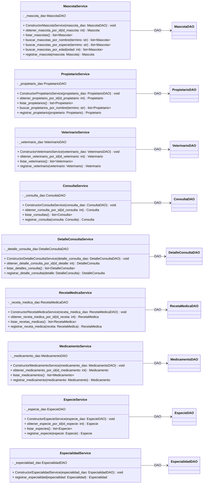
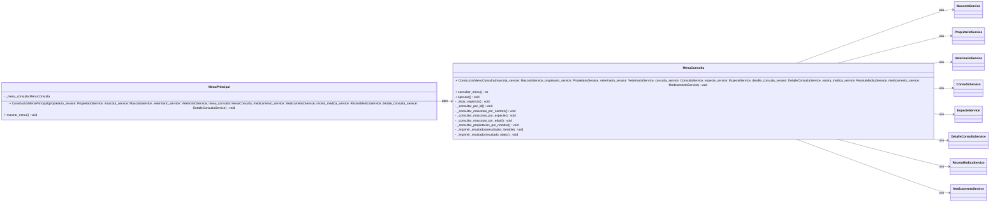
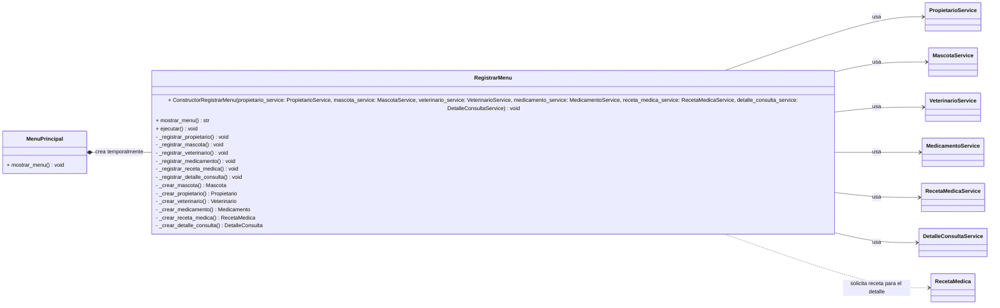

# Veterinaria VetCare

# models

Refactorización de consulta y detalle_consulta : 

Un setter monolitico que actualiza todos los valores de golpe es mala practica.
Se dividio en varios setters por cada atributo de clase 
Para automatizar este proceso se utilizo un agente IA.

El agente realizo: Analizo el codigo, separo el setter monolitico en varios setters para cada atributo.
Agente: Gemini 3.6 Flash

## Servicios

Cada entidad tiene su propio servicio (`*_service.py`). La interfaz recibe directamente
los servicios que necesita, y cada operación se delega al servicio de su entidad.

# Flujo de una ID
Para una consulta por ID de medicamento, el resultado pasa por estos pasos:

1. En `menu_consulta.py`, una opción asigna a `resultado` lo que devuelve el service:
   ```python
   resultado = self._medicamento_service.obtener_medicamento_por_id(id_entidad)
   ```
2. En `medicamento_service.py`, el método devuelve lo que obtuvo del DAO:
   ```python
   return self._medicamento_dao.obtener_por_id_estricto(id_medicamento)
   ```
3. En `medicamento_dao.py`, `obtener_por_id_estricto` devuelve el objeto creado desde la fila:
   ```python
   return self._crear_medicamento(fila)
   ```
   Y `_crear_medicamento` hace:
   ```python
   return Medicamento(...)
   ```
4. De vuelta en el menú, ese objeto queda en `resultado` y se pasa a:
   ```python
   self._imprimir_resultado(resultado)
   ```

Así que el `return` del DAO devuelve un objeto `Medicamento`; el menú lo recibe y `_imprimir_resultado` lo muestra.

## Quién usa el resultado de `obtener_por_id_estricto`

En la aplicación, `obtener_por_id_estricto` no imprime el resultado. Devuelve un
objeto al servicio que lo llamó; el servicio devuelve ese mismo objeto al menú,
y el menú decide qué hacer con él.

Para consultar un medicamento por ID, el recorrido completo es:

1. En `MenuConsulta._consultar_por_id`, la opción de medicamento llama al servicio:
   ```python
   resultado = self._medicamento_service.obtener_medicamento_por_id(id_entidad)
   ```
2. En `MedicamentoService.obtener_medicamento_por_id`, se delega la búsqueda al DAO:
   ```python
   return self._medicamento_dao.obtener_por_id_estricto(id_medicamento)
   ```
3. En `MedicamentoDAO.obtener_por_id_estricto`, se busca la fila en SQLite, se crea
   un objeto `Medicamento` y se devuelve al servicio:
   ```python
   return self._crear_medicamento(fila)
   ```
4. El servicio devuelve el objeto al menú. `_consultar_por_id` lo guarda en
   `resultado` y se lo pasa a `_imprimir_resultado(resultado)`, que lo muestra.

En cambio, el script `tests/test_sql_a_dominio_medicamento.py` llama directamente
al DAO. Allí el propio script recibe el objeto en la variable `medicamento` y lo
usa para mostrar sus datos y modificar su stock en memoria.

## Objetos creados al leer

Al leer, el DAO recibe una fila de SQLite y crea una instancia
Eso quiere decir que el objeto creado por el usuario no es el mismo que se usa para leerlo.

# fechas
 La base de datos guarda fecha_nacimiento como texto (TEXT), pero el modelo Mascota espera una fecha de Python (datetime.date).

Al guardar: mascota.fecha_nacimiento.isoformat() convierte la fecha en texto para SQLite.

Al leer: date.fromisoformat(fila[2]) convierte ese texto de vuelta en fecha.

## Búsqueda de objetos a partir de un ID

En algunos DAO, una fila de SQLite contiene el ID de una especie, pero el modelo
espera recibir el objeto `Especie`. Para convertir ese ID al valor correspondiente
de la enumeración se recorre `Especie` y se devuelve la primera coincidencia:

```python
especie = next(
    especie
    for especie in Especie
    if especie.id_especie == fila[3]
)
```

`next()` devuelve el elemento que cumple la condición; no devuelve el elemento
siguiente a la coincidencia. En este ejemplo, `fila[3]` es `id_especie` según
la tupla `(id_mascota, nombre, fecha_nacimiento, id_especie)`. El objeto encontrado
se pasa al constructor de `Mascota`, que requiere una instancia de `Especie`, no
solo su ID.

Esta búsqueda aparece en estos métodos:

- `EspecieDAO.obtener_por_id_estricto`: busca el valor de `Especie` cuyo ID coincide
  con la única columna consultada, `id_especie`.
- `EspecieDAO.listar_todos`: hace la misma conversión para cada fila de especies.
- `MascotaDAO._crear_mascota`: convierte el `id_especie` de la fila de mascota para
  poder construir el objeto `Mascota`.
- `MascotaDAO.listar_todos`: hace esa conversión para cada mascota listada.
- `PropietarioDAO._crear_propietario`: convierte el `id_especie` de la mascota
  asociada antes de construir la `Mascota` que contiene el propietario.

## Base de datos

Se realizo la conexion de la base de datos mediante main.py el cual incializa la conexion
conexion.py se encarga de repetir el codigo que estaba en los DAO asi no va creando
varias conexiones, crea solo una. Se uso "?" para tratar los datos del usuario
meramente como texto y asi evitar f-strings para evitar inyecciones SQL

¿Que hizo la IA?:

`main.py` crea una instancia compartida de `ConexionDB` y la inyecta en los DAO.
Cada operación usa `obtener_conexion()` para confirmar los cambios al terminar
o revertirlos si ocurre un error. La base nueva se guarda en
`database/clinica_vetcare.db`.

Agente: GPT-6 Luna | Copilot

## Diagrama UML de clases

Uso de IA para generacion base del diagrama: Use IA para generar el diagrama BASE de clase UML
Luego de la entrega del primer diagrama lo fui perfeccionando y dividiendolo en pequeños diagramas
dado que era demasiado extenso. El prompt que utilice:

en el readme integra en mermaid.js un diagrama de clases UML que tenga clases, atributos, metodos, relaciones como herencia asociacion descomposicion etc.

Los atributos todos ponlos privados como debe ser "-" al tener "_" en python y los metodos dependeran del metodo. Recorda que el tipo de visibilidad viene primero luego el atributo y luego del atributo viene el tipo de dato. Los metodos pasa lo mismo con el tipo de dato, en este caso si no devuelve nada ponle void.

ej: 
atributo
- id_mascota : int
metodo
+ calcular_edad() : int 

Aparte de eso en los atributos el primero debe ser si o si el constructor el constructor debe ser el nombre de la clase junto a constructor ej:

clase mascota

el primer atributo seria su constructor llamado

ConstructorMascota() metele ahi todo lo que se debe inicializar en el init. 


La respuesta la enviare al final del documento dado que es demasiado extenso.
Agente: GPT-6 Luna | Copilot

# Diagrama Mermaid: Dominio

```mermaid

classDiagram
    direction TB

    class Persona {
        + ConstructorPersona(nombre: str, rut: str, telefono: str) void
        - _nombre str
        - _rut str
        - _telefono str
        + nombre() str
        + rut() str
        + telefono() str
        + actualizar_telefono(nuevo_telefono: str) void
        + __str__() str
    }

    class Propietario {
        + ConstructorPropietario(nombre: str, rut: str, telefono: str, id_propietario: int, email: str, mascota: Mascota) void
        - _id_propietario int
        - _email str
        - _mascota Mascota
        + id_propietario() int
        + email() str
        + mascota() Mascota
        + asignar_mascota(nueva_mascota: Mascota) void
        + __str__() str
    }

    class Veterinario {
        + ConstructorVeterinario(id_persona: int, nombre: str, rut: str, telefono: str, id_veterinario: int, especialidad: Especialidad) void
        - _id_persona int
        - _id_veterinario int
        - _especialidad Especialidad
        + id_persona() int
        + id_veterinario() int
        + especialidad() Especialidad
        + realizar_consulta() void
        + __str__() str
    }

    class Mascota {
        + ConstructorMascota(id_mascota: int, nombre: str, fecha_nacimiento: date, especie: Especie) void
        - _id_mascota int
        - _nombre str
        - _fecha_nacimiento date
        - _especie Especie
        + id_mascota() int
        + nombre() str
        + fecha_nacimiento() date
        + especie() Especie
        + tipo_especie() str
        + calcular_edad() int
        + __str__() str
    }

    class Especie {
        + ConstructorEspecie(id_especie: int, nombre_especie: str, informacion_especie: str) void
        - _id_especie int
        - _nombre_especie str
        - _informacion_especie str
        + id_especie() int
        + nombre_especie() str
        + informacion_especie() str
    }

    class Especialidad {
        <<enumeration>>
        MEDICINA_GENERAL
        CIRUGIA
        DERMATOLOGIA
        CARDIOLOGIA
        OFTALMOLOGIA
        ONCOLOGIA
        NEUROLOGIA
        ORTOPEDIA_Y_TRAUMATOLOGIA
        MEDICINA_EXOTICOS
        ETOLOGIA_CLINICA
        ODONTOLOGIA
        MEDICINA_FELINA
    }

    class Consulta {
        + ConstructorConsulta(id_consulta: int, motivo: str, fecha_consulta: date, veterinario_id: int, mascota_id: int, propietario_id: int) void
        - _id_consulta int
        - _motivo str
        - _fecha_consulta date
        - _veterinario_id int
        - _mascota_id int
        - _propietario_id int
        + id_consulta() int
        + motivo() str
        + fecha_consulta() date
        + veterinario_id() int
        + mascota_id() int
        + propietario_id() int
        + __repr__() str
    }

    class DetalleConsulta {
        + ConstructorDetalleConsulta(id_detalle: int, diagnostico: str, tratamiento: str, receta: RecetaMedica) void
        - _id_detalle int
        - _diagnostico str
        - _tratamiento str
        - _receta RecetaMedica
        + id_detalle() int
        + diagnostico() str
        + tratamiento() str
        + receta() RecetaMedica
        + __str__() str
        + __repr__() str
    }

    class RecetaMedica {
        + ConstructorRecetaMedica(id_receta: int, nombre_comercial: str, cantidad_mg: int, instrucciones: str) void
        - _id_receta int
        - _nombre_comercial str
        - _cantidad_mg int
        - _instrucciones str
        + id_receta() int
        + nombre_comercial() str
        + cantidad_mg() int
        + instrucciones() str
        + __str__() str
    }

    class Medicamento {
        + ConstructorMedicamento(id_medicamento: int, nombre_comercial: str, nombre_generico: str, tipo: str, precio: float, stock: int) void
        - _id_medicamento int
        - _nombre_comercial str
        - _nombre_generico str
        - _tipo str
        - _precio float
        - _stock int
        + id_medicamento() int
        + nombre_comercial() str
        + nombre_generico() str
        + tipo() str
        + precio() float
        + stock() int
        + __str__() str
    }

    class Pago {
        + ConstructorPago(id_pago: int, fecha_pago: datetime.datetime, monto: float, metodo_pago: MetodosPago) void
        - _id_pago int
        - _fecha_pago datetime.datetime
        - _monto float
        - _metodo_pago MetodosPago
        + id_pago() int
        + fecha_pago() datetime.datetime
        + monto() float
        + metodo_pago() MetodosPago
        + pagar(monto: float) void
        + __str__() str
    }

    class MetodosPago {
        <<enumeration>>
        EFECTIVO
        TARJETA_CREDITO
        TARJETA_DEBITO
        TRANSFERENCIA_BANCARIA
        PAYPAL
        CRIPTOMONEDA
    }

    %% Herencia
    Persona <|-- Propietario : herencia
    Persona <|-- Veterinario : herencia

    %% Asociaciones
    Propietario "0..*" --> "1" Mascota : tiene
    Mascota "*" --> "1" Especie : pertenece a
    Veterinario "*" --> "1" Especialidad : tiene

    %% Consulta (dependencias por id)
    Consulta ..> Veterinario : veterinario_id
    Consulta ..> Mascota : mascota_id
    Consulta ..> Propietario : propietario_id

    %% Detalle / receta
    DetalleConsulta "*" --> "1" RecetaMedica : referencia

    %% Pago
    Pago ..> MetodosPago : metodo_pago
```



# Diagrama Mermaid: persistencia_daos

```mermaid
classDiagram
    direction LR

    class ConexionDB {
        + ConstructorConexionDB(ruta_db: str) void
        - _ruta_db str
        + obtener_conexion() ContextManager~Connection~
    }
    note for ConexionDB "Se inyecta en el constructor de los 9 DAO (atributo _db)"

    class MascotaDAO {
        + ConstructorMascotaDAO(conexion_db: ConexionDB) void
        - _db ConexionDB
        + crear_tabla() void
        + insertar(mascota: Mascota) void
        - _crear_mascota(fila: tuple) Mascota
        + obtener_por_id_estricto(id_mascota: int) Mascota
        + listar_todos() list~Mascota~
        + actualizar(mascota: Mascota) bool
        + eliminar(id_mascota: int) bool
    }

    class PropietarioDAO {
        + ConstructorPropietarioDAO(conexion_db: ConexionDB) void
        - _db ConexionDB
        + crear_tabla() void
        + insertar(propietario: Propietario) void
        - _crear_propietario(fila_propietario: tuple, fila_mascota: tuple) Propietario
        + obtener_por_id_estricto(id_propietario: int) Propietario
        + listar_todos() list~Propietario~
        + actualizar(propietario: Propietario) bool
        + eliminar(id_propietario: int) bool
    }

    class VeterinarioDAO {
        + ConstructorVeterinarioDAO(conexion_db: ConexionDB) void
        - _db ConexionDB
        + crear_tabla() void
        + insertar(veterinario: Veterinario) void
        + obtener_por_id_estricto(id_veterinario: int) Veterinario
        + listar_todos() list~Veterinario~
        + actualizar(veterinario: Veterinario) bool
        + eliminar(id_veterinario: int) bool
    }

    class ConsultaDAO {
        + ConstructorConsultaDAO(conexion_db: ConexionDB) void
        - _db ConexionDB
        + crear_tabla() void
        + insertar(consulta: Consulta) void
        + obtener_por_id_estricto(id_consulta: int) Consulta
        + listar_todos() list~Consulta~
        + actualizar(consulta: Consulta) bool
        + eliminar(id_consulta: int) bool
    }

    class DetalleConsultaDAO {
        + ConstructorDetalleConsultaDAO(conexion_db: ConexionDB) void
        - _db ConexionDB
        + crear_tabla() void
        + insertar(detalle: DetalleConsulta) void
        - _crear_detalle(fila_detalle: tuple, fila_receta: tuple) DetalleConsulta
        + obtener_por_id_estricto(id_detalle: int) DetalleConsulta
        + listar_todos() list~DetalleConsulta~
        + actualizar(detalle: DetalleConsulta) bool
        + eliminar(id_detalle: int) bool
    }

    class RecetaMedicaDAO {
        + ConstructorRecetaMedicaDAO(conexion_db: ConexionDB) void
        - _db ConexionDB
        + crear_tabla() void
        + insertar(receta: RecetaMedica) void
        + obtener_por_id_estricto(id_receta: int) RecetaMedica
        + listar_todos() list~RecetaMedica~
        + actualizar(receta: RecetaMedica) bool
        + eliminar(id_receta: int) bool
    }

    class MedicamentoDAO {
        + ConstructorMedicamentoDAO(conexion_db: ConexionDB) void
        - _db ConexionDB
        - _crear_medicamento(fila: tuple) Medicamento
        + crear_tabla() void
        + insertar(medicamento: Medicamento) void
        + obtener_por_id_estricto(id_medicamento: int) Medicamento
        + listar_todos() list~Medicamento~
        + buscar_por_termino_seguro(termino: str) list~Medicamento~
        + actualizar(medicamento: Medicamento) bool
        + eliminar(id_medicamento: int) bool
        + actualizar_stock_seguro(id_medicamento: int, nuevo_stock: int) bool
    }

    class EspecieDAO {
        + ConstructorEspecieDAO(conexion_db: ConexionDB) void
        - _db ConexionDB
        + crear_tabla() void
        + insertar(especie: Especie) void
        + obtener_por_id_estricto(id_especie: int) Especie
        + listar_todos() list~Especie~
        + actualizar(especie: Especie) bool
        + eliminar(id_especie: int) bool
    }

    class EspecialidadDAO {
        + ConstructorEspecialidadDAO(conexion_db: ConexionDB) void
        - _db ConexionDB
        + crear_tabla() void
        + insertar(especialidad: Especialidad) void
        + obtener_por_nombre_estricto(nombre: str) Especialidad
        + listar_todos() list~Especialidad~
        + actualizar(especialidad: Especialidad, nombre_anterior: str) bool
        + eliminar(nombre: str) bool
    }
```



# Diagrama Mermaid: Servicios


# Diagrama Mermaid: Menus Consulta



# Diagrama Mermaid: Menus Registro



# Diagrama UML de Clases : Boceto
La respuesta de la IA ante mi prompt fue un diagrama masivo que tuve que auditar y dividir en más diagramas
```mermaid
classDiagram
    class Persona {
        + ConstructorPersona(nombre: str, rut: str, telefono: str) : void
        - _nombre : str
        - _rut : str
        - _telefono : str
        + nombre() : str
        + rut() : str
        + telefono() : str
        + actualizar_telefono(nuevo_telefono: str) : void
        + __str__() : str
    }

    class Propietario {
        + ConstructorPropietario(nombre: str, rut: str, telefono: str, id_propietario: int, email: str, mascota: Mascota) : void
        - _id_propietario : int
        - _email : str
        - _mascota : Mascota
        + id_propietario() : int
        + email() : str
        + mascota() : Mascota
        + asignar_mascota(nueva_mascota: Mascota) : void
        + __str__() : str
    }

    class Veterinario {
        + ConstructorVeterinario(id_persona: int, nombre: str, rut: str, telefono: str, id_veterinario: int, especialidad: Especialidad) : void
        - _id_persona : int
        - _id_veterinario : int
        - _especialidad : Especialidad
        + id_persona() : int
        + id_veterinario() : int
        + especialidad() : Especialidad
        + realizar_consulta() : void
        + __str__() : str
    }

    class Mascota {
        + ConstructorMascota(id_mascota: int, nombre: str, fecha_nacimiento: date, especie: Especie) : void
        - _id_mascota : int
        - _nombre : str
        - _fecha_nacimiento : date
        - _especie : Especie
        + id_mascota() : int
        + nombre() : str
        + fecha_nacimiento() : date
        + especie() : Especie
        + tipo_especie() : str
        + calcular_edad() : int
        + __str__() : str
    }

    class Especie {
        + ConstructorEspecie(id_especie: int, nombre_especie: str, informacion_especie: str) : void
        - _id_especie : int
        - _nombre_especie : str
        - _informacion_especie : str
        + id_especie() : int
        + nombre_especie() : str
        + informacion_especie() : str
    }

    class Consulta {
        + ConstructorConsulta(id_consulta: int, motivo: str, fecha_consulta: date, veterinario_id: int, mascota_id: int, propietario_id: int) : void
        - _id_consulta : int
        - _motivo : str
        - _fecha_consulta : date
        - _veterinario_id : int
        - _mascota_id : int
        - _propietario_id : int
        + id_consulta() : int
        + motivo() : str
        + fecha_consulta() : date
        + veterinario_id() : int
        + mascota_id() : int
        + propietario_id() : int
        + __repr__() : str
    }

    class DetalleConsulta {
        + ConstructorDetalleConsulta(id_detalle: int, diagnostico: str, tratamiento: str, receta: RecetaMedica) : void
        - _id_detalle : int
        - _diagnostico : str
        - _tratamiento : str
        - _receta : RecetaMedica
        + id_detalle() : int
        + diagnostico() : str
        + tratamiento() : str
        + receta() : RecetaMedica
        + __str__() : str
        + __repr__() : str
    }

    class RecetaMedica {
        + ConstructorRecetaMedica(id_receta: int, nombre_comercial: str, cantidad_mg: int, instrucciones: str) : void
        - _id_receta : int
        - _nombre_comercial : str
        - _cantidad_mg : int
        - _instrucciones : str
        + id_receta() : int
        + nombre_comercial() : str
        + cantidad_mg() : int
        + instrucciones() : str
        + __str__() : str
    }

    class Medicamento {
        + ConstructorMedicamento(id_medicamento: int, nombre_comercial: str, nombre_generico: str, tipo: str, precio: float, stock: int) : void
        - _id_medicamento : int
        - _nombre_comercial : str
        - _nombre_generico : str
        - _tipo : str
        - _precio : float
        - _stock : int
        + id_medicamento() : int
        + nombre_comercial() : str
        + nombre_generico() : str
        + tipo() : str
        + precio() : float
        + stock() : int
        + __str__() : str
    }

    class Pago {
        + ConstructorPago(id_pago: int, fecha_pago: datetime.datetime, monto: float, metodo_pago: MetodosPago) : void
        - _id_pago : int
        - _fecha_pago : datetime.datetime
        - _monto : float
        - _metodo_pago : MetodosPago
        + id_pago() : int
        + fecha_pago() : datetime.datetime
        + monto() : float
        + metodo_pago() : MetodosPago
        + pagar(monto: float) : void
        + __str__() : str
    }

    class Especialidad {
        <<enumeration>>
        MEDICINA_GENERAL
        CIRUGIA
        DERMATOLOGIA
        CARDIOLOGIA
        OFTALMOLOGIA
        ONCOLOGIA
        NEUROLOGIA
        ORTOPEDIA_Y_TRAUMATOLOGIA
        MEDICINA_EXOTICOS
        ETOLOGIA_CLINICA
        ODONTOLOGIA
        MEDICINA_FELINA
    }

    class MetodosPago {
        <<enumeration>>
        EFECTIVO
        TARJETA_CREDITO
        TARJETA_DEBITO
        TRANSFERENCIA_BANCARIA
        PAYPAL
        CRIPTOMONEDA
    }

    class ConexionDB {
        + ConstructorConexionDB(ruta_db: str) : void
        - _ruta_db : str
        + obtener_conexion() : ContextManager~Connection~
    }

    class MascotaDAO {
        + ConstructorMascotaDAO(conexion_db: ConexionDB) : void
        - _db : ConexionDB
        + crear_tabla() : void
        + insertar(mascota: Mascota) : void
        - _crear_mascota(fila: tuple) : Mascota
        + obtener_por_id_estricto(id_mascota: int) : Mascota
        + listar_todos() : list~Mascota~
        + actualizar(mascota: Mascota) : bool
        + eliminar(id_mascota: int) : bool
    }

    class PropietarioDAO {
        + ConstructorPropietarioDAO(conexion_db: ConexionDB) : void
        - _db : ConexionDB
        + crear_tabla() : void
        + insertar(propietario: Propietario) : void
        - _crear_propietario(fila_propietario: tuple, fila_mascota: tuple) : Propietario
        + obtener_por_id_estricto(id_propietario: int) : Propietario
        + listar_todos() : list~Propietario~
        + actualizar(propietario: Propietario) : bool
        + eliminar(id_propietario: int) : bool
    }

    class VeterinarioDAO {
        + ConstructorVeterinarioDAO(conexion_db: ConexionDB) : void
        - _db : ConexionDB
        + crear_tabla() : void
        + insertar(veterinario: Veterinario) : void
        + obtener_por_id_estricto(id_veterinario: int) : Veterinario
        + listar_todos() : list~Veterinario~
        + actualizar(veterinario: Veterinario) : bool
        + eliminar(id_veterinario: int) : bool
    }

    class ConsultaDAO {
        + ConstructorConsultaDAO(conexion_db: ConexionDB) : void
        - _db : ConexionDB
        + crear_tabla() : void
        + insertar(consulta: Consulta) : void
        + obtener_por_id_estricto(id_consulta: int) : Consulta
        + listar_todos() : list~Consulta~
        + actualizar(consulta: Consulta) : bool
        + eliminar(id_consulta: int) : bool
    }

    class DetalleConsultaDAO {
        + ConstructorDetalleConsultaDAO(conexion_db: ConexionDB) : void
        - _db : ConexionDB
        + crear_tabla() : void
        + insertar(detalle: DetalleConsulta) : void
        - _crear_detalle(fila_detalle: tuple, fila_receta: tuple) : DetalleConsulta
        + obtener_por_id_estricto(id_detalle: int) : DetalleConsulta
        + listar_todos() : list~DetalleConsulta~
        + actualizar(detalle: DetalleConsulta) : bool
        + eliminar(id_detalle: int) : bool
    }

    class RecetaMedicaDAO {
        + ConstructorRecetaMedicaDAO(conexion_db: ConexionDB) : void
        - _db : ConexionDB
        + crear_tabla() : void
        + insertar(receta: RecetaMedica) : void
        + obtener_por_id_estricto(id_receta: int) : RecetaMedica
        + listar_todos() : list~RecetaMedica~
        + actualizar(receta: RecetaMedica) : bool
        + eliminar(id_receta: int) : bool
    }

    class MedicamentoDAO {
        + ConstructorMedicamentoDAO(conexion_db: ConexionDB) : void
        - _db : ConexionDB
        - _crear_medicamento(fila: tuple) : Medicamento
        + crear_tabla() : void
        + insertar(medicamento: Medicamento) : void
        + obtener_por_id_estricto(id_medicamento: int) : Medicamento
        + listar_todos() : list~Medicamento~
        + buscar_por_termino_seguro(termino: str) : list~Medicamento~
        + actualizar(medicamento: Medicamento) : bool
        + eliminar(id_medicamento: int) : bool
        + actualizar_stock_seguro(id_medicamento: int, nuevo_stock: int) : bool
    }

    class EspecieDAO {
        + ConstructorEspecieDAO(conexion_db: ConexionDB) : void
        - _db : ConexionDB
        + crear_tabla() : void
        + insertar(especie: Especie) : void
        + obtener_por_id_estricto(id_especie: int) : Especie
        + listar_todos() : list~Especie~
        + actualizar(especie: Especie) : bool
        + eliminar(id_especie: int) : bool
    }

    class EspecialidadDAO {
        + ConstructorEspecialidadDAO(conexion_db: ConexionDB) : void
        - _db : ConexionDB
        + crear_tabla() : void
        + insertar(especialidad: Especialidad) : void
        + obtener_por_nombre_estricto(nombre: str) : Especialidad
        + listar_todos() : list~Especialidad~
        + actualizar(especialidad: Especialidad, nombre_anterior: str) : bool
        + eliminar(nombre: str) : bool
    }

    class MascotaService {
        + ConstructorMascotaService(mascota_dao: MascotaDAO) : void
        - _mascota_dao : MascotaDAO
        + obtener_mascota_por_id(id_mascota: int) : Mascota
        + listar_mascotas() : list~Mascota~
        + buscar_mascotas_por_nombre(termino: str) : list~Mascota~
        + buscar_mascotas_por_especie(termino: str) : list~Mascota~
        + buscar_mascotas_por_edad(edad: int) : list~Mascota~
        + registrar_mascota(mascota: Mascota) : Mascota
    }

    class PropietarioService {
        + ConstructorPropietarioService(propietario_dao: PropietarioDAO) : void
        - _propietario_dao : PropietarioDAO
        + obtener_propietario_por_id(id_propietario: int) : Propietario
        + listar_propietarios() : list~Propietario~
        + buscar_propietarios_por_nombre(termino: str) : list~Propietario~
        + registrar_propietario(propietario: Propietario) : Propietario
    }

    class VeterinarioService {
        + ConstructorVeterinarioService(veterinario_dao: VeterinarioDAO) : void
        - _veterinario_dao : VeterinarioDAO
        + obtener_veterinario_por_id(id_veterinario: int) : Veterinario
        + listar_veterinarios() : list~Veterinario~
        + registrar_veterinario(veterinario: Veterinario) : Veterinario
    }

    class ConsultaService {
        + ConstructorConsultaService(consulta_dao: ConsultaDAO) : void
        - _consulta_dao : ConsultaDAO
        + obtener_consulta_por_id(id_consulta: int) : Consulta
        + listar_consultas() : list~Consulta~
        + registrar_consulta(consulta: Consulta) : Consulta
    }

    class DetalleConsultaService {
        + ConstructorDetalleConsultaService(detalle_consulta_dao: DetalleConsultaDAO) : void
        - _detalle_consulta_dao : DetalleConsultaDAO
        + obtener_detalle_consulta_por_id(id_detalle: int) : DetalleConsulta
        + listar_detalles_consulta() : list~DetalleConsulta~
        + registrar_detalle_consulta(detalle: DetalleConsulta) : DetalleConsulta
    }

    class RecetaMedicaService {
        + ConstructorRecetaMedicaService(receta_medica_dao: RecetaMedicaDAO) : void
        - _receta_medica_dao : RecetaMedicaDAO
        + obtener_receta_medica_por_id(id_receta: int) : RecetaMedica
        + listar_recetas_medicas() : list~RecetaMedica~
        + registrar_receta_medica(receta: RecetaMedica) : RecetaMedica
    }

    class MedicamentoService {
        + ConstructorMedicamentoService(medicamento_dao: MedicamentoDAO) : void
        - _medicamento_dao : MedicamentoDAO
        + obtener_medicamento_por_id(id_medicamento: int) : Medicamento
        + listar_medicamentos() : list~Medicamento~
        + registrar_medicamento(medicamento: Medicamento) : Medicamento
    }

    class EspecieService {
        + ConstructorEspecieService(especie_dao: EspecieDAO) : void
        - _especie_dao : EspecieDAO
        + obtener_especie_por_id(id_especie: int) : Especie
        + listar_especies() : list~Especie~
        + registrar_especie(especie: Especie) : Especie
    }

    class EspecialidadService {
        + ConstructorEspecialidadService(especialidad_dao: EspecialidadDAO) : void
        - _especialidad_dao : EspecialidadDAO
        + registrar_especialidad(especialidad: Especialidad) : Especialidad
    }

    class MenuPrincipal {
        + ConstructorMenuPrincipal(propietario_service: PropietarioService, mascota_service: MascotaService, veterinario_service: VeterinarioService, menu_consulta: MenuConsulta, medicamento_service: MedicamentoService, receta_medica_service: RecetaMedicaService, detalle_consulta_service: DetalleConsultaService) : void
        - _propietario_service : PropietarioService
        - _mascota_service : MascotaService
        - _veterinario_service : VeterinarioService
        - _menu_consulta : MenuConsulta
        - _medicamento_service : MedicamentoService
        - _receta_medica_service : RecetaMedicaService
        - _detalle_consulta_service : DetalleConsultaService
        + mostrar_menu() : void
    }

    class MenuConsulta {
        + ConstructorMenuConsulta(mascota_service: MascotaService, propietario_service: PropietarioService, veterinario_service: VeterinarioService, consulta_service: ConsultaService, especie_service: EspecieService, detalle_consulta_service: DetalleConsultaService, receta_medica_service: RecetaMedicaService, medicamento_service: MedicamentoService) : void
        - _mascota_service : MascotaService
        - _propietario_service : PropietarioService
        - _veterinario_service : VeterinarioService
        - _consulta_service : ConsultaService
        - _especie_service : EspecieService
        - _detalle_consulta_service : DetalleConsultaService
        - _receta_medica_service : RecetaMedicaService
        - _medicamento_service : MedicamentoService
        + consultar_menu() : str
        + ejecutar() : void
        - _listar_registros() : void
        - _consultar_por_id() : void
        - _consultar_mascotas_por_nombre() : void
        - _consultar_mascotas_por_especie() : void
        - _consultar_mascotas_por_edad() : void
        - _consultar_propietarios_por_nombre() : void
        - _imprimir_resultados(resultados: Iterable) : void
        - _imprimir_resultado(resultado: object) : void
    }

    class RegistrarMenu {
        + ConstructorRegistrarMenu(propietario_service: PropietarioService, mascota_service: MascotaService, veterinario_service: VeterinarioService, medicamento_service: MedicamentoService, receta_medica_service: RecetaMedicaService, detalle_consulta_service: DetalleConsultaService) : void
        - _propietario_service : PropietarioService
        - _mascota_service : MascotaService
        - _veterinario_service : VeterinarioService
        - _medicamento_service : MedicamentoService
        - _receta_medica_service : RecetaMedicaService
        - _detalle_consulta_service : DetalleConsultaService
        + mostrar_menu() : str
        + ejecutar() : void
        - _registrar_propietario() : void
        - _registrar_mascota() : void
        - _registrar_veterinario() : void
        - _registrar_medicamento() : void
        - _registrar_receta_medica() : void
        - _registrar_detalle_consulta() : void
        - _crear_mascota() : Mascota
        - _crear_propietario() : Propietario
        - _crear_veterinario() : Veterinario
        - _crear_medicamento() : Medicamento
        - _crear_receta_medica() : RecetaMedica
        - _crear_detalle_consulta() : DetalleConsulta
    }

    Persona <|-- Propietario : herencia
    Persona <|-- Veterinario : herencia
    Propietario "0..*" --> "1" Mascota : tiene
    Mascota "*" --> "1" Especie : pertenece a
    Veterinario "*" --> "1" Especialidad : tiene
    DetalleConsulta "*" --> "1" RecetaMedica : referencia
    Consulta ..> Mascota : id_mascota
    Consulta ..> Propietario : propietario_id
    Consulta ..> Veterinario : veterinario_id
    Pago ..> MetodosPago : metodo_pago

    ConexionDB <-- MascotaDAO : conexion
    ConexionDB <-- PropietarioDAO : conexion
    ConexionDB <-- VeterinarioDAO : conexion
    ConexionDB <-- ConsultaDAO : conexion
    ConexionDB <-- DetalleConsultaDAO : conexion
    ConexionDB <-- RecetaMedicaDAO : conexion
    ConexionDB <-- MedicamentoDAO : conexion
    ConexionDB <-- EspecieDAO : conexion
    ConexionDB <-- EspecialidadDAO : conexion

    MascotaDAO <-- MascotaService : DAO
    PropietarioDAO <-- PropietarioService : DAO
    VeterinarioDAO <-- VeterinarioService : DAO
    ConsultaDAO <-- ConsultaService : DAO
    DetalleConsultaDAO <-- DetalleConsultaService : DAO
    RecetaMedicaDAO <-- RecetaMedicaService : DAO
    MedicamentoDAO <-- MedicamentoService : DAO
    EspecieDAO <-- EspecieService : DAO
    EspecialidadDAO <-- EspecialidadService : DAO

    MenuConsulta --> MascotaService : usa
    MenuConsulta --> PropietarioService : usa
    MenuConsulta --> VeterinarioService : usa
    MenuConsulta --> ConsultaService : usa
    MenuConsulta --> EspecieService : usa
    MenuConsulta --> DetalleConsultaService : usa
    MenuConsulta --> RecetaMedicaService : usa
    MenuConsulta --> MedicamentoService : usa
    MenuPrincipal --> MenuConsulta : abre
    RegistrarMenu --> PropietarioService : usa
    RegistrarMenu --> MascotaService : usa
    RegistrarMenu --> VeterinarioService : usa
    RegistrarMenu --> MedicamentoService : usa
    RegistrarMenu --> RecetaMedicaService : usa
    RegistrarMenu --> DetalleConsultaService : usa
    RegistrarMenu ..> RecetaMedica : solicita receta para el detalle
    MenuPrincipal *-- RegistrarMenu : crea temporalmente
```